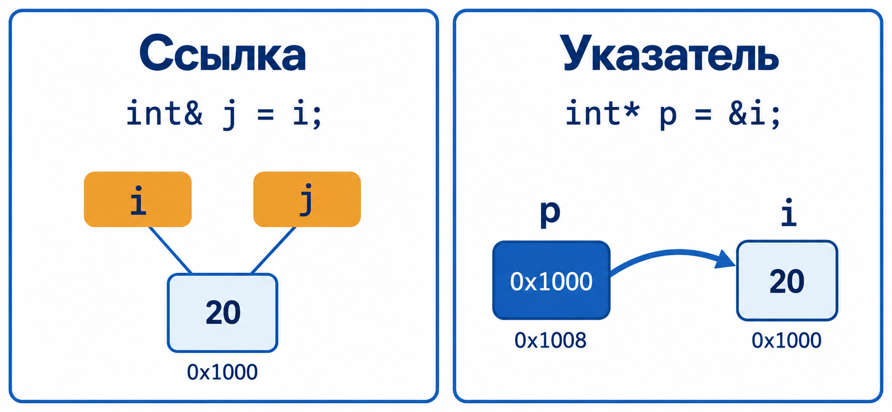
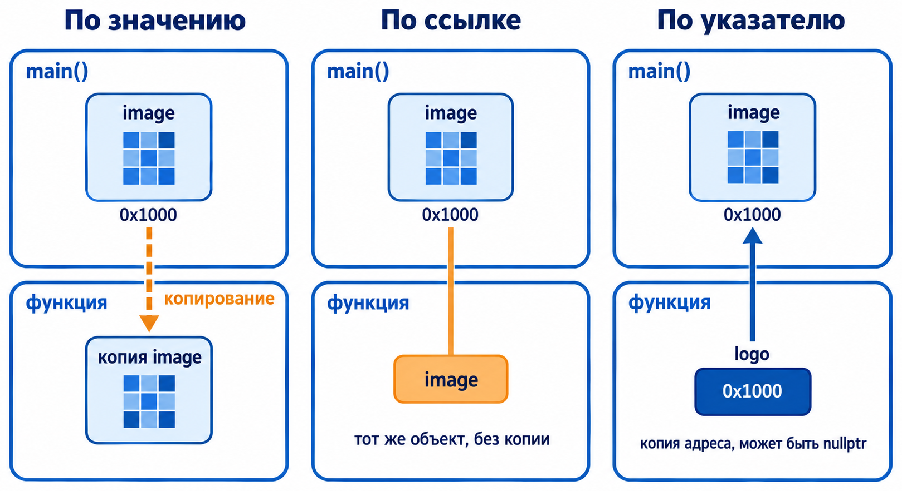

::: {.content-visible unless-format="revealjs"}

[Открыть слайды](../slides/lectures/06-references-initialization-functions-namespaces.html){.btn .btn-outline-primary target="_blank"}

:::

## План лекции

- Ссылки и время жизни объектов
- Выбор способа передачи аргументов
- Перегрузка функций, `nullptr` и аргументы по умолчанию
- Инициализация: начальное значение и фигурные скобки
- Пространства имён

## Обмен значениями через указатели

```{.cpp filename="swap-pointers.cpp"}

```

[{.godbolt-link-image width="32"}][godbolt-06-swap-pointers]{aria-label="Open in Compiler Explorer"}

Чтобы изменить исходные переменные, передаём их адреса.

## Указатель может быть нулевым

```{.cpp filename="swap-null-pointer.cpp"}

```

[{.godbolt-link-image width="32"}][godbolt-06-swap-null-pointer]{aria-label="Open in Compiler Explorer"}

Разыменование `nullptr` приводит к **неопределённому поведению**.

Для обмена нужны два существующих объекта. Молчаливый `return` при `nullptr` скрыл бы нарушение этого условия.

## Ссылка — другое имя объекта

**Lvalue-ссылка** (`T&`) — другое имя, или псевдоним, объекта типа `T`. Обращаясь к ссылке, мы работаем с этим объектом.

- При создании ссылку нужно инициализировать — связать с объектом.
- Привязка не создаёт копию объекта.
- Перепривязать ссылку к другому объекту нельзя.
- Указателя на саму ссылку нет: взятие её адреса даёт адрес объекта.

## Ссылка в коде

```{.cpp filename="reference-alias.cpp"}

```

[{.godbolt-link-image width="32"}][godbolt-06-reference-alias]{aria-label="Open in Compiler Explorer"}

В объявлении `int&` символ `&` задаёт ссылочный тип, а в выражении `&alias` — берёт адрес объекта.

`int& alias;` без инициализатора — ошибка.

## Ссылка и указатель в памяти

{height=460 fig-alt="Имена i и j обозначают один объект. Указатель p — отдельный объект, который хранит адрес i."}

`i` и `j` — два имени одного объекта. Указатель `p` — отдельный объект со своим адресом.

Будет ли сама связь с объектом занимать память, зависит от реализации.

## Ссылку нельзя перепривязать

```{.cpp filename="reference-assignment.cpp"}

```

[{.godbolt-link-image width="32"}][godbolt-06-reference-assignment]{aria-label="Open in Compiler Explorer"}

Присваивание через ссылку меняет объект, а не связь с ним.

## Чтение через const-ссылку

```{.cpp filename="const-reference.cpp"}

```

[{.godbolt-link-image width="32"}][godbolt-06-const-reference]{aria-label="Open in Compiler Explorer"}

`const T&` запрещает изменение **через эту ссылку**. Сам объект может оставаться изменяемым.

## Обмен значениями через ссылки

```{.cpp filename="swap-references.cpp"}

```

[{.godbolt-link-image width="32"}][godbolt-06-swap-references]{aria-label="Open in Compiler Explorer"}

Вызов передаёт сами переменные. У ссылки нет корректного «нулевого» состояния; объект должен оставаться живым.

## Копия или исходный объект?

```{.cpp filename="value-and-reference.cpp"}

```

[{.godbolt-link-image width="32"}][godbolt-06-value-and-reference]{aria-label="Open in Compiler Explorer"}

## Как передавать аргумент?

| Параметр | Смысл | Типичный случай |
|---|---|---|
| `T value` | Отдельный объект-параметр | Дешёво копируемое значение: `int`, `double` |
| `const T& value` | Чтение без копирования в параметр | Большая структура или строка |
| `T& value` | Работа с исходным изменяемым объектом | Изменить переданный объект |
| `const T* value` | Чтение через указатель | Объект может отсутствовать |
| `T* value` | Изменение через указатель | Объект может отсутствовать |

Допустимость `nullptr` определяет договорённость функции. Указатель также может обозначать начало массива.

Если функция вычисляет новый результат, обычно возвращайте его через `return`. Для изменения существующего объекта используйте `T&`.

## Что получает функция

{height=520 fig-alt="По значению функция получает копию изображения; по ссылке работает с тем же изображением; по указателю получает копию адреса."}

## Параметры для работы с изображением

`Image` хранит большое изображение. Какие типы параметров нужны этим функциям?

- `show` — показать существующее изображение, не меняя его;
- `blur` — размыть существующее изображение;
- `set_logo` — использовать изображение как логотип, не меняя его; отсутствие означает убрать логотип;
- `set_zoom` — задать масштаб целым числом процентов.

::: {.fragment}

```{.cpp filename="image-parameters.hpp"}

```

[{.godbolt-link-image width="32"}][godbolt-06-image-parameters]{aria-label="Open in Compiler Explorer"}

:::

## Когда отсутствие объекта допустимо

```{.cpp filename="optional-pointer.cpp"}

```

[{.godbolt-link-image width="32"}][godbolt-06-optional-pointer]{aria-label="Open in Compiler Explorer"}

Здесь `nullptr` имеет осмысленное значение, которое функция явно обрабатывает.

## Ссылка не владеет объектом

```{.cpp filename="dangling-reference.cpp"}

```

[{.godbolt-link-image width="32"}][godbolt-06-dangling-reference]{aria-label="Open in Compiler Explorer"}

После возврата из `local_value` локальный объект уже уничтожен. Чтение через возвращённую ссылку — **неопределённое поведение**.

Диагностика компилятора не заменяет контроль времени жизни. Нельзя рассчитывать на конкретное значение или падение программы.

## Локальный результат возвращаем по значению

```{.cpp filename="return-value.cpp"}

```

[{.godbolt-link-image width="32"}][godbolt-06-return-value]{aria-label="Open in Compiler Explorer"}

Вызывающий код получает результат, а не ссылку на локальную переменную. После выхода из функции локальная переменная больше не нужна.

## Какие привязки ссылок допустимы?

```{.cpp filename="reference-lifetime.cpp"}

```

[{.godbolt-link-image width="32"}][godbolt-06-reference-lifetime]{aria-label="Open in Compiler Explorer"}

::: {.fragment}
- `a` и `b` ссылаются на `x`.
- `c` связывается с временным `int`. Его время жизни продлевается до конца блока.
- `int& d = 42;` — ошибка: неконстантная lvalue-ссылка не привязывается к такому временному объекту.
:::

## Временный объект в аргументе const&

```{.cpp filename="const-reference-argument.cpp"}

```

[{.godbolt-link-image width="32"}][godbolt-06-const-reference-argument]{aria-label="Open in Compiler Explorer"}

Параметр `const&` не копирует готовую `std::string`. Но вызов `greet("world")` требует создать временную строку из литерала; `name` ссылается на неё.

::: {.fragment}
Временная строка живёт до конца полного выражения с вызовом — здесь до `;`. Сохранённая на неё ссылка после этого будет висячей.
:::

## Перегрузка: одно имя, разные параметры

**Перегрузка функций** — несколько функций с одним именем, но разными списками параметров: по типам или количеству.

```{.cpp filename="function-overload.cpp"}

```

[{.godbolt-link-image width="32"}][godbolt-06-function-overload]{aria-label="Open in Compiler Explorer"}

Компилятор выбирает перегрузку по аргументам. Здесь оба вызова имеют точное совпадение типов.

## Перегрузки с разным числом параметров

```{.cpp filename="overload-parameter-count.cpp"}

```

[{.godbolt-link-image width="32"}][godbolt-06-overload-parameter-count]{aria-label="Open in Compiler Explorer"}

В каждом вызове подходит только одна функция по числу аргументов.

## Что напечатает print(value)?

```{.cpp filename="overload-conversion.cpp"}

```

[{.godbolt-link-image width="32"}][godbolt-06-overload-conversion]{aria-label="Open in Compiler Explorer"}

::: {.fragment}
**20.** Перегрузки для `double` нет, но допустимо преобразование в `int`. В этом примере дробная часть теряется.
:::

## А если добавить перегрузку для float?

Какую функцию выберет компилятор?

```{.cpp filename="overload-ambiguous.cpp"}

```

[{.godbolt-link-image width="32"}][godbolt-06-overload-ambiguous]{aria-label="Open in Compiler Explorer"}

::: {.fragment}
**Ни одну: вызов неоднозначен.** `20.1` имеет тип `double`. Ни одно из двух преобразований не лучше другого.
:::

## Как выбрать нужную перегрузку

```{.cpp filename="overload-exact-match.cpp"}

```

[{.godbolt-link-image width="32"}][godbolt-06-overload-exact-match]{aria-label="Open in Compiler Explorer"}

Суффикс `F` задаёт литералу тип `float`. Теперь оба вызова имеют точное совпадение типов.

## Возвращаемый тип не различает перегрузки

```{.cpp filename="overload-return-type.cpp"}

```

[{.godbolt-link-image width="32"}][godbolt-06-overload-return-type]{aria-label="Open in Compiler Explorer"}

У функций одинаковый список параметров, поэтому объявления конфликтуют. Тип переменной, в которую мы хотим записать результат, не исправит эту ошибку.

## nullptr вместо числового нуля

```{.cpp filename="nullptr-overload.cpp"}

```

[{.godbolt-link-image width="32"}][godbolt-06-nullptr-overload]{aria-label="Open in Compiler Explorer"}

`NULL` — макрос с зависящим от реализации определением. Не полагайтесь на него при выборе перегрузки; для нулевого указателя используйте `nullptr`.

## nullptr не выбирает тип указателя

```{.cpp filename="nullptr-ambiguous.cpp"}

```

[{.godbolt-link-image width="32"}][godbolt-06-nullptr-ambiguous]{aria-label="Open in Compiler Explorer"}

Для `nullptr` обе указательные перегрузки подходят, поэтому вызов неоднозначен. Нулевой указатель конкретного типа, например переменная `int*`, выбрал бы соответствующую перегрузку.

## У nullptr есть собственный тип

```{.cpp filename="nullptr-type.cpp"}

```

[{.godbolt-link-image width="32"}][godbolt-06-nullptr-type]{aria-label="Open in Compiler Explorer"}

`std::nullptr_t` объявлен в `<cstddef>`. Сам он не является указательным типом, но его значения преобразуются в указательные типы. Отдельная перегрузка позволяет обработать `nullptr` как точное совпадение.

## Аргументы по умолчанию

```{.cpp filename="default-argument.cpp"}

```

[{.godbolt-link-image width="32"}][godbolt-06-default-argument]{aria-label="Open in Compiler Explorer"}

Пропущенные аргументы подставляются справа. Нельзя пропустить первый аргумент, передав только второй.

## Где указывать значение по умолчанию

- Значение должно быть видно в объявлении в месте вызова.
- Если объявление и определение разделены, значение обычно указывают в объявлении; повторять его в определении нельзя.
- В обычном списке параметров после параметра со значением по умолчанию остальные тоже должны иметь значения по умолчанию.
- Значения по умолчанию не создают новые перегрузки: сочетание `f(int)` и `f(int, int = 0)` делает вызов `f(1)` неоднозначным.

## Инициализация и присваивание

**Инициализация** задаёт начальное состояние объекта при его создании. **Присваивание** меняет значение уже существующего объекта.

```{.cpp filename="initialization-and-assignment.cpp"}

```

[{.godbolt-link-image width="32"}][godbolt-06-initialization-and-assignment]{aria-label="Open in Compiler Explorer"}

## {#empty-parentheses .unlisted}

:::: {.columns}
::: {.column width="50%"}

```{.cpp filename="empty-parentheses.cpp"}

```

[{.godbolt-link-image width="32"}][godbolt-06-empty-parentheses]{aria-label="Open in Compiler Explorer"}

:::
::: {.column .fragment width="50%" data-fragment-index="0"}

```{.cpp filename="empty-brace-initialization.cpp"}

```

[{.godbolt-link-image width="32"}][godbolt-06-empty-brace-initialization]{aria-label="Open in Compiler Explorer"}

:::
::::

::: {.fragment data-fragment-index="0"}
- `int value();` объявляет **функцию** без параметров, возвращающую `int`. Присваивание `value = 42` вызывает ошибку компиляции.
- `int value{};` создаёт **переменную** типа `int` со значением `0`.
:::

## Виды инициализации

| Название | Описание |
|---|---|
| Default-initialization | Объявление объекта без инициализатора |
| Value-initialization | В частности, получение нуля для `int` с пустым `{}` |
| Direct-initialization | Прямая инициализация: аргументы в `()` или `{}` без `=` |
| Copy-initialization | В частности, инициализация через `=` при объявлении |
| List-initialization | Инициализация списком в фигурных скобках |
| Aggregate initialization | Поэлементная инициализация массива или простой структуры |

Эти понятия пересекаются: фигурные скобки могут привести к value-initialization или инициализации агрегата.

## Есть ли начальное значение?

```{.cpp filename="default-and-value-initialization.cpp"}

```

[{.godbolt-link-image width="32"}][godbolt-06-default-and-value-initialization]{aria-label="Open in Compiler Explorer"}

Для локального `int` запись без инициализатора не задаёт значение. Чтение такого значения в C++20 — неопределённое поведение. У глобальных и `static` переменных действуют дополнительные правила нулевой инициализации.

## Несколько форм инициализации

```{.cpp filename="initialization-forms.cpp"}

```

[{.godbolt-link-image width="32"}][godbolt-06-initialization-forms]{aria-label="Open in Compiler Explorer"}

Это не набор непересекающихся категорий: пустой список `{}` для `int` приводит к value-initialization.

## Фигурные скобки запрещают сужение

```{.cpp filename="narrowing-initialization.cpp"}

```

[{.godbolt-link-image width="32"}][godbolt-06-narrowing-initialization]{aria-label="Open in Compiler Explorer"}

Инициализация `checked` вызывает ошибку компиляции из-за сужения. Если потеря дробной части задумана, выразите её явно: `static_cast<int>(source)`.

## Инициализация агрегата

```{.cpp filename="aggregate-initialization.cpp"}

```

[{.godbolt-link-image width="32"}][godbolt-06-aggregate-initialization]{aria-label="Open in Compiler Explorer"}

Значения задаются в порядке объявления полей. Вложенные скобки инициализируют вложенный `Point`.

## Выбор формы инициализации

- По возможности инициализируйте переменную при объявлении. Не читайте её до получения корректного значения.
- Для чисел `{}` удобно, когда нужна проверка сужения; пустые скобки дают ноль.
- Для простых структур используйте список значений полей.
- Для классов `()` и `{}` могут выбирать разные конструкторы.

Подробности: [инициализация в C++](https://en.cppreference.com/w/cpp/language/initialization).

## Что такое пространство имён?

**Пространство имён** (`namespace`) — область, в которой можно объединить объявления функций, типов и переменных.

- Одинаковые имена в разных пространствах не конфликтуют сами по себе.
- Квалифицированное имя с `::` указывает, в каком пространстве искать сущность.
- Одно пространство можно дополнять несколькими блоками объявлений.
- Пространства могут быть вложенными; для длинного имени можно задать псевдоним.

## Пространства имён предотвращают конфликты

Перед выбором перегрузки компилятору нужно найти имя функции.

```{.cpp filename="namespace-qualified.cpp"}

```

[{.godbolt-link-image width="32"}][godbolt-06-namespace-qualified]{aria-label="Open in Compiler Explorer"}

Квалифицированное имя `screen::print` явно указывает, какую функцию вызвать.

## using: одно имя или всё пространство?

```{.cpp filename="namespace-using.cpp"}

```

[{.godbolt-link-image width="32"}][godbolt-06-namespace-using]{aria-label="Open in Compiler Explorer"}

`using screen::print;` вводит конкретное имя. Директива `using namespace screen;` позволяет искать неквалифицированные имена во всём пространстве. Здесь область действия — блок `main`.

## Директивы using могут создать неоднозначность

```{.cpp filename="namespace-ambiguous.cpp"}

```

[{.godbolt-link-image width="32"}][godbolt-06-namespace-ambiguous]{aria-label="Open in Compiler Explorer"}

Вызов `print()` неоднозначен. Укажите `screen::print()` или `file::print()`. Не размещайте `using namespace` в глобальной области заголовка: это влияет на включающий его код.

## Вложенные пространства имён

```{.cpp filename="namespace-nested.cpp"}

```

[{.godbolt-link-image width="32"}][godbolt-06-namespace-nested]{aria-label="Open in Compiler Explorer"}

`graphics` находится внутри `course`. Полное имя функции — `course::graphics::draw`.

## Продолжение пространства и псевдоним

```{.cpp filename="namespace-alias.cpp"}

```

[{.godbolt-link-image width="32"}][godbolt-06-namespace-alias]{aria-label="Open in Compiler Explorer"}

Запись `namespace course::graphics` сокращает вложенные блоки `namespace` начиная с C++17. Второй блок дополняет то же пространство, а псевдоним `gfx` сокращает его имя.

## Безымянное пространство имён

```{.cpp filename="unnamed-namespace.cpp"}

```

[{.godbolt-link-image width="32"}][godbolt-06-unnamed-namespace]{aria-label="Open in Compiler Explorer"}

`counter` — деталь реализации этой единицы трансляции. В другом `.cpp` одноимённый счётчик в безымянном пространстве будет отдельным объектом.

## Где применять безымянное пространство?

- В `.cpp`: для вспомогательных функций и переменных, которые не должны предоставляться другим единицам трансляции.
- Единица трансляции — исходный файл после обработки `#include` и остальных директив препроцессора.
- Это не запрет доступа из `main` в том же файле и не механизм защиты данных.
- В заголовке такие объявления создадут отдельные сущности в каждой включающей его единице трансляции; обычно это не то, что нужно для общего состояния.

[godbolt-06-swap-references]: <https://godbolt.org/#g:!((g:!((h:codeEditor,i:(j:1,lang:c%2B%2B,options:(compileOnChange:'0'),source:'%23include+%3Ciostream%3E%0A%0Avoid+swap_values(int%26+left,+int%26+right)+%7B%0A++++int+temporary+%3D+left%3B%0A++++left+%3D+right%3B%0A++++right+%3D+temporary%3B%0A%7D%0A%0Aint+main()+%7B%0A++++int+first+%3D+10%3B%0A++++int+second+%3D+20%3B%0A++++swap_values(first,+second)%3B%0A++++std::cout+%3C%3C+first+%3C%3C+!'+!'+%3C%3C+second+%3C%3C+!'%5Cn!'%3B+//+20+10%0A%7D%0A'),l:'5'),(h:executor,i:(compilationPanelShown:'0',compiler:clang2310,compilerOutShown:'0',lang:c%2B%2B,libs:!(),options:'-std%3Dc%2B%2B20+-O0',source:1,tree:0),l:'5')),l:'2')),version:4>
<!-- godbolt source="../examples/06-references-initialization-functions-namespaces/swap-references.cpp" compiler="clang2310" options="-std=c++20 -O0" -->

[godbolt-06-function-overload]: <https://godbolt.org/#g:!((g:!((h:codeEditor,i:(j:1,lang:c%2B%2B,options:(compileOnChange:'0'),source:'%23include+%3Ciostream%3E%0A%0Avoid+print(int+value)+%7B%0A++++std::cout+%3C%3C+%22int:+%22+%3C%3C+value+%3C%3C+!'%5Cn!'%3B%0A%7D%0Avoid+print(double+value)+%7B%0A++++std::cout+%3C%3C+%22double:+%22+%3C%3C+value+%3C%3C+!'%5Cn!'%3B%0A%7D%0A%0Aint+main()+%7B%0A++++print(20)%3B+++//+int%0A++++print(20.1)%3B+//+double%0A%7D%0A'),l:'5'),(h:executor,i:(compilationPanelShown:'0',compiler:clang2310,compilerOutShown:'0',lang:c%2B%2B,libs:!(),options:'-std%3Dc%2B%2B20+-O0',source:1,tree:0),l:'5')),l:'2')),version:4>
<!-- godbolt source="../examples/06-references-initialization-functions-namespaces/function-overload.cpp" compiler="clang2310" options="-std=c++20 -O0" -->

[godbolt-06-default-argument]: <https://godbolt.org/#g:!((g:!((h:codeEditor,i:(j:1,lang:c%2B%2B,options:(compileOnChange:'0'),source:'%23include+%3Ciostream%3E%0A%0Astruct+Point+%7B%0A++++int+x%3B%0A++++int+y%3B%0A%7D%3B%0A%0APoint+make_point(int+x+%3D+0,+int+y+%3D+0)+%7B%0A++++return+%7Bx,+y%7D%3B%0A%7D%0A%0Avoid+print(Point+point)+%7B%0A++++std::cout+%3C%3C+!'(!'+%3C%3C+point.x+%3C%3C+%22,+%22+%3C%3C+point.y+%3C%3C+%22)%5Cn%22%3B%0A%7D%0A%0Aint+main()+%7B%0A++++print(make_point(10,+20))%3B+//+(10,+20)%0A++++print(make_point(10))%3B+++++//+(10,+0)%0A++++print(make_point())%3B+++++++//+(0,+0)%0A%7D%0A'),l:'5'),(h:executor,i:(compilationPanelShown:'0',compiler:clang2310,compilerOutShown:'0',lang:c%2B%2B,libs:!(),options:'-std%3Dc%2B%2B20+-O0',source:1,tree:0),l:'5')),l:'2')),version:4>
<!-- godbolt source="../examples/06-references-initialization-functions-namespaces/default-argument.cpp" compiler="clang2310" options="-std=c++20 -O0" -->

[godbolt-06-unnamed-namespace]: <https://godbolt.org/#g:!((g:!((h:codeEditor,i:(j:1,lang:c%2B%2B,options:(compileOnChange:'0'),source:'%23include+%3Ciostream%3E%0A%0Anamespace+%7B%0A++++int+counter+%3D+0%3B%0A%7D%0A%0Avoid+increment()+%7B%0A++++%2B%2Bcounter%3B%0A%7D%0A%0Aint+main()+%7B%0A++++increment()%3B%0A++++std::cout+%3C%3C+counter+%3C%3C+!'%5Cn!'%3B+//+1%0A%7D%0A'),l:'5'),(h:executor,i:(compilationPanelShown:'0',compiler:clang2310,compilerOutShown:'0',lang:c%2B%2B,libs:!(),options:'-std%3Dc%2B%2B20+-O0',source:1,tree:0),l:'5')),l:'2')),version:4>
<!-- godbolt source="../examples/06-references-initialization-functions-namespaces/unnamed-namespace.cpp" compiler="clang2310" options="-std=c++20 -O0" -->

[godbolt-06-const-reference-argument]: <https://godbolt.org/#g:!((g:!((h:codeEditor,i:(j:1,lang:c%2B%2B,options:(compileOnChange:'0'),source:'%23include+%3Ciostream%3E%0A%23include+%3Cstring%3E%0A%0Avoid+greet(const+std::string%26+name)+%7B%0A++++std::cout+%3C%3C+%22Hello,+%22+%3C%3C+name+%3C%3C+%22!!%5Cn%22%3B%0A%7D%0A%0Aint+main()+%7B%0A++++greet(%22world%22)%3B+//+A+temporary+std::string+is+created+for+this+call.%0A%7D+//+The+temporary+has+already+been+destroyed+after+the+call+expression.%0A'),l:'5'),(h:executor,i:(compilationPanelShown:'0',compiler:clang2310,compilerOutShown:'0',lang:c%2B%2B,libs:!(),options:'-std%3Dc%2B%2B20+-O0',source:1,tree:0),l:'5')),l:'2')),version:4>
<!-- godbolt source="../examples/06-references-initialization-functions-namespaces/const-reference-argument.cpp" compiler="clang2310" options="-std=c++20 -O0" -->

[godbolt-06-overload-exact-match]: <https://godbolt.org/#g:!((g:!((h:codeEditor,i:(j:1,lang:c%2B%2B,options:(compileOnChange:'0'),source:'%23include+%3Ciostream%3E%0A%0Avoid+print(int+value)+%7B%0A++++std::cout+%3C%3C+%22int:+%22+%3C%3C+value+%3C%3C+!'%5Cn!'%3B%0A%7D%0Avoid+print(float+value)+%7B%0A++++std::cout+%3C%3C+%22float:+%22+%3C%3C+value+%3C%3C+!'%5Cn!'%3B%0A%7D%0A%0Aint+main()+%7B%0A++++print(20)%3B++++//+int:+exact+match.%0A++++print(20.1F)%3B+//+float:+exact+match.%0A%7D%0A'),l:'5'),(h:executor,i:(compilationPanelShown:'0',compiler:clang2310,compilerOutShown:'0',lang:c%2B%2B,libs:!(),options:'-std%3Dc%2B%2B20+-O0',source:1,tree:0),l:'5')),l:'2')),version:4>
<!-- godbolt source="../examples/06-references-initialization-functions-namespaces/overload-exact-match.cpp" compiler="clang2310" options="-std=c++20 -O0" -->

[godbolt-06-reference-lifetime]: <https://godbolt.org/#g:!((g:!((h:codeEditor,i:(j:1,lang:c%2B%2B,options:(compileOnChange:'0'),source:'%23include+%3Ciostream%3E%0A%0Aint+main()+%7B%0A++++int+x+%3D+10%3B%0A++++int%26+a+%3D+x%3B%0A++++const+int%26+b+%3D+x%3B%0A++++const+int%26+c+%3D+42%3B%0A++++//+int%26+d+%3D+42%3B%0A%0A++++std::cout+%3C%3C+a+%3C%3C+!'+!'+%3C%3C+b+%3C%3C+!'+!'+%3C%3C+c+%3C%3C+!'%5Cn!'%3B%0A%7D%0A'),l:'5'),(h:executor,i:(compilationPanelShown:'0',compiler:clang2310,compilerOutShown:'0',lang:c%2B%2B,libs:!(),options:'-std%3Dc%2B%2B20+-O0',source:1,tree:0),l:'5')),l:'2')),version:4>
<!-- godbolt source="../examples/06-references-initialization-functions-namespaces/reference-lifetime.cpp" compiler="clang2310" options="-std=c++20 -O0" -->

[godbolt-06-swap-pointers]: <https://godbolt.org/#g:!((g:!((h:codeEditor,i:(j:1,lang:c%2B%2B,options:(compileOnChange:'0'),source:'%23include+%3Ciostream%3E%0A%0Avoid+swap_values(int*+left,+int*+right)+%7B%0A++++int+temporary+%3D+*left%3B%0A++++*left+%3D+*right%3B%0A++++*right+%3D+temporary%3B%0A%7D%0A%0Aint+main()+%7B%0A++++int+first+%3D+10%3B%0A++++int+second+%3D+20%3B%0A++++swap_values(%26first,+%26second)%3B%0A++++std::cout+%3C%3C+first+%3C%3C+!'+!'+%3C%3C+second+%3C%3C+!'%5Cn!'%3B+//+20+10%0A%7D%0A'),l:'5'),(h:executor,i:(compilationPanelShown:'0',compiler:clang2310,compilerOutShown:'0',lang:c%2B%2B,libs:!(),options:'-std%3Dc%2B%2B20+-O0',source:1,tree:0),l:'5')),l:'2')),version:4>
<!-- godbolt source="../examples/06-references-initialization-functions-namespaces/swap-pointers.cpp" compiler="clang2310" options="-std=c++20 -O0" -->

[godbolt-06-swap-null-pointer]: <https://godbolt.org/#g:!((g:!((h:codeEditor,i:(j:1,lang:c%2B%2B,options:(compileOnChange:'0'),source:'void+swap_values(int*+left,+int*+right)+%7B%0A++++int+temporary+%3D+*left%3B%0A++++*left+%3D+*right%3B%0A++++*right+%3D+temporary%3B%0A%7D%0A%0Aint+main()+%7B%0A++++int+value+%3D+10%3B%0A++++swap_values(%26value,+nullptr)%3B%0A%7D%0A'),l:'5'),(h:compiler,i:(compiler:clang2310,filters:(binary:'1',binaryObject:'1',execute:'1'),j:1,lang:c%2B%2B,libs:!(),options:'-std%3Dc%2B%2B20+-O0+-Wall+-Wextra+-pedantic',source:1,tree:0),l:'5')),l:'2')),version:4>
<!-- godbolt source="../examples/06-references-initialization-functions-namespaces/swap-null-pointer.cpp" compiler="clang2310" options="-std=c++20 -O0 -Wall -Wextra -pedantic" mode="compiler" -->

[godbolt-06-reference-alias]: <https://godbolt.org/#g:!((g:!((h:codeEditor,i:(j:1,lang:c%2B%2B,options:(compileOnChange:'0'),source:'%23include+%3Ciostream%3E%0A%0Aint+main()+%7B%0A++++int+value+%3D+10%3B%0A++++int%26+alias+%3D+value%3B%0A++++alias+%3D+20%3B%0A++++std::cout+%3C%3C+value+%3C%3C+!'%5Cn!'%3B+//+20%0A++++std::cout+%3C%3C+std::boolalpha+%3C%3C+(%26alias+%3D%3D+%26value)+%3C%3C+!'%5Cn!'%3B+//+true%0A%7D%0A'),l:'5'),(h:executor,i:(compilationPanelShown:'0',compiler:clang2310,compilerOutShown:'0',lang:c%2B%2B,libs:!(),options:'-std%3Dc%2B%2B20+-O0',source:1,tree:0),l:'5')),l:'2')),version:4>
<!-- godbolt source="../examples/06-references-initialization-functions-namespaces/reference-alias.cpp" compiler="clang2310" options="-std=c++20 -O0" -->

[godbolt-06-reference-assignment]: <https://godbolt.org/#g:!((g:!((h:codeEditor,i:(j:1,lang:c%2B%2B,options:(compileOnChange:'0'),source:'%23include+%3Ciostream%3E%0A%0Aint+main()+%7B%0A++++int+first+%3D+10%3B%0A++++int+second+%3D+20%3B%0A++++int%26+alias+%3D+first%3B%0A++++alias+%3D+second%3B+//+Assign+to+first%3B+alias+still+refers+to+first.%0A++++alias+%3D+30%3B%0A++++std::cout+%3C%3C+first+%3C%3C+!'+!'+%3C%3C+second+%3C%3C+!'%5Cn!'%3B+//+30+20%0A%7D%0A'),l:'5'),(h:executor,i:(compilationPanelShown:'0',compiler:clang2310,compilerOutShown:'0',lang:c%2B%2B,libs:!(),options:'-std%3Dc%2B%2B20+-O0',source:1,tree:0),l:'5')),l:'2')),version:4>
<!-- godbolt source="../examples/06-references-initialization-functions-namespaces/reference-assignment.cpp" compiler="clang2310" options="-std=c++20 -O0" -->

[godbolt-06-const-reference]: <https://godbolt.org/#g:!((g:!((h:codeEditor,i:(j:1,lang:c%2B%2B,options:(compileOnChange:'0'),source:'%23include+%3Ciostream%3E%0A%0Aint+main()+%7B%0A++++int+value+%3D+10%3B%0A++++const+int%26+view+%3D+value%3B%0A++++//+view+%3D+20%3B+//+Error:+cannot+modify+value+through+this+reference.%0A++++value+%3D+20%3B%0A++++std::cout+%3C%3C+view+%3C%3C+!'%5Cn!'%3B+//+20%0A%7D%0A'),l:'5'),(h:executor,i:(compilationPanelShown:'0',compiler:clang2310,compilerOutShown:'0',lang:c%2B%2B,libs:!(),options:'-std%3Dc%2B%2B20+-O0',source:1,tree:0),l:'5')),l:'2')),version:4>
<!-- godbolt source="../examples/06-references-initialization-functions-namespaces/const-reference.cpp" compiler="clang2310" options="-std=c++20 -O0" -->

[godbolt-06-value-and-reference]: <https://godbolt.org/#g:!((g:!((h:codeEditor,i:(j:1,lang:c%2B%2B,options:(compileOnChange:'0'),source:'%23include+%3Ciostream%3E%0A%0Avoid+increment_copy(int+value)+%7B%0A++++%2B%2Bvalue%3B%0A++++std::cout+%3C%3C+value+%3C%3C+!'%5Cn!'%3B%0A%7D%0Avoid+increment_original(int%26+value)+%7B%0A++++%2B%2Bvalue%3B%0A%7D%0A%0Aint+main()+%7B%0A++++int+count+%3D+10%3B%0A++++increment_copy(count)%3B+//+Prints+11%3B+count+is+still+10.%0A++++std::cout+%3C%3C+count+%3C%3C+!'%5Cn!'%3B+//+10%0A++++increment_original(count)%3B%0A++++std::cout+%3C%3C+count+%3C%3C+!'%5Cn!'%3B+//+11%0A%7D%0A'),l:'5'),(h:executor,i:(compilationPanelShown:'0',compiler:clang2310,compilerOutShown:'0',lang:c%2B%2B,libs:!(),options:'-std%3Dc%2B%2B20+-O0',source:1,tree:0),l:'5')),l:'2')),version:4>
<!-- godbolt source="../examples/06-references-initialization-functions-namespaces/value-and-reference.cpp" compiler="clang2310" options="-std=c++20 -O0" -->

[godbolt-06-image-parameters]: <https://godbolt.org/#g:!((g:!((h:codeEditor,i:(j:1,lang:c%2B%2B,options:(compileOnChange:'0'),source:'//+Interface+declarations%3B+Image+and+the+functions+are+defined+elsewhere.%0Astruct+Image%3B%0A%0Avoid+show(const+Image%26+image)%3B+++//+Read+the+image+without+copying+it.%0Avoid+blur(Image%26+image)%3B+++++++++//+Modify+the+original+image.%0Avoid+set_logo(const+Image*+logo)%3B+//+nullptr+means+no+logo.%0Avoid+set_zoom(int+percent)%3B++++++//+Copy+a+small+value.%0A'),l:'5'),(h:compiler,i:(compiler:clang2310,filters:(binary:'1',binaryObject:'1',execute:'1'),j:1,lang:c%2B%2B,libs:!(),options:'-std%3Dc%2B%2B20+-O0+-Wall+-Wextra+-pedantic',source:1,tree:0),l:'5')),l:'2')),version:4>
<!-- godbolt source="../examples/06-references-initialization-functions-namespaces/image-parameters.hpp" compiler="clang2310" options="-std=c++20 -O0 -Wall -Wextra -pedantic" mode="compiler" -->

[godbolt-06-optional-pointer]: <https://godbolt.org/#g:!((g:!((h:codeEditor,i:(j:1,lang:c%2B%2B,options:(compileOnChange:'0'),source:'%23include+%3Ciostream%3E%0A%0Avoid+print_value(const+int*+value)+%7B%0A++++if+(value+%3D%3D+nullptr)+%7B%0A++++++++std::cout+%3C%3C+%22No+value%5Cn%22%3B%0A++++++++return%3B%0A++++%7D%0A++++std::cout+%3C%3C+*value+%3C%3C+!'%5Cn!'%3B%0A%7D%0A%0Aint+main()+%7B%0A++++int+value+%3D+42%3B%0A++++print_value(%26value)%3B+//+42%0A++++print_value(nullptr)%3B+//+No+value%0A%7D%0A'),l:'5'),(h:executor,i:(compilationPanelShown:'0',compiler:clang2310,compilerOutShown:'0',lang:c%2B%2B,libs:!(),options:'-std%3Dc%2B%2B20+-O0',source:1,tree:0),l:'5')),l:'2')),version:4>
<!-- godbolt source="../examples/06-references-initialization-functions-namespaces/optional-pointer.cpp" compiler="clang2310" options="-std=c++20 -O0" -->

[godbolt-06-dangling-reference]: <https://godbolt.org/#g:!((g:!((h:codeEditor,i:(j:1,lang:c%2B%2B,options:(compileOnChange:'0'),source:'%23include+%3Ciostream%3E%0A%0Aint%26+local_value()+%7B%0A++++int+value+%3D+20%3B%0A++++return+value%3B+//+Reference+to+a+local+variable.%0A%7D%0A%0Aint+main()+%7B%0A++++int%26+result+%3D+local_value()%3B%0A++++std::cout+%3C%3C+result+%3C%3C+!'%5Cn!'%3B+//+Undefined+behavior.%0A%7D%0A'),l:'5'),(h:compiler,i:(compiler:clang2310,filters:(binary:'1',binaryObject:'1',execute:'1'),j:1,lang:c%2B%2B,libs:!(),options:'-std%3Dc%2B%2B20+-O0+-Wall+-Wextra+-pedantic',source:1,tree:0),l:'5')),l:'2')),version:4>
<!-- godbolt source="../examples/06-references-initialization-functions-namespaces/dangling-reference.cpp" compiler="clang2310" options="-std=c++20 -O0 -Wall -Wextra -pedantic" mode="compiler" -->

[godbolt-06-return-value]: <https://godbolt.org/#g:!((g:!((h:codeEditor,i:(j:1,lang:c%2B%2B,options:(compileOnChange:'0'),source:'%23include+%3Ciostream%3E%0A%0Aint+make_value()+%7B%0A++++int+value+%3D+20%3B%0A++++return+value%3B%0A%7D%0A%0Aint+main()+%7B%0A++++int+result+%3D+make_value()%3B%0A++++std::cout+%3C%3C+result+%3C%3C+!'%5Cn!'%3B+//+20%0A%7D%0A'),l:'5'),(h:executor,i:(compilationPanelShown:'0',compiler:clang2310,compilerOutShown:'0',lang:c%2B%2B,libs:!(),options:'-std%3Dc%2B%2B20+-O0',source:1,tree:0),l:'5')),l:'2')),version:4>
<!-- godbolt source="../examples/06-references-initialization-functions-namespaces/return-value.cpp" compiler="clang2310" options="-std=c++20 -O0" -->

[godbolt-06-overload-parameter-count]: <https://godbolt.org/#g:!((g:!((h:codeEditor,i:(j:1,lang:c%2B%2B,options:(compileOnChange:'0'),source:'%23include+%3Ciostream%3E%0A%0Avoid+print()+%7B%0A++++std::cout+%3C%3C+!'%5Cn!'%3B%0A%7D%0Avoid+print(int+value)+%7B%0A++++std::cout+%3C%3C+value+%3C%3C+!'%5Cn!'%3B%0A%7D%0Avoid+print(int+first,+int+second)+%7B%0A++++std::cout+%3C%3C+first+%3C%3C+!'+!'+%3C%3C+second+%3C%3C+!'%5Cn!'%3B%0A%7D%0A%0Aint+main()+%7B%0A++++print()%3B%0A++++print(10)%3B%0A++++print(10,+20)%3B%0A%7D%0A'),l:'5'),(h:executor,i:(compilationPanelShown:'0',compiler:clang2310,compilerOutShown:'0',lang:c%2B%2B,libs:!(),options:'-std%3Dc%2B%2B20+-O0',source:1,tree:0),l:'5')),l:'2')),version:4>
<!-- godbolt source="../examples/06-references-initialization-functions-namespaces/overload-parameter-count.cpp" compiler="clang2310" options="-std=c++20 -O0" -->

[godbolt-06-overload-conversion]: <https://godbolt.org/#g:!((g:!((h:codeEditor,i:(j:1,lang:c%2B%2B,options:(compileOnChange:'0'),source:'%23include+%3Ciostream%3E%0A%0Avoid+print(int+value)+%7B%0A++++std::cout+%3C%3C+value+%3C%3C+!'%5Cn!'%3B%0A%7D%0A%0Aint+main()+%7B%0A++++double+value+%3D+20.1%3B%0A++++print(value)%3B%0A%7D%0A'),l:'5'),(h:executor,i:(compilationPanelShown:'0',compiler:clang2310,compilerOutShown:'0',lang:c%2B%2B,libs:!(),options:'-std%3Dc%2B%2B20+-O0',source:1,tree:0),l:'5')),l:'2')),version:4>
<!-- godbolt source="../examples/06-references-initialization-functions-namespaces/overload-conversion.cpp" compiler="clang2310" options="-std=c++20 -O0" -->

[godbolt-06-overload-ambiguous]: <https://godbolt.org/#g:!((g:!((h:codeEditor,i:(j:1,lang:c%2B%2B,options:(compileOnChange:'0'),source:'void+print(int)+%7B%7D%0Avoid+print(float)+%7B%7D%0A%0Aint+main()+%7B%0A++++print(20.1)%3B+//+The+argument+has+type+double.%0A%7D%0A'),l:'5'),(h:compiler,i:(compiler:clang2310,filters:(binary:'1',binaryObject:'1',execute:'1'),j:1,lang:c%2B%2B,libs:!(),options:'-std%3Dc%2B%2B20+-O0+-Wall+-Wextra+-pedantic',source:1,tree:0),l:'5')),l:'2')),version:4>
<!-- godbolt source="../examples/06-references-initialization-functions-namespaces/overload-ambiguous.cpp" compiler="clang2310" options="-std=c++20 -O0 -Wall -Wextra -pedantic" mode="compiler" -->

[godbolt-06-overload-return-type]: <https://godbolt.org/#g:!((g:!((h:codeEditor,i:(j:1,lang:c%2B%2B,options:(compileOnChange:'0'),source:'int+convert(int+value)+%7B%0A++++return+value%3B%0A%7D%0Afloat+convert(int+value)+%7B%0A++++return+static_cast%3Cfloat%3E(value)%3B%0A%7D%0A%0Aint+main()+%7B%0A++++return+convert(10)%3B%0A%7D%0A'),l:'5'),(h:compiler,i:(compiler:clang2310,filters:(binary:'1',binaryObject:'1',execute:'1'),j:1,lang:c%2B%2B,libs:!(),options:'-std%3Dc%2B%2B20+-O0+-Wall+-Wextra+-pedantic',source:1,tree:0),l:'5')),l:'2')),version:4>
<!-- godbolt source="../examples/06-references-initialization-functions-namespaces/overload-return-type.cpp" compiler="clang2310" options="-std=c++20 -O0 -Wall -Wextra -pedantic" mode="compiler" -->

[godbolt-06-nullptr-overload]: <https://godbolt.org/#g:!((g:!((h:codeEditor,i:(j:1,lang:c%2B%2B,options:(compileOnChange:'0'),source:'%23include+%3Ciostream%3E%0A%0Avoid+print(int)+%7B%0A++++std::cout+%3C%3C+%22int%5Cn%22%3B%0A%7D%0Avoid+print(const+char*)+%7B%0A++++std::cout+%3C%3C+%22const+char*%5Cn%22%3B%0A%7D%0A%0Aint+main()+%7B%0A++++print(0)%3B+++++++//+int%0A++++print(%22hello%22)%3B+//+const+char*%0A++++print(nullptr)%3B+//+const+char*%0A%7D%0A'),l:'5'),(h:executor,i:(compilationPanelShown:'0',compiler:clang2310,compilerOutShown:'0',lang:c%2B%2B,libs:!(),options:'-std%3Dc%2B%2B20+-O0',source:1,tree:0),l:'5')),l:'2')),version:4>
<!-- godbolt source="../examples/06-references-initialization-functions-namespaces/nullptr-overload.cpp" compiler="clang2310" options="-std=c++20 -O0" -->

[godbolt-06-nullptr-ambiguous]: <https://godbolt.org/#g:!((g:!((h:codeEditor,i:(j:1,lang:c%2B%2B,options:(compileOnChange:'0'),source:'void+print(const+char*)+%7B%7D%0Avoid+print(int*)+%7B%7D%0A%0Aint+main()+%7B%0A++++print(%22hello%22)%3B+//+OK:+const+char*.%0A++++print(nullptr)%3B+//+Error:+ambiguous+call.%0A%7D%0A'),l:'5'),(h:compiler,i:(compiler:clang2310,filters:(binary:'1',binaryObject:'1',execute:'1'),j:1,lang:c%2B%2B,libs:!(),options:'-std%3Dc%2B%2B20+-O0+-Wall+-Wextra+-pedantic',source:1,tree:0),l:'5')),l:'2')),version:4>
<!-- godbolt source="../examples/06-references-initialization-functions-namespaces/nullptr-ambiguous.cpp" compiler="clang2310" options="-std=c++20 -O0 -Wall -Wextra -pedantic" mode="compiler" -->

[godbolt-06-nullptr-type]: <https://godbolt.org/#g:!((g:!((h:codeEditor,i:(j:1,lang:c%2B%2B,options:(compileOnChange:'0'),source:'%23include+%3Ccstddef%3E%0A%23include+%3Ciostream%3E%0A%0Avoid+print(const+char*)+%7B+std::cout+%3C%3C+%22const+char*%5Cn%22%3B+%7D%0Avoid+print(int*)+%7B+std::cout+%3C%3C+%22int*%5Cn%22%3B+%7D%0Avoid+print(std::nullptr_t)+%7B+std::cout+%3C%3C+%22nullptr%5Cn%22%3B+%7D%0A%0Aint+main()+%7B%0A++++print(nullptr)%3B+//+Exact+match:+std::nullptr_t.%0A%7D%0A'),l:'5'),(h:executor,i:(compilationPanelShown:'0',compiler:clang2310,compilerOutShown:'0',lang:c%2B%2B,libs:!(),options:'-std%3Dc%2B%2B20+-O0',source:1,tree:0),l:'5')),l:'2')),version:4>
<!-- godbolt source="../examples/06-references-initialization-functions-namespaces/nullptr-type.cpp" compiler="clang2310" options="-std=c++20 -O0" -->

[godbolt-06-initialization-and-assignment]: <https://godbolt.org/#g:!((g:!((h:codeEditor,i:(j:1,lang:c%2B%2B,options:(compileOnChange:'0'),source:'%23include+%3Ciostream%3E%0A%0Aint+main()+%7B%0A++++int+value+%3D+10%3B+//+Initialization:+create+an+object+with+a+value.%0A++++value+%3D+20%3B+++++//+Assignment:+change+an+existing+object.%0A++++std::cout+%3C%3C+value+%3C%3C+!'%5Cn!'%3B%0A%7D%0A'),l:'5'),(h:executor,i:(compilationPanelShown:'0',compiler:clang2310,compilerOutShown:'0',lang:c%2B%2B,libs:!(),options:'-std%3Dc%2B%2B20+-O0',source:1,tree:0),l:'5')),l:'2')),version:4>
<!-- godbolt source="../examples/06-references-initialization-functions-namespaces/initialization-and-assignment.cpp" compiler="clang2310" options="-std=c++20 -O0" -->

[godbolt-06-default-and-value-initialization]: <https://godbolt.org/#g:!((g:!((h:codeEditor,i:(j:1,lang:c%2B%2B,options:(compileOnChange:'0'),source:'%23include+%3Ciostream%3E%0A%0Aint+main()+%7B%0A++++int+uninitialized%3B+//+No+initial+value%3B+do+not+read+it.%0A++++int+zero%7B%7D%3B+++++++//+Initialized+to+0.%0A++++uninitialized+%3D+7%3B+//+Assign+before+the+first+read.%0A++++std::cout+%3C%3C+uninitialized+%3C%3C+!'+!'+%3C%3C+zero+%3C%3C+!'%5Cn!'%3B+//+7+0%0A%7D%0A'),l:'5'),(h:executor,i:(compilationPanelShown:'0',compiler:clang2310,compilerOutShown:'0',lang:c%2B%2B,libs:!(),options:'-std%3Dc%2B%2B20+-O0',source:1,tree:0),l:'5')),l:'2')),version:4>
<!-- godbolt source="../examples/06-references-initialization-functions-namespaces/default-and-value-initialization.cpp" compiler="clang2310" options="-std=c++20 -O0" -->

[godbolt-06-initialization-forms]: <https://godbolt.org/#g:!((g:!((h:codeEditor,i:(j:1,lang:c%2B%2B,options:(compileOnChange:'0'),source:'%23include+%3Ciostream%3E%0A%0Aint+main()+%7B%0A++++int+copy+%3D+2%3B++++//+Copy-initialization.%0A++++int+direct(2)%3B+++//+Direct-initialization.%0A++++int+list%7B2%7D%3B+++++//+Direct-list-initialization.%0A++++int+zero%7B%7D%3B++++++//+Empty+list+leads+to+value-initialization:+0.%0A++++std::cout+%3C%3C+copy+%3C%3C+!'+!'+%3C%3C+direct+%3C%3C+!'+!'+%3C%3C+list+%3C%3C+!'+!'+%3C%3C+zero%3B%0A%7D%0A'),l:'5'),(h:executor,i:(compilationPanelShown:'0',compiler:clang2310,compilerOutShown:'0',lang:c%2B%2B,libs:!(),options:'-std%3Dc%2B%2B20+-O0',source:1,tree:0),l:'5')),l:'2')),version:4>
<!-- godbolt source="../examples/06-references-initialization-functions-namespaces/initialization-forms.cpp" compiler="clang2310" options="-std=c++20 -O0" -->

[godbolt-06-narrowing-initialization]: <https://godbolt.org/#g:!((g:!((h:codeEditor,i:(j:1,lang:c%2B%2B,options:(compileOnChange:'0'),source:'%23include+%3Ciostream%3E%0A%0Aint+main()+%7B%0A++++double+source+%3D+3.5%3B%0A++++int+rounded+%3D+source%3B+//+Allowed+conversion%3B+value+is+3.%0A++++int+checked%7Bsource%7D%3B+//+Error:+narrowing+conversion.%0A++++std::cout+%3C%3C+rounded+%3C%3C+!'+!'+%3C%3C+checked+%3C%3C+!'%5Cn!'%3B%0A%7D%0A'),l:'5'),(h:compiler,i:(compiler:clang2310,filters:(binary:'1',binaryObject:'1',execute:'1'),j:1,lang:c%2B%2B,libs:!(),options:'-std%3Dc%2B%2B20+-O0+-Wall+-Wextra+-pedantic',source:1,tree:0),l:'5')),l:'2')),version:4>
<!-- godbolt source="../examples/06-references-initialization-functions-namespaces/narrowing-initialization.cpp" compiler="clang2310" options="-std=c++20 -O0 -Wall -Wextra -pedantic" mode="compiler" -->

[godbolt-06-aggregate-initialization]: <https://godbolt.org/#g:!((g:!((h:codeEditor,i:(j:1,lang:c%2B%2B,options:(compileOnChange:'0'),source:'%23include+%3Ciostream%3E%0A%0Astruct+Point+%7B%0A++++int+x%3B%0A++++int+y%3B%0A%7D%3B%0Astruct+Circle+%7B%0A++++Point+center%3B%0A++++int+radius%3B%0A%7D%3B%0A%0Aint+main()+%7B%0A++++Circle+circle%7B%7B1,+2%7D,+3%7D%3B%0A++++std::cout+%3C%3C+circle.center.x+%3C%3C+!'+!'+%3C%3C+circle.center.y%0A++++++++++++++%3C%3C+!'+!'+%3C%3C+circle.radius+%3C%3C+!'%5Cn!'%3B+//+1+2+3%0A%7D%0A'),l:'5'),(h:executor,i:(compilationPanelShown:'0',compiler:clang2310,compilerOutShown:'0',lang:c%2B%2B,libs:!(),options:'-std%3Dc%2B%2B20+-O0',source:1,tree:0),l:'5')),l:'2')),version:4>
<!-- godbolt source="../examples/06-references-initialization-functions-namespaces/aggregate-initialization.cpp" compiler="clang2310" options="-std=c++20 -O0" -->

[godbolt-06-namespace-qualified]: <https://godbolt.org/#g:!((g:!((h:codeEditor,i:(j:1,lang:c%2B%2B,options:(compileOnChange:'0'),source:'%23include+%3Ciostream%3E%0A%0Anamespace+screen+%7B%0A++++void+print()+%7B+std::cout+%3C%3C+%22screen%5Cn%22%3B+%7D%0A%7D%0Anamespace+file+%7B%0A++++void+print()+%7B+std::cout+%3C%3C+%22file%5Cn%22%3B+%7D%0A%7D%0A%0Aint+main()+%7B%0A++++screen::print()%3B%0A++++file::print()%3B%0A%7D%0A'),l:'5'),(h:executor,i:(compilationPanelShown:'0',compiler:clang2310,compilerOutShown:'0',lang:c%2B%2B,libs:!(),options:'-std%3Dc%2B%2B20+-O0',source:1,tree:0),l:'5')),l:'2')),version:4>
<!-- godbolt source="../examples/06-references-initialization-functions-namespaces/namespace-qualified.cpp" compiler="clang2310" options="-std=c++20 -O0" -->

[godbolt-06-namespace-using]: <https://godbolt.org/#g:!((g:!((h:codeEditor,i:(j:1,lang:c%2B%2B,options:(compileOnChange:'0'),source:'%23include+%3Ciostream%3E%0A%0Anamespace+screen+%7B%0A++++void+print()+%7B+std::cout+%3C%3C+%22screen%5Cn%22%3B+%7D%0A++++void+clear()+%7B+std::cout+%3C%3C+%22clear%5Cn%22%3B+%7D%0A%7D%0A%0Aint+main()+%7B%0A++++using+screen::print%3B%0A++++print()%3B%0A++++screen::clear()%3B%0A++++//+clear()%3B+//+Error:+using-declaration+introduced+only+print.%0A%7D%0A'),l:'5'),(h:executor,i:(compilationPanelShown:'0',compiler:clang2310,compilerOutShown:'0',lang:c%2B%2B,libs:!(),options:'-std%3Dc%2B%2B20+-O0',source:1,tree:0),l:'5')),l:'2')),version:4>
<!-- godbolt source="../examples/06-references-initialization-functions-namespaces/namespace-using.cpp" compiler="clang2310" options="-std=c++20 -O0" -->

[godbolt-06-namespace-ambiguous]: <https://godbolt.org/#g:!((g:!((h:codeEditor,i:(j:1,lang:c%2B%2B,options:(compileOnChange:'0'),source:'namespace+screen+%7B%0A++++void+print()+%7B%7D%0A%7D%0Anamespace+file+%7B%0A++++void+print()+%7B%7D%0A%7D%0A%0Aint+main()+%7B%0A++++using+namespace+screen%3B%0A++++using+namespace+file%3B%0A++++print()%3B+//+Error:+screen::print+or+file::print%3F%0A%7D%0A'),l:'5'),(h:compiler,i:(compiler:clang2310,filters:(binary:'1',binaryObject:'1',execute:'1'),j:1,lang:c%2B%2B,libs:!(),options:'-std%3Dc%2B%2B20+-O0+-Wall+-Wextra+-pedantic',source:1,tree:0),l:'5')),l:'2')),version:4>
<!-- godbolt source="../examples/06-references-initialization-functions-namespaces/namespace-ambiguous.cpp" compiler="clang2310" options="-std=c++20 -O0 -Wall -Wextra -pedantic" mode="compiler" -->

[godbolt-06-namespace-nested]: <https://godbolt.org/#g:!((g:!((h:codeEditor,i:(j:1,lang:c%2B%2B,options:(compileOnChange:'0'),source:'%23include+%3Ciostream%3E%0A%0Anamespace+course+%7B%0A++++namespace+graphics+%7B%0A++++++++void+draw()+%7B%0A++++++++++++std::cout+%3C%3C+%22draw%5Cn%22%3B%0A++++++++%7D%0A++++%7D%0A%7D%0A%0Aint+main()+%7B%0A++++course::graphics::draw()%3B%0A%7D%0A'),l:'5'),(h:executor,i:(compilationPanelShown:'0',compiler:clang2310,compilerOutShown:'0',lang:c%2B%2B,libs:!(),options:'-std%3Dc%2B%2B20+-O0',source:1,tree:0),l:'5')),l:'2')),version:4>
<!-- godbolt source="../examples/06-references-initialization-functions-namespaces/namespace-nested.cpp" compiler="clang2310" options="-std=c++20 -O0" -->

[godbolt-06-namespace-alias]: <https://godbolt.org/#g:!((g:!((h:codeEditor,i:(j:1,lang:c%2B%2B,options:(compileOnChange:'0'),source:'%23include+%3Ciostream%3E%0A%0Anamespace+course::graphics+%7B%0A++++void+draw()+%7B+std::cout+%3C%3C+%22draw%5Cn%22%3B+%7D%0A%7D%0Anamespace+course::graphics+%7B%0A++++void+clear()+%7B+std::cout+%3C%3C+%22clear%5Cn%22%3B+%7D%0A%7D%0A%0Aint+main()+%7B%0A++++namespace+gfx+%3D+course::graphics%3B%0A++++gfx::clear()%3B%0A++++gfx::draw()%3B%0A%7D%0A'),l:'5'),(h:executor,i:(compilationPanelShown:'0',compiler:clang2310,compilerOutShown:'0',lang:c%2B%2B,libs:!(),options:'-std%3Dc%2B%2B20+-O0',source:1,tree:0),l:'5')),l:'2')),version:4>
<!-- godbolt source="../examples/06-references-initialization-functions-namespaces/namespace-alias.cpp" compiler="clang2310" options="-std=c++20 -O0" -->

[godbolt-06-empty-parentheses]: <https://godbolt.org/#g:!((g:!((h:codeEditor,i:(j:1,lang:c%2B%2B,options:(compileOnChange:'0'),source:'int+main()+%7B%0A++++int+value()%3B%0A++++value+%3D+42%3B%0A%7D%0A'),l:'5'),(h:compiler,i:(compiler:clang2310,filters:(binary:'1',binaryObject:'1',execute:'1'),j:1,lang:c%2B%2B,libs:!(),options:'-std%3Dc%2B%2B20+-O0+-Wall+-Wextra+-pedantic',source:1,tree:0),l:'5')),l:'2')),version:4>
<!-- godbolt source="../examples/06-references-initialization-functions-namespaces/empty-parentheses.cpp" compiler="clang2310" options="-std=c++20 -O0 -Wall -Wextra -pedantic" mode="compiler" -->

[godbolt-06-empty-brace-initialization]: <https://godbolt.org/#g:!((g:!((h:codeEditor,i:(j:1,lang:c%2B%2B,options:(compileOnChange:'0'),source:'%23include+%3Ciostream%3E%0A%0Aint+main()+%7B%0A++++int+value%7B%7D%3B%0A++++std::cout+%3C%3C+value+%3C%3C+!'%5Cn!'%3B%0A%7D%0A'),l:'5'),(h:executor,i:(compilationPanelShown:'0',compiler:clang2310,compilerOutShown:'0',lang:c%2B%2B,libs:!(),options:'-std%3Dc%2B%2B20+-O0',source:1,tree:0),l:'5')),l:'2')),version:4>
<!-- godbolt source="../examples/06-references-initialization-functions-namespaces/empty-brace-initialization.cpp" compiler="clang2310" options="-std=c++20 -O0" -->
