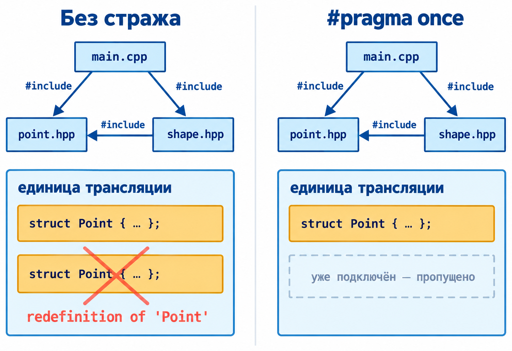
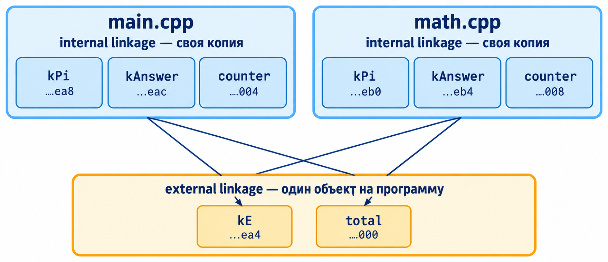

::: {.content-visible unless-format="revealjs"}

[Открыть слайды](../slides/lectures/07-compiler-preprocessor.html){.btn .btn-outline-primary target="_blank"}

:::

## План лекции

- Программы состоят из файлов
- Этапы трансляции
- Объявление и определение, заголовочные файлы
- Препроцессор: `#include`, макросы, условная компиляция, стражи
- Компилятор и объектные файлы
- Компоновщик/линковщик и ошибки компоновки
- Linkage и storage duration

## 1. Программы состоят из файлов

- Логическое разбиение на модули
- Повторное использование кода
- Ускорение сборки: пересобираются изменённые `.cpp` и файлы, зависящие от изменённых заголовков
- Небольшие файлы проще читать и редактировать

Файлы бывают двух видов:

- заголовочные — `*.h`, `*.hpp`
- с исходным кодом — `*.cpp`

## 2. Этапы трансляции


Каждый исходный файл обрабатывается отдельно. На этапе компоновки объектные файлы и библиотеки связываются в программу.

Стандарт описывает процесс через девять логических фаз — их список приведён в [дополнительном слайде](#translation-phases-cpp20).

## Этапы по отдельности

| Команда | Что выполняется | Результат |
|---|---|---|
| `clang++ -std=c++20 -E main.cpp` | препроцессор | текст после препроцессора — в консоль |
| `clang++ -std=c++20 -S main.cpp` | препроцессор и компиляция | ассемблер `main.s` |
| `clang++ -std=c++20 -c main.cpp` | всё это и ассемблирование | объектный файл `main.o` |
| `clang++ main.o math.o` | компоновка | исполняемый файл `a.out` |

Компоновщик отдельно запускать не нужно: `clang++` вызывает его сам. Флаг `-Xlinker <arg>` передаёт ему следующий аргумент, например `-Xlinker -v`.


## 3. Объявление и определение

- **Объявление** (declaration) задаёт имя и атрибуты сущности, например сигнатуру функции. Согласованные объявления одной функции можно повторять
- **Определение** (definition) задаёт сущность полностью и одновременно является объявлением

```{.cpp filename="declaration-and-definition.cpp"}

```

## Определение в другом файле

:::: {.columns}

::: {.column width="40%"}

```{.cpp filename="math.cpp"}

```

:::

::: {.column width="60%"}

```{.cpp filename="main.cpp"}

```

:::

::::

Собираем оба файла: `clang++ -std=c++20 main.cpp math.cpp`. Чтобы скомпилировать вызов в `main.cpp`, хватает объявления. Определение найдёт компоновщик.

## Заголовочный файл

Что кладут в заголовок:

- объявления функций
- объявления переменных: `extern int total;`
- определения типов: `class`, `struct`, `enum`
- константы

Заголовок описывает интерфейс для других единиц трансляции. Объявления и определения функций, классов и переменных, нужных только одному `.cpp`, оставляют в этом `.cpp`.

## Объявления в заголовке, определения в `.cpp`

:::: {.columns}
::: {.column width="45%"}

```{.cpp filename="math.hpp"}

```

:::
::: {.column width="55%"}

```{.cpp filename="math.cpp"}

```

:::
::::

Объявления записаны в `math.hpp`. Файл с определениями включает тот же заголовок: компилятор проверит согласованность объявлений и определений.

## Использование заголовка

```{.cpp filename="main.cpp"}

```

`main.cpp` видит объявления из `math.hpp`. Определения функций он получит при компоновке с `math.o`.

## 4. Препроцессор

- Препроцессор обрабатывает директивы и токены препроцессора до основного синтаксического и семантического анализа C++
- Макросы работают с токенами: они не проверяют типы и смысл выражений C++
- Его команды называют директивами, все они начинаются с `#`
- Директива `#include "math.hpp"` заменяется содержимым файла `math.hpp`

## Директивы препроцессора

- Макросы: `#define`, `#undef`
- Предопределённые макросы: `__FILE__`, `__LINE__`
- Операторы макросов: `#` и `##`
- Условное включение: `#if`, `#ifdef`, `#ifndef`, `#elif`, `#else`, `#endif`
- Подключение файлов: `<filename>` и `"filename"`. У Clang кавычки обычно добавляют поиск рядом с текущим файлом; каталоги также задаются настройками сборки, например `-I`. Точный порядок зависит от реализации
- Другие директивы: `#pragma once` — о нём ниже, в разделе про стражи; `#error`
- `#pragma pack` управляет выравниванием полей структуры — его мы разбирали в лекции 4

## Что делает `#include`


После включения заголовков, раскрытия макросов и условной компиляции получается **единица трансляции** для дальнейшего анализа.

## Смотрим через `clang++ -E`

`clang++ -std=c++20 -E main.cpp -o main.ii` сохраняет результат препроцессинга в файл.

```{.cpp filename="main-preprocessed.txt"}

```

Это сокращённый фрагмент вывода: определения из `<iostream>` опущены. Пометки `# 4 "main.cpp" 2` сохраняют исходный файл и строку для диагностики ошибок.

## Макросы

- `#define` задаёт макрос: при раскрытии его имя заменяется последовательностью токенов
- Макрос с параметрами подставляет токены аргументов в эту последовательность. Типы аргументов при этом не проверяются

```{.cpp filename="macro-max.cpp"}

```

[{.godbolt-link-image width="32"}][godbolt-07-macro-max]{aria-label="Open in Compiler Explorer"}

## Макрос после препроцессора

`clang++ -std=c++20 -E macro-max.cpp -o macro-max.ii`

```{.cpp filename="macro-max-preprocessed.txt"}

```

Фрагмент настоящего вывода `-E`: часть из `<iostream>` опущена. Вместо вызова `MAXIMUM` стоит выражение, директива `#define` и комментарий исчезли.

Скобки вокруг параметров сохраняют группировку выражений при подстановке аргументов.

## Что напечатает `MAXIMUM(i++, j++)`?

```{.cpp filename="macro-double-evaluation.cpp"}

```

[{.godbolt-link-image width="32"}][godbolt-07-macro-double-evaluation]{aria-label="Open in Compiler Explorer"}

::: {.fragment}

**3 2 4.** Макрос раскрывается в `((i++) > (j++) ? (i++) : (j++))`, и `j++` выполняется дважды. Обычная функция `int Maximum(int x, int y)` вычислила бы каждый аргумент один раз — и заодно проверила бы типы.

:::

## Препроцессор не знает C++

**Этот пример намеренно не компилируется:** макрос `log` перехватывает имя в `std::log`.

```{.cpp filename="macro-name-collision.cpp"}

```

::: {.fragment}

`error: too few arguments provided to function-like macro invocation`. Препроцессор видит `log(2.718)` и раскрывает свой макрос — пространство имён `std` для него ничего не значит. Поэтому имена макросов пишут `ЗАГЛАВНЫМИ_БУКВАМИ`, а сами макросы используют только там, где функция не справится.

:::


## Условная компиляция

```{.cpp filename="conditional-log.cpp"}

```

[{.godbolt-link-image width="32"}][godbolt-07-conditional-log]{aria-label="Open in Compiler Explorer"}

С флагом `-DDEBUG` программа печатает сообщение с именем файла и номером строки. Без флага вызов макроса исчезает после препроцессинга.

`__VA_OPT__(, )` из C++20 ставит запятую, только если переданы дополнительные аргументы.

## Макрос через другой макрос

```{.cpp filename="macro-log-levels.cpp"}

```

[{.godbolt-link-image width="32"}][godbolt-07-macro-log-levels]{aria-label="Open in Compiler Explorer"}

`LOG_ERROR` раскрывается в `LOG`, затем в вызов `std::printf`. Оба уровня используют общий формат сообщения. `__FILE__` и `__LINE__` относятся к месту вызова в `main`.

## Имена и переносимость макросов

- `, ##__VA_ARGS__` встречается в старом коде, но это расширение GNU. Для C++20 используем `__VA_OPT__`
- Имена с двумя подчёркиваниями, например `__DEBUG__`, зарезервированы за реализацией
- Для собственного переключателя подходит `DEBUG`; стандартный `NDEBUG` имеет отдельное назначение — отключает `assert`


## Двойное включение

**Пример намеренно не компилируется:** `Point` определяется дважды в одной единице трансляции.

:::: {.columns}

::: {.column width="56%"}

{fig-alt="main.cpp подключает point.hpp дважды: напрямую и через shape.hpp"}

:::

::: {.column width="44%"}

```{.cpp filename="main.cpp"}

```

```{.cpp filename="shape.hpp"}

```

```{.cpp filename="point.hpp"}

```

:::

::::

`struct Point` попадает в единицу трансляции дважды: `error: redefinition of 'Point'`. Clang подсказывает: `unguarded header; consider using #ifdef guards or #pragma once`.


## Стражи включения

:::: {.columns}

::: {.column width="50%"}

```{.cpp filename="point.hpp"}

```

:::

::: {.column width="50%"}

```{.cpp filename="point.hpp"}

```

:::

::::

При втором включении `POINT_HPP` уже определён, и препроцессор пропускает текст до `#endif`. `#pragma once` делает то же короче. Его нет в стандарте, но поддерживают все основные компиляторы.

## 5. Компилятор

- Получает единицу трансляции — `.cpp` после препроцессора
- Каждый `.cpp` компилируется отдельно и независимо от остальных
- В обычной сборке заголовок обрабатывается в составе каждой единицы трансляции, которая его включает
- В режиме `-S` выдаёт ассемблерный текст (`.s`); режим `-c` включает и ассемблирование, выдавая объектный файл (`.o`, `.obj`)

## Что выдаёт компилятор

```{.nasm filename="increment-x86-64.asm"}

```

`clang++ -std=c++20 -S -masm=intel -O0 math.cpp` для x86-64 с ABI Itanium; показан фрагмент, комментарии добавлены вручную. Конкретные инструкции и имена зависят от целевой платформы. Функция называется `_Z9IncrementRi`: компилятор кодирует в имени типы параметров (name mangling). Так перегрузки из лекции 6 получают разные имена.

## Зачем нужно ассемблирование

- В выводе `-S` видны мнемоники вроде `push`, `mov`, `call`. Процессор исполняет машинные команды, закодированные байтами
- Ассемблер кодирует каждую команду в байты машинного кода и собирает объектный файл:
  - секции: код (`.text`) и данные (`.data`, `.rodata`)
  - таблицу символов: что определено в файле, а что нужно извне
  - записи перемещений (relocations): места, где нужно вычислить адреса или относительные смещения
- Отдельный шаг удобен: компилятору не нужно знать двоичное кодирование команд, а ассемблер так же обрабатывает код, написанный на ассемблере вручную
- На поддерживаемых целях Clang использует встроенный ассемблер: `clang++ -c` может получить `.o` без промежуточного текстового `.s`

## Что внутри объектного файла

Ниже — фрагмент для **macOS, x86-64**. В Linux имена записей перемещений отличаются.

```
$ objdump -dr --x86-asm-syntax=intel main.o
…
  1d: 48 8d 7d f4       lea   rdi, [rbp - 12]
  21: e8 00 00 00 00    call  …
            X86_64_RELOC_BRANCH  __Z9IncrementRi
  26: 8b 7d f8          mov   edi, dword ptr [rbp - 8]
  29: 8b 75 f4          mov   esi, dword ptr [rbp - 12]
  2c: e8 00 00 00 00    call  …
            X86_64_RELOC_BRANCH  __Z3Addii
…
```

Слева — байты машинного кода, справа — те же команды текстом. На месте адресов `Increment` и `Add` стоят нули: функции определены в другом файле, и их адреса ассемблеру неизвестны. Пометки `X86_64_RELOC_BRANCH` указывают, где нужно вычислить относительное смещение для вызова. В Linux аналогичная запись может выглядеть как `R_X86_64_PLT32`.

Перед вызовом `Increment(y)` инструкция `lea` помещает адрес `y` в `rdi`. В показанном выше теле `Increment` этот адрес используется для чтения и изменения `y`.


## Символы объектного файла

Пример вывода на **macOS**; адреса и дополнительные символы зависят от сборки.

```{=html}
<pre class="nm-output"><code>$ nm main.o | c++filt
                 <span class="nm-undefined">U</span> Add(int, int)
                 <span class="nm-undefined">U</span> Increment(int&amp;)
0000000000000000 <span class="nm-text">T</span> _main
                 … и ещё около 60 символов из &lt;iostream&gt;

$ nm math.o | c++filt
0000000000000020 <span class="nm-text">T</span> Add(int, int)
0000000000000000 <span class="nm-text">T</span> Increment(int&amp;)</code></pre>
```

- [U]{.nm-undefined} — **undefined**: символ используется, но в этом файле не определён
- [T]{.nm-text} — **text**: символ определён в секции кода `.text`

Для символов кода `T` означает внешнее связывание, `t` — локальное. `c++filt` восстанавливает читаемые имена: в macOS `__Z3Addii` превращается в `Add(int, int)`. В Linux декорированное имя обычно `_Z3Addii`, а точка входа — `main` вместо `_main`.


## 6. Компоновщик/линковщик

- Объединяет объектные файлы и библиотеки в исполняемый файл или библиотеку
- Ищет определения нужных символов в объектных файлах и библиотеках; в нашем примере функция с `U` находится как `T`
- Обрабатывает записи перемещений: вычисляет адреса и смещения для обращений к функциям и данным

## Как компоновщик связывает файлы


## Программа из трёх файлов

:::: {.columns}
::: {.column width="47%"}

**Объявления**

```{.cpp filename="math.hpp"}

```

**Определения**

```{.cpp filename="math.cpp"}

```

:::
::: {.column width="53%"}

**Вызовы**

```{.cpp filename="main.cpp"}

```

:::
::::

## Собираем по шагам

Рабочий пример находится в `examples/07-compiler-preprocessor/separate-compilation`. Команды выполняются в каталоге с его `main.cpp`, `math.cpp` и `math.hpp`.

```
$ clang++ -std=c++20 -c main.cpp     # main.o
$ clang++ -std=c++20 -c math.cpp     # math.o
$ clang++ main.o math.o -o program   # компоновка
$ ./program
4
```

Программа печатает `4`. Далее меняем по одному условию и проверяем, на каком этапе возникает ошибка.

## Что пересобрать после изменения?

Оба файла, `main.cpp` и `math.cpp`, включают `math.hpp`.

| Изменился файл | Какие объекты пересобираем | Затем |
|---|---|---|
| `math.cpp` | `math.o` | повторяем компоновку |
| `math.hpp` | `main.o` и `math.o` | повторяем компоновку |

Зависимость от заголовка действует и через другие заголовки. Системы сборки отслеживают такие зависимости; обычный запуск компоновщика не пересобирает `.cpp`.

## Ошибки компиляции и компоновки

- **Ошибка компиляции** — проблема внутри одной единицы трансляции: синтаксис, типы, необъявленное имя. Например, вызов `Add` без объявления: `error: use of undeclared identifier 'Add'`
- В наших примерах **ошибка компоновки** означает, что компоновщик не нашёл определение нужного символа или обнаружил недопустимые повторные определения

## Убрали объявление: на каком этапе ошибка?

В `math.hpp` оставили только `Increment`. Файлы `main.cpp` и `math.cpp` не менялись.

```{.cpp filename="math.hpp"}

```

`clang++ -std=c++20 -c main.cpp`

::: {.fragment}

**Намеренная ошибка компиляции:** `use of undeclared identifier 'Add'`. В единице трансляции `main.cpp` нет объявления `Add`. Определение в соседнем `math.cpp` этого не исправляет.

Проверка: `clang++ -std=c++20 -E main.cpp` покажет вызов `Add`, но не его объявление.

:::

## Вернули объявление, забыли `math.o`

С исходным `math.hpp` обе единицы трансляции компилируются. Передадим компоновщику только один объектный файл:

```bash
clang++ -std=c++20 -c main.cpp
clang++ -std=c++20 -c math.cpp
clang++ main.o -o program
```

::: {.fragment}

**Намеренная ошибка компоновки:** не найдены определения `Add` и `Increment`. Они есть в `math.o`, но этот файл не передан компоновщику.

`nm main.o | c++filt` показывает `U` у обеих функций; `nm math.o | c++filt` — их определения. Исправление: `clang++ main.o math.o -o program`.

:::

## Перенесли `Add` в заголовок

Определение `Add` убрали из `math.cpp` и поместили в `math.hpp`, который включают оба `.cpp`.

```{.cpp filename="math.hpp"}

```

`clang++ -std=c++20 main.cpp math.cpp -o program`

::: {.fragment}

**Намеренная ошибка компоновки:** `duplicate symbol` на macOS или `multiple definition` на Linux для `Add(int, int)`. Определение оказалось в двух единицах трансляции. `#pragma once` защищает от повторного включения только внутри каждой из них.

Возвращаем объявление в `math.hpp`, а определение — в `math.cpp`: программа снова печатает `4`.

:::

:::: {.content-visible unless-format="revealjs"}

## Практика: проверяем каждый этап сборки

Ниже — воспроизводимая последовательность для терминала macOS или Linux. Перед каждой сборкой определите ожидаемый результат: какой этап завершится ошибкой и какой информации ему не хватает? Все изменения выполняются во временной копии примера.

### 1. Рабочая программа

Из корня репозитория:

```bash
lecture_examples="$PWD/examples/07-compiler-preprocessor"
demo_dir="$(mktemp -d)"
cp "$lecture_examples/separate-compilation/"{main.cpp,math.cpp,math.hpp} "$demo_dir/"
cd "$demo_dir"
clang++ -std=c++20 -Wall -Wextra -pedantic -c main.cpp
clang++ -std=c++20 -Wall -Wextra -pedantic -c math.cpp
clang++ main.o math.o -o program
./program
```

Результат — `4`. Следующие команды выполняются в том же терминале и каталоге.

### 2. Нет объявления

```bash
cp "$lecture_examples/build-errors/missing-declaration/math.hpp" math.hpp
clang++ -std=c++20 -Wall -Wextra -pedantic -c main.cpp
clang++ -std=c++20 -E main.cpp -o main.ii
```

Компиляция намеренно завершается ошибкой: `Add` не объявлена. Препроцессор успешно создаёт `main.ii`: в нём можно найти вызов `Add`, но её объявления там нет.

### 3. Нет объектного файла при компоновке

```bash
cp "$lecture_examples/separate-compilation/math.hpp" math.hpp
clang++ -std=c++20 -Wall -Wextra -pedantic -c main.cpp
clang++ -std=c++20 -Wall -Wextra -pedantic -c math.cpp
clang++ main.o -o program
nm main.o | c++filt
nm math.o | c++filt
```

Компиляция успешна, компоновка намеренно завершается ошибкой. Символы `Add` и `Increment` помечены `U` в `main.o`, а их определения находятся в `math.o`.

### 4. Определение в заголовке

```bash
cp "$lecture_examples/build-errors/header-definition/"{math.hpp,math.cpp} .
clang++ -std=c++20 -Wall -Wextra -pedantic -c main.cpp
clang++ -std=c++20 -Wall -Wextra -pedantic -c math.cpp
clang++ main.o math.o -o program
```

Компоновка намеренно завершается ошибкой: теперь определение `Add` есть в обоих объектных файлах. В этом варианте `math.cpp` содержит только определение `Increment`:

```{.cpp filename="math.cpp"}

```

### 5. Почему страж не помог?

`#pragma once` уже стоит в обоих вариантах `math.hpp`. Проверяем результат отдельной обработки каждого `.cpp`:

```bash
clang++ -std=c++20 -E main.cpp -o main.ii
clang++ -std=c++20 -E math.cpp -o math.ii
nm main.o | c++filt
nm math.o | c++filt
```

В каждом `.ii` определение `Add` встречается один раз, но объектных файлов два. Оба содержат определение одного внешнего символа. Страж не управляет компоновкой.

### 6. Восстанавливаем разделение

```bash
cp "$lecture_examples/separate-compilation/"{math.hpp,math.cpp} .
clang++ -std=c++20 -Wall -Wextra -pedantic -c main.cpp
clang++ -std=c++20 -Wall -Wextra -pedantic -c math.cpp
clang++ main.o math.o -o program
./program
```

Результат снова `4`: общий заголовок содержит объявления, а определения находятся в одном `.cpp`.

::::

## Определили в заголовке

```{.cpp filename="shared.hpp"}

```

**Намеренная ошибка компоновки.** В каталоге `multiple-definitions` заголовок включён в `main.cpp` и `a.cpp`. Команда `clang++ -std=c++20 main.cpp a.cpp` сообщает:

```
duplicate symbol '_shared' in:
    a.o
    main.o
ld: 1 duplicate symbols
```

На Linux это обычно `multiple definition of 'shared'`. `#pragma once` не спасает: он защищает от повторного включения в одну единицу трансляции, а их здесь две. Но почему тогда константу `const int kAnswer = 239;` держать в заголовке можно? Ответ — в linkage.


## 7. Linkage

Linkage определяет, могут ли объявления имени в разных местах обозначать одну и ту же сущность.

Здесь рассматриваем программы без модулей C++20; module linkage оставляем за рамками лекции.

- **External** — объявления в разных единицах трансляции могут обозначать одну сущность
- **Internal** — такая связь ограничена одной единицей трансляции: например, `static`-переменная на уровне пространства имён
- **No linkage** — имя не связывается с объявлениями в других областях: например, имя обычной локальной переменной

Внешнее связывание не делает объявление видимым автоматически: для вызова функции в другом `.cpp` её всё равно нужно объявить, обычно через заголовок.

## Пример: `math.hpp`

```{.cpp filename="math.hpp"}

```

## Пример: `math.cpp`

```{.cpp filename="math.cpp"}

```

## Пример: `main.cpp`

```{.cpp filename="main.cpp"}

```

`const float kE` в `main.cpp` видит объявление `extern` из заголовка и поэтому получает external linkage.

## Какие адреса совпадут?

В каталоге `linkage` собираем `clang++ -std=c++20 main.cpp math.cpp` и запускаем. Ниже — пример вывода на macOS (arm64); конкретные адреса меняются от запуска к запуску.

::: {.fragment}

```
kPi     3.14 0x1041efea8
kE      2.72 0x1041efea4
kAnswer 239 0x1041efeac
counter 3 0x1041f4004
total   2 0x1041f4000
--- PrintInfo() из math.cpp ---
kPi     3.14 0x1041efeb0
kE      2.72 0x1041efea4
kAnswer 239 0x1041efeb4
counter 0 0x1041f4008
total   2 0x1041f4000
```

:::

::: {.fragment}

Совпали только `kE` и `total` — это один объект на всю программу. У `kPi`, `kAnswer` и `counter` в каждой единице трансляции своя копия, поэтому `counter = 3` из `main` в `math.cpp` не видно.

:::


## Linkage в картинке



## One Definition Rule (ODR)

Теперь понятно, почему `int shared = 239;` в заголовке ломает сборку, а `const int kAnswer = 239;` — нет. У `kAnswer` internal linkage: в каждой единице трансляции своя копия. У `shared` — external: это один объект на всю программу, а определений два.

В одной единице трансляции не должно быть повторного определения одной и той же функции или переменной.

Для используемой обычной **не-`inline` функции или переменной с external linkage** требуется одно определение во всей программе. Ниже — схема для переменной `shared`.

:::: {.columns}

::: {.column width="42%"}

```{.cpp filename="shared.hpp"}

```

:::

::: {.column width="58%"}

```{.cpp filename="a.cpp"}

```

:::

::::

## Определения в заголовках: исключения

Правило «определение всегда в одном `.cpp`» не универсально:

- `inline`-функции и `inline`-переменные могут иметь определения в нескольких единицах трансляции
- Для шаблонов и определений типов также допускается повторение при выполнении требований ODR
- Для допустимых повторных определений нужна одинаковая последовательность токенов и выполнение остальных требований ODR, в том числе к сущностям, которые обозначают используемые имена
- Константа `const int kAnswer = 239;` с internal linkage создаёт отдельный объект в каждом `.cpp`

Не каждое нарушение ODR обязано приводить к сообщению об ошибке. Успешная сборка сама по себе не доказывает соблюдение правила. Подробнее — [C++20, правило одного определения](https://timsong-cpp.github.io/cppwp/n4861/basic.def.odr#13).

## Счётчик и константа в заголовке

В каталоге `counter-sharing` есть три варианта `counter.hpp`. Каждый вариант подключается в два `.cpp`. Сравним счётчик и константу.

:::: {.columns}
::: {.column width="33%"}

Обычная переменная (`plain`)

```{.cpp filename="counter.hpp"}

```

:::
::: {.column width="33%"}

Своя копия (`internal`)

```{.cpp filename="counter.hpp"}

```

:::
::: {.column width="34%"}

Общий объект (`inline`)

```{.cpp filename="counter.hpp"}

```

:::
::::

Вариант `plain` намеренно приводит к ошибке компоновки: определения одной не-`inline` переменной с external linkage повторяются.

## Меняем счётчик из другого `.cpp`

```{.cpp filename="counter.cpp"}

```

Функции увеличивают счётчик и возвращают адреса счётчика и константы из единицы трансляции `counter.cpp`. Сравним их с адресами из `main.cpp`.

## Какой счётчик увидит `main`?

```{.cpp filename="main.cpp"}

```

Из каталога `counter-sharing`: `clang++ -std=c++20 -Iinline main.cpp counter.cpp -o program`, затем `./program`. Каталог после `-I` выбирает заголовок: `inline`, `internal` или `plain`.

## Один объект или два?

В каждой строке вывода: значение из `main.cpp`, значение из `counter.cpp`, результат сравнения адресов.

| Вариант заголовка | Что получилось | Строка `counter` | Строка `kAnswer` |
|---|---|---|---|
| `plain` | ошибка компоновки | — | — |
| `internal` | отдельные объекты в каждом `.cpp` | `0 1 false` | `239 239 false` |
| `inline` | один общий счётчик и одна общая константа | `1 1 true` | `239 239 true` |

Обычная константа `kAnswer` здесь имеет internal linkage. В варианте `inline` оба имени имеют external linkage: при соблюдении ODR для каждого объекта адрес совпадает в разных единицах трансляции.

`constexpr` требует константного выражения для инициализации этой переменной и делает её константой; `inline` позволяет разместить определения общего объекта в заголовке.

У функций слово `inline` также связано с правилами определений; оно не обязывает компилятор встраивать вызов. Подробнее — [C++20, `inline`](https://timsong-cpp.github.io/cppwp/n4861/dcl.inline).

## Storage duration

:::: {.columns}
::: {.column width="52%"}

```{.cpp filename="scope-linkage-storage.cpp"}

```

:::
::: {.column width="48%"}

| Имя | Область видимости | Linkage | Хранение |
|---|---|---|---|
| `total` | глобальная | external | static |
| `local` | блок `Count` | нет | automatic |
| `calls` | блок `Count` | нет | static |

Два вызова печатают:

```text
1 1 1
2 1 2
```

Имя `calls` доступно только в своём блоке, а значение сохраняется между вызовами.

:::
::::

Область видимости отвечает, где можно использовать имя; linkage — какие объявления связаны; продолжительность хранения — как долго существует память объекта.

:::: {.content-visible unless-format="revealjs"}

## Справка: продолжительность хранения

**Продолжительность хранения** определяет, как долго существует область памяти объекта. Это отдельное свойство от области видимости имени и linkage.

| Категория | Продолжительность хранения |
|---|---|
| automatic | до выхода из соответствующего блока |
| static | на протяжении выполнения программы |
| thread | на протяжении выполнения соответствующего потока |
| dynamic | от выделения памяти до её освобождения |

Время жизни самого объекта связано с его инициализацией и уничтожением и может отличаться от продолжительности хранения памяти.

### Хранение в языке и размещение в памяти

- Стек — типичная реализация автоматического хранения
- Секции `.data` и `.bss` часто используются для объектов со статическим хранением
- Динамические выделения обычно обслуживает аллокатор; физическое размещение зависит от реализации

Эти способы реализации и примеры хранения разобраны в [лекции 5](05-memory.md#длительность-хранения-storage-duration). Стандарт не требует размещать каждый объект именно так.

Локальная `static`-переменная имеет локальную область видимости имени и статическую продолжительность хранения. Эти свойства не противоречат друг другу.

### Спецификаторы класса памяти

- `static` у переменной на уровне пространства имён — static storage duration и internal linkage
- `static` у локальной переменной — static storage duration без linkage
- `extern int total;` — объявление переменной; её определение размещают отдельно
- `thread_local` — thread storage duration

::::

## Дополнительно: девять фаз C++20 {#translation-phases-cpp20}

| Фаза | Основное действие |
|---|---|
| 1 | Отображение символов исходного файла в исходный набор символов |
| 2 | Склейка строк: удаление «`\` + перевод строки» |
| 3 | Разбиение на токены препроцессора; замена комментариев пробелами |
| 4 | Директивы, включение заголовков и раскрытие макросов |
| 5 | Перевод символов и escape-последовательностей литералов в кодировку исполнения |
| 6 | Склейка соседних строковых литералов |
| 7 | Синтаксический и семантический анализ, трансляция |
| 8 | Инстанцирование требуемых шаблонов |
| 9 | Разрешение внешних ссылок и компоновка |

Это логические фазы, а не девять отдельных запусков программ. Реализация может объединять их, сохраняя поведение, описанное в [C++20, фазы трансляции](https://timsong-cpp.github.io/cppwp/n4861/lex.phases).

[godbolt-07-macro-max]: <https://godbolt.org/#g:!((g:!((h:codeEditor,i:(j:1,lang:c%2B%2B,options:(compileOnChange:'0'),source:'%23include+%3Ciostream%3E%0A%0A%23define+MAXIMUM(x,+y)+((x)+%3E+(y)+%3F+(x)+:+(y))%0A%0Aint+main()+%7B%0A++++//+%D0%92%D1%8B%D0%B1%D0%B8%D1%80%D0%B0%D0%B5%D0%BC+%D0%B1%D0%BE%D0%BB%D1%8C%D1%88%D0%B5%D0%B5+%D0%B7%D0%BD%D0%B0%D1%87%D0%B5%D0%BD%D0%B8%D0%B5.%0A++++std::cout+%3C%3C+MAXIMUM(10,+20)+%3C%3C+!'%5Cn!'%3B%0A%0A++++return+0%3B%0A%7D%0A'),l:'5'),(h:executor,i:(compilationPanelShown:'0',compiler:clang2310,compilerOutShown:'0',lang:c%2B%2B,libs:!(),options:'-std%3Dc%2B%2B20+-O0',source:1,tree:0),l:'5')),l:'2')),version:4>
<!-- godbolt source="../examples/07-compiler-preprocessor/macro-max.cpp" compiler="clang2310" options="-std=c++20 -O0" -->

[godbolt-07-macro-double-evaluation]: <https://godbolt.org/#g:!((g:!((h:codeEditor,i:(j:1,lang:c%2B%2B,options:(compileOnChange:'0'),source:'%23include+%3Ciostream%3E%0A%0A%23define+MAXIMUM(x,+y)+((x)+%3E+(y)+%3F+(x)+:+(y))%0A%0Aint+main()+%7B%0A++++int+i+%3D+1%3B%0A++++int+j+%3D+2%3B%0A++++int+m+%3D+MAXIMUM(i%2B%2B,+j%2B%2B)%3B%0A%0A++++std::cout+%3C%3C+m+%3C%3C+!'+!'+%3C%3C+i+%3C%3C+!'+!'+%3C%3C+j+%3C%3C+!'%5Cn!'%3B%0A%0A++++return+0%3B%0A%7D%0A'),l:'5'),(h:executor,i:(compilationPanelShown:'0',compiler:clang2310,compilerOutShown:'0',lang:c%2B%2B,libs:!(),options:'-std%3Dc%2B%2B20+-O0',source:1,tree:0),l:'5')),l:'2')),version:4>
<!-- godbolt source="../examples/07-compiler-preprocessor/macro-double-evaluation.cpp" compiler="clang2310" options="-std=c++20 -O0" -->

[godbolt-07-conditional-log]: <https://godbolt.org/#g:!((g:!((h:codeEditor,i:(j:1,lang:c%2B%2B,options:(compileOnChange:'0'),source:'%23include+%3Ccstdio%3E%0A%0A%23ifdef+DEBUG%0A%23define+ERROR_LOG(format,+...)++++++++++++++++++++++%5C%0A++++std::printf(%22%5BERROR%5D+(%25s:%25d)+%22+format+%22%5Cn%22,+++++%5C%0A++++++++++++++++__FILE__,+__LINE__+__VA_OPT__(,+)+__VA_ARGS__)%0A%23else%0A%23define+ERROR_LOG(format,+...)%0A%23endif%0A%0Aint+main()+%7B%0A++++ERROR_LOG(%22fatal+error+no:+%25d%22,+1)%3B%0A%0A++++return+0%3B%0A%7D%0A'),l:'5'),(h:executor,i:(compilationPanelShown:'0',compiler:clang2310,compilerOutShown:'0',lang:c%2B%2B,libs:!(),options:'-std%3Dc%2B%2B20+-O0+-DDEBUG',source:1,tree:0),l:'5')),l:'2')),version:4>
<!-- godbolt source="../examples/07-compiler-preprocessor/conditional-log.cpp" compiler="clang2310" options="-std=c++20 -O0 -DDEBUG" -->

[godbolt-07-macro-log-levels]: <https://godbolt.org/#g:!((g:!((h:codeEditor,i:(j:1,lang:c%2B%2B,options:(compileOnChange:'0'),source:'%23include+%3Ccstdio%3E%0A%0A%23define+LOG(level,+format,+...)+%5C%0A++++std::printf(%22%5B%22+level+%22%5D+(%25s:%25d)+%22+format+%22%5Cn%22,+%5C%0A++++++++++++++++__FILE__,+__LINE__+__VA_OPT__(,+)+__VA_ARGS__)%0A%23define+LOG_ERROR(...)+LOG(%22ERROR%22,+__VA_ARGS__)%0A%23define+LOG_INFO(...)+LOG(%22INFO%22,+__VA_ARGS__)%0A%0Aint+main()+%7B%0A++++LOG_INFO(%22started%22)%3B%0A++++LOG_ERROR(%22error+code:+%25d%22,+1)%3B%0A%0A++++return+0%3B%0A%7D%0A'),l:'5'),(h:executor,i:(compilationPanelShown:'0',compiler:clang2310,compilerOutShown:'0',lang:c%2B%2B,libs:!(),options:'-std%3Dc%2B%2B20+-O0',source:1,tree:0),l:'5')),l:'2')),version:4>
<!-- godbolt source="../examples/07-compiler-preprocessor/macro-log-levels.cpp" compiler="clang2310" options="-std=c++20 -O0" -->
