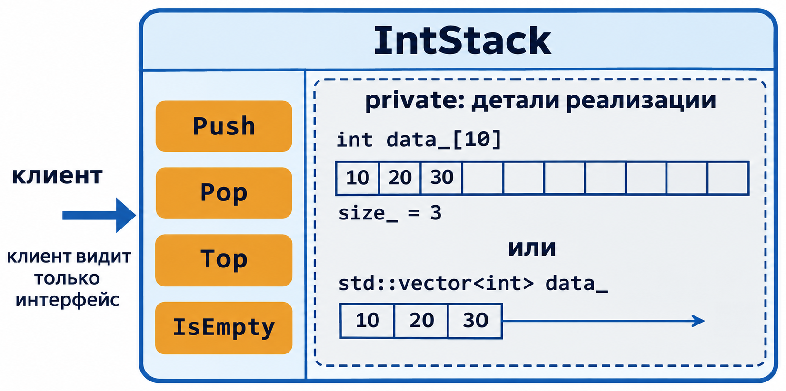
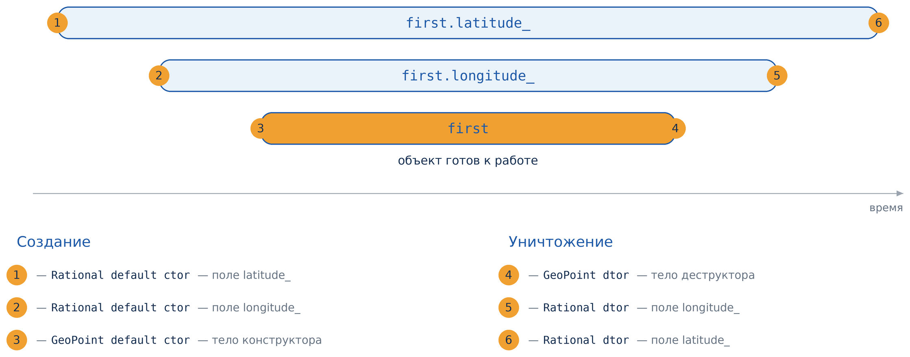
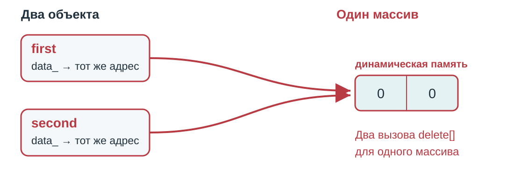
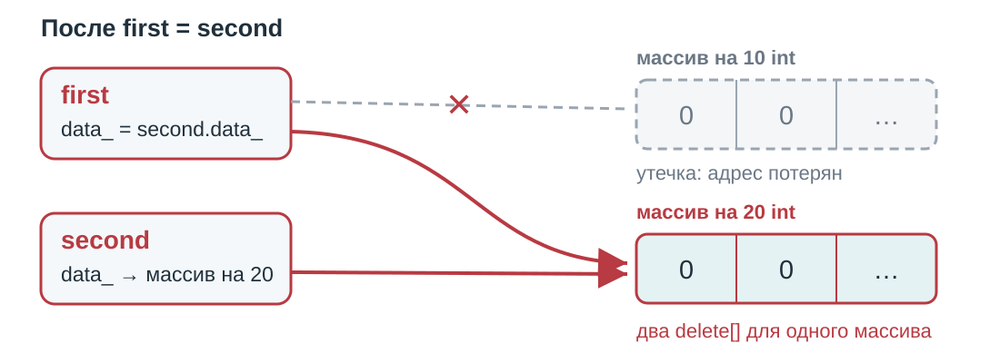
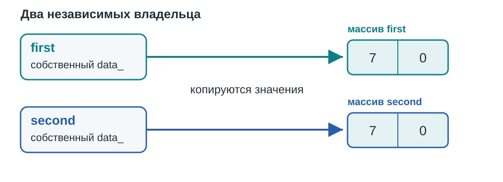

::: {.content-visible unless-format="revealjs"}

[Открыть слайды](../slides/lectures/08-abstraction-encapsulation.html){.btn .btn-outline-primary target="_blank"}

:::

## План лекции

- Абстракция и инвариант: стек и дата на открытых структурах
- Класс и инкапсуляция: `public`, `private`, методы
- Конструкторы, деструктор, копирование и присваивание
- Порядок создания и уничтожения объектов
- `= default`, `= delete` и `explicit`
- Специальные функции и правила трёх, [пяти]{.not-yet} и нуля

## Абстракция

**Абстракция** — придание объекту характеристик, которые чётко определяют его концептуальные границы, отличая от всех других объектов.

Основная идея — **отделить способ использования составных объектов данных от деталей их реализации** в виде более простых объектов.

Например, стек определяется операциями над вершиной и порядком LIFO, а не тем, как хранятся его элементы.

## Задача: реализовать стек

Стек хранит элементы по правилу **LIFO**: последним добавили — первым извлекли.

| Операция | Что делает |
|---|---|
| `Push(value)` | Добавляет элемент на вершину |
| `Pop()` | Удаляет вершину непустого стека |
| `Top()` | Возвращает вершину непустого стека |
| `IsEmpty()` | Проверяет, пуст ли стек |

Для простоты в стеке помещается не больше 10 элементов.

## Стек на структуре

:::: {.columns}

::: {.column width="45%"}

```{.cpp filename="plain-stack.hpp"}

```

:::

::: {.column width="55%"}

```{.cpp filename="plain-stack.cpp"}

```

:::

::::

Данные лежат в структуре, операции — в отдельных функциях. `Pop` и `IsEmpty` устроены так же.

## Поля структуры открыты

```{.cpp filename="stack-open.cpp"}

```

[{.godbolt-link-image width="32"}][godbolt-08-stack-open]{aria-label="Open in Compiler Explorer"}

::: {.fragment}

```
42
100500
```

Записать в `size` можно что угодно: теперь в стеке «100500 элементов», хотя массив рассчитан на 10.

:::

## Инвариант

**Инвариант** — условие, которое выполняется для объекта всегда, когда им можно пользоваться. Оно описывает непротиворечивое внутреннее состояние.

- Стек: `0 ≤ size ≤ 10`, элементы лежат в `data[0]` … `data[size - 1]`
- Дата: такой день есть в этом месяце, а `timestamp` соответствует году, месяцу и дню

С открытыми полями инвариант держится на честном слове: `stack.size = 100500` его нарушает.

## Дата на структуре

```{.cpp filename="plain-date.hpp"}

```

Четыре поля описывают одну дату и должны быть согласованы: `timestamp` вычисляется по году, месяцу и дню.

## Создание даты

```{.cpp filename="create-date.cpp"}

```

`CreateDate` заполняет поля согласованно и проверяет дату внутри `ToTimestamp`. Но поля открыты, и обходить её никто не мешает.

## Поля даты открыты

```{.cpp filename="date-open.cpp"}

```

::: {.fragment}

```
2023-100-65 10050
```

:::

## Чем плохи открытые поля

- Любой код может менять поля напрямую и обходить проверки `CreateDate`
- Можно испортить одно поле: `date.day = 65`
- Можно рассогласовать поля: `timestamp` больше не соответствует дате
- Ошибка проявится не там, где её сделали, а там, где испорченные данные прочитают

## Класс

**Класс** — пользовательский тип, который объединяет данные и операции над ними. Переменная такого типа — **объект**.

- **поля** хранят состояние объекта;
- **методы** — функции, которые работают с этим состоянием;
- **публичный интерфейс** — методы, доступные внешнему коду, то есть клиенту.

Для стека поля хранят элементы и размер, а методы добавляют, удаляют и читают вершину.

## Инкапсуляция

**Инкапсуляция** — объединение данных и методов, которые с ними работают, в одно целое и сокрытие деталей реализации от внешнего кода.

Клиент работает с объектом только через публичные методы. Поэтому класс сам отвечает за свой инвариант: обойти его проверки снаружи нельзя.

## Стек как класс {.compact-code .tall-code}

```{.cpp filename="stack.hpp"}

```

Методы объявлены в секции `public`, поля — в `private`.

## Клиент работает через публичный интерфейс

```{.cpp filename="stack-client.cpp"}

```

[{.godbolt-link-image width="32"}][godbolt-08-stack-client]{aria-label="Open in Compiler Explorer"}

::: {.fragment}

```
20
10
```

:::

## Поля закрыты

```{.cpp filename="private-access-error.cpp"}

```

[{.godbolt-link-image width="32"}][godbolt-08-private-access-error]{aria-label="Open in Compiler Explorer"}

**Не компилируется:** `error: 'size_' is a private member of 'IntStack'`. Сломать стек снаружи больше не получится.

## Реализация может быть другой {.compact-code .tall-code}

```{.cpp filename="stack-vector.hpp"}

```

Интерфейс тот же, но элементы хранит `std::vector`. Клиентский код `stack-client.cpp` не меняется.

## Одна абстракция — разные реализации

{.tall-image width="1100" fig-alt="Клиент видит только методы Push, Pop, Top и IsEmpty; за ними может быть массив на 10 элементов или std::vector"}

## Что должно сохраниться при замене

Совпадения вывода одного примера недостаточно. Какие договорённости должны сохраниться?

::: {.fragment}

- `Push(x)` кладёт `x` на вершину, если есть свободное место
- `Top()` читает вершину непустого стека и не меняет его
- `Pop()` удаляет только верхний элемент непустого стека
- `IsEmpty()` сообщает, есть ли элементы; ёмкость по-прежнему 10

:::

Представление изменилось, а смысл операций и их предусловия — нет.

## Модификаторы доступа

| Спецификатор | Кому доступен член класса |
|---|---|
| `public` | любому коду |
| `private` | только методам самого класса |
| `protected` | методам класса и его наследников — вернёмся к нему вместе с наследованием |

Спецификатор действует до следующего спецификатора или до конца класса. Чем `class` отличается от `struct`, обсудим в конце лекции.

## Дата как класс: год, месяц и день

```{.cpp filename="date.hpp"}

```

[{.godbolt-link-image width="32"}][godbolt-08-date-class]{aria-label="Open in Compiler Explorer"}

Конструктор и `Set` проверяют дату. `const` после списка параметров означает, что метод не меняет объект, — о нём чуть ниже.

## Дата как класс: только timestamp

```{.cpp filename="date-alternative.hpp"}

```

[{.godbolt-link-image width="32"}][godbolt-08-date-alternative-class]{aria-label="Open in Compiler Explorer"}

Публичный интерфейс тот же, поэтому клиентский код не меняется: `date-use.cpp` и `date-alternative-use.cpp` отличаются только подключённым заголовком.

## Конструктор

Специальная функция-член, которая создаёт объект и устанавливает его инвариант. Имя совпадает с именем класса, возвращаемого типа нет.

- **по умолчанию** (default constructor) — вызывается без аргументов
- **преобразующий** (converting constructor) — создаёт объект из значения другого типа
- **копирующий** (copy constructor) — из другого объекта того же типа
- [**перемещающий** (move constructor)]{.not-yet} — забирает данные у объекта, который больше не нужен

Поля инициализируются в порядке объявления в классе, до выполнения тела конструктора.

## Конструктор устанавливает инвариант

```{.cpp filename="date-constructor.cpp"}

```

- После `:` идёт **список инициализации**: поля получают значения до входа в тело конструктора
- Если дата некорректна, конструктор бросает исключение. Вернуть код ошибки он не может, поэтому объект просто не будет создан. Исключения подробно разберём в отдельной лекции

## Методы тоже поддерживают инвариант

```{.cpp filename="date-set.cpp"}

```

`this` — указатель на текущий объект, `*this` — сам объект. `return *this` возвращает ссылку на него: тип результата метода — `Date&`.

## Клиент не может нарушить инвариант

```{.cpp filename="date-use.cpp"}

```

::: {.fragment}

```
2023-11-1 1698796800
2023-11-2 1698883200
```

:::

`timestamp` всегда соответствует дате: изменить дату можно только через `Set`.

## Почему не сеттер для каждого поля? {.compact-code .tall-code}

```{.cpp filename="date-setters.cpp"}

```

[{.godbolt-link-image width="32"}][godbolt-08-date-setters]{aria-label="Open in Compiler Explorer"}

::: {.fragment}

`2024-2-31`: каждый сеттер по отдельности корректен, а вместе они дают 31 февраля. Поэтому `Set` меняет и проверяет дату целиком.

:::

## `Set` меняет всё или ничего

```{.cpp filename="date-transaction.cpp"}

```

::: {.fragment}

```
invalid date
31.3
```

:::

`Set` сначала проверяет дату и только потом меняет поля, поэтому при ошибке объект остаётся прежним. `try`/`catch` перехватывает исключение — подробно в лекции про исключения.

## Рациональное число

`Rational` — дробь с целым числителем и знаменателем.

Инвариант представления:

::: {.fragment}

- знаменатель положителен;
- дробь сокращена;
- ноль хранится как `0/1`.

:::

## `Rational`: конструкторы

```{.cpp filename="rational.hpp"}

```

Копирующий конструктор и присваивание компилятор сгенерировал бы и сам. Здесь они написаны вручную, чтобы разобрать их устройство.

## Конструктор `Rational`

```{.cpp filename="rational-constructor.cpp"}

```

После инициализации полей `NormalizeRational` сокращает дробь и переносит знак в числитель. При нулевом знаменателе она бросает `std::invalid_argument`.

## Нормализация в действии

```{.cpp filename="rational-use.cpp"}

```

[{.godbolt-link-image width="32"}][godbolt-08-rational-use]{aria-label="Open in Compiler Explorer"}

::: {.fragment}

`0/1`, `1/2`, `-1/2`, `1/2`. `PrintRational` из `print-rational.hpp` печатает дробь и принимает её по `const Rational&`: объект не копируется и не меняется.

:::

## Копирующий конструктор

```{.cpp filename="rational-copy-constructor.cpp"}

```

`other` передаётся по константной ссылке. Принять его по значению нельзя: чтобы передать аргумент, его пришлось бы скопировать этим же конструктором.

## [Перемещающий конструктор]{.not-yet}

```{.cpp filename="rational-move-constructor.cpp"}

```

- [`Rational&&`]{.not-yet} — rvalue-ссылка из лекции 6. Она привязывается к объекту, который больше не нужен, например к [`std::move(original)`]{.not-yet}
- `std::exchange(field, value)` записывает в поле новое значение и возвращает старое: источник остаётся корректной дробью `0/1`
- [`noexcept`]{.not-yet} — обещание не бросать исключений. Подробно о перемещении — в отдельной лекции

## Копирование и [перемещение]{.not-yet} `Rational`

```{.cpp filename="rational-constructors.cpp"}

```

::: {.fragment}

```
1/2
1/2
0/1
```

:::

## Константные методы

```{.cpp filename="rational-methods.cpp"}

```

`const` после списка параметров — обещание не менять объект. Только такие методы можно вызвать у константного объекта или через `const Rational&`, как в `PrintRational`.

## `const`-метод не может менять поля

```{.cpp filename="const-method-error.cpp"}

```

[{.godbolt-link-image width="32"}][godbolt-08-const-method-error]{aria-label="Open in Compiler Explorer"}

**Не компилируется:** `error: cannot assign to non-static data member within const member function 'Numerator'`.

## Деструктор

Специальная функция-член, которая выполняется при уничтожении объекта.

- Имя: `~ClassName()`.
- Нет параметров и возвращаемого типа.
- Освобождает ресурсы, которыми владеет объект.
- После тела деструктора поля уничтожаются в обратном порядке объявления.

## Деструктор освобождает память {.compact-code}

```{.cpp filename="int-buffer.hpp"}

```

`new int[size]{}` создаёт массив из нулей. Строки 13–14 запрещают копирование — зачем, увидим ниже.

## Когда вызывается деструктор?

```{.cpp filename="buffer-lifetime.cpp"}

```

[{.godbolt-link-image width="32"}][godbolt-08-buffer-lifetime]{aria-label="Open in Compiler Explorer"}

::: {.fragment}

```
inside block
~IntBuffer
after block
```

Деструктор вызывается автоматически, когда объект выходит из своей области видимости.

:::

## Копирование и присваивание

| Операция | Что происходит | Обычная сигнатура |
|---|---|---|
| `T second = first;` | Создаётся новый объект | `T(const T&)` |
| `second = first;` | Меняется существующий объект | `T& operator=(const T&)` |

Знак `=` в объявлении объекта обозначает инициализацию, а не вызов оператора присваивания.

Стандартная реализация копирует поля по одному. Для указателя копируется адрес, а не объект по этому адресу.

## Инициализация или присваивание? {.comments-with-fragment}

```{.cpp filename="rational-copy.cpp"}

```

[{.godbolt-link-image width="32"}][godbolt-08-rational-copy]{aria-label="Open in Compiler Explorer"}

::: {.fragment}

`3/4`, `1/2`, `1/2`. В строке 5 работает копирующий конструктор, в строках 7 и 8 — присваивание.

:::

## Копирующий оператор присваивания

```{.cpp filename="rational-copy-assignment.cpp"}

```

Оператор возвращает ссылку на `*this`, поэтому работают цепочки `a = b = c`.

## Нужен ли конструктор без аргументов?

| Тип | Вызов без аргументов | Состояние |
|---|---|---|
| `Rational` | Допустим: все параметры имеют значения по умолчанию | `0/1` |
| `Date` | Не допускается: нужны три аргумента | Дату выбирает клиент |

Конструктор, у которого все параметры имеют значения по умолчанию, тоже называется **конструктором по умолчанию**. У нашего `Rational` он уже есть.

Если объявлен свой конструктор, конструктор без аргументов компилятор сам не добавляет.

## Неявный конструктор по умолчанию

```{.cpp filename="implicit-default.cpp"}

```

[{.godbolt-link-image width="32"}][godbolt-08-implicit-default]{aria-label="Open in Compiler Explorer"}

::: {.fragment}

`0/1`, `0/1`. У `GeoPoint` нет своих конструкторов, и компилятор создал `GeoPoint()`: он вызывает конструкторы по умолчанию полей.

:::

## Свой конструктор отключает неявный

```{.cpp filename="missing-default-error.cpp"}

```

[{.godbolt-link-image width="32"}][godbolt-08-missing-default-error]{aria-label="Open in Compiler Explorer"}

**Не компилируется:** `error: no matching constructor for initialization of 'GeoPoint'`. Конструктор с параметрами подавил неявный конструктор по умолчанию.

## `= default`

```{.cpp filename="defaulted-constructor.cpp"}

```

[{.godbolt-link-image width="32"}][godbolt-08-defaulted-constructor]{aria-label="Open in Compiler Explorer"}

`= default` просит компилятор сгенерировать стандартную реализацию. Она должна подходить для инварианта класса: здесь поля сами становятся `0/1`.

## Классы, которые сообщают о себе {.compact-code}

:::: {.columns}

::: {.column width="48.4%"}

```{.cpp filename="rational.hpp"}

```

:::

::: {.column width="51.6%"}

```{.cpp filename="geo-point.hpp"}

```

:::

::::

Каждая специальная функция печатает своё имя. `GeoPoint` хранит два поля `Rational`.

## Что печатают специальные функции

```{.cpp filename="geo-point-copy-move.cpp"}

```

Поля копируются в списке инициализации, до тела конструктора. Поэтому `Rational copy ctor` появится в выводе раньше, чем `GeoPoint copy ctor`. Остальные функции из `lifetime/` устроены так же.

## Порядок вызовов: создание, строки 6–9 {.compact-code}

:::: {.columns}

::: {.column width="40%"}

```{.cpp filename="construction-order.cpp"}

```

[{.godbolt-link-image width="32"}][godbolt-08-construction-order]{aria-label="Open in Compiler Explorer"}

:::

::: {.column width="16%"}
:::

::: {.column width="44%" .fragment}

```{=html}
<pre class="call-output"><code><span data-from="6">Rational default ctor  ← first.latitude_</span>
<span data-from="6">Rational default ctor  ← first.longitude_</span>
<span data-from="6">GeoPoint default ctor  ← first</span>
<span data-from="7">Rational value ctor    ← latitude</span>
<span data-from="8">Rational value ctor    ← longitude</span>
<span data-from="9">Rational copy ctor     ← second.latitude_</span>
<span data-from="9">Rational copy ctor     ← second.longitude_</span>
<span data-from="9">GeoPoint value ctor    ← second</span></code></pre>
```

Сначала создаются поля, потом выполняется тело конструктора объекта.

:::

::::

::: {.notes}
Стрелки и пометки справа добавлены для объяснения, программа их не печатает.
:::

## Порядок вызовов: копирование и [перемещение]{.not-yet}, строки 10–11 {.compact-code}

:::: {.columns}

::: {.column width="40%"}

```{.cpp filename="construction-order.cpp"}

```

:::

::: {.column width="16%"}
:::

::: {.column width="44%" .fragment}

```{=html}
<pre class="call-output" style="margin-top: 170px;"><code><span data-from="10">Rational copy ctor  ← third.latitude_</span>
<span data-from="10">Rational copy ctor  ← third.longitude_</span>
<span data-from="10">GeoPoint copy ctor  ← third</span>
<span data-from="11">Rational <span class="not-yet">move ctor</span>  ← fourth.latitude_</span>
<span data-from="11">Rational <span class="not-yet">move ctor</span>  ← fourth.longitude_</span>
<span data-from="11">GeoPoint <span class="not-yet">move ctor</span>  ← fourth</span></code></pre>
```

Копирующий и [перемещающий]{.not-yet} конструкторы `GeoPoint` вызывают такие же конструкторы полей.

:::

::::

## Порядок вызовов: присваивание, строки 12–13 {.compact-code}

:::: {.columns}

::: {.column width="40%"}

```{.cpp filename="construction-order.cpp"}

```

:::

::: {.column width="16%"}
:::

::: {.column width="44%" .fragment}

```{=html}
<pre class="call-output" style="margin-top: 210px;"><code><span data-from="12">GeoPoint copy assignment  ← first</span>
<span data-from="12">Rational copy assignment  ← first.latitude_</span>
<span data-from="12">Rational copy assignment  ← first.longitude_</span>
<span data-from="13">GeoPoint <span class="not-yet">move assignment</span>  ← third</span>
<span data-from="13">Rational <span class="not-yet">move assignment</span>  ← third.latitude_</span>
<span data-from="13">Rational <span class="not-yet">move assignment</span>  ← third.longitude_</span></code></pre>
```

Объекты уже существуют, поэтому конструкторы не вызываются. Оператор присваивания `GeoPoint` сам присваивает поля.

:::

::::

## Порядок вызовов: уничтожение, строка 14 {.compact-code}

:::: {.columns}

::: {.column width="40%"}

```{.cpp filename="construction-order.cpp"}

```

:::

::: {.column width="16%"}
:::

::: {.column width="44%" .fragment}

```{=html}
<pre class="call-output" style="margin-top: 120px;"><code><span data-from="14" data-group="fourth">GeoPoint dtor  ← fourth</span>
<span data-from="14" data-group="fourth">Rational dtor  ← fourth.longitude_</span>
<span data-from="14" data-group="fourth">Rational dtor  ← fourth.latitude_</span>
<span data-from="14" data-group="third">GeoPoint dtor  ← third</span>
<span data-from="14" data-group="third">Rational dtor  ← third.longitude_</span>
<span data-from="14" data-group="third">Rational dtor  ← third.latitude_</span>
<span data-from="14" data-group="second">GeoPoint dtor  ← second</span>
<span data-from="14" data-group="second">Rational dtor  ← second.longitude_</span>
<span data-from="14" data-group="second">Rational dtor  ← second.latitude_</span>
<span data-from="14" data-group="longitude">Rational dtor  ← longitude</span>
<span data-from="14" data-group="latitude">Rational dtor  ← latitude</span>
<span data-from="14" data-group="first">GeoPoint dtor  ← first</span>
<span data-from="14" data-group="first">Rational dtor  ← first.longitude_</span>
<span data-from="14" data-group="first">Rational dtor  ← first.latitude_</span></code></pre>
```

:::

::::

## Порядок создания и уничтожения

{fig-alt="Время жизни first.latitude_, first.longitude_ и самого first вложено, как скобки: сначала создаются поля, потом выполняется тело конструктора; уничтожение идёт в обратном порядке"}

Времена жизни вложены, как скобки: что создано последним, уничтожается первым — как элементы стека. Так же, в обратном порядке, уничтожаются и локальные объекты `main`.

## `= delete`: запрет копирования

```{.cpp filename="default-delete-error.cpp"}

```

[{.godbolt-link-image width="32"}][godbolt-08-default-delete-error]{aria-label="Open in Compiler Explorer"}

**Не компилируется:** `error: call to deleted constructor of 'IntArray'`. Удалённая функция объявлена, но вызвать её нельзя.

## Неявное преобразование типов

```{.cpp filename="implicit-conversion.cpp"}

```

[{.godbolt-link-image width="32"}][godbolt-08-implicit-conversion]{aria-label="Open in Compiler Explorer"}

::: {.fragment}

`1/1`, `2/1`. Конструктор `Rational(int numerator = 0, int denominator = 1)` можно вызвать с одним `int`, поэтому компилятор сам превращает `1` и `2` в `Rational`.

:::

## `explicit`: создание должно быть явным

```{.cpp filename="rational.hpp"}

```

`explicit` запрещает неявные преобразования через этот конструктор: вызвать его можно только явно.

## Какие строки теперь нужно исправить?

```{.cpp filename="explicit-conversion-error.cpp"}

```

[{.godbolt-link-image width="32"}][godbolt-08-explicit-conversion-error]{aria-label="Open in Compiler Explorer"}

::: {.fragment}

Строки 4 и 6: `Rational number = 1` и `PrintRational(2)` требуют неявного преобразования.

- `error: no viable conversion from 'int' to 'Rational'`
- `error: no matching function for call to 'PrintRational'`

:::

## Явное создание объекта

```{.cpp filename="explicit-conversion.cpp"}

```

[{.godbolt-link-image width="32"}][godbolt-08-explicit-conversion]{aria-label="Open in Compiler Explorer"}

`Rational number{1}` и `Rational{2}` вызывают конструктор явно, и программа снова печатает `1/1` и `2/1`.

## Что компилятор объявляет сам

```{=html}
<style>
.special-members { width: 100%; table-layout: fixed; border-collapse: separate; border-spacing: 3px; font-size: 0.68em; margin: 0 !important; }
.special-members th, .special-members td { padding: 0.4em 0.3em; border: 0 !important; text-align: center; vertical-align: middle; line-height: 1.15; }
.special-members thead th, .special-members tbody th { background: #1E5AA8; color: #fff; font-weight: 600; }
.special-members tbody th { text-align: left; }
.special-members td { font-family: "Source Code Pro", monospace; }
.special-members td.d { background: #EAF2FA; color: #1E5AA8; }
.special-members td.u { background: #fff; color: #1E5AA8; font-family: inherit; font-weight: 700; box-shadow: inset 0 0 0 3px #1E5AA8; }
.special-members td.n { background: #F3F4F6; color: #8A94A0; font-family: inherit; }
.special-members td.x { background: #6B7280; color: #fff; }
.special-members td.w { background: #FCE3B6; color: #8A4B00; font-weight: 700; }
</style>
<table class="special-members">
<thead>
<tr><th>Вы объявили</th><th>Конструктор по умолчанию</th><th>Деструктор</th><th>Копирующий конструктор</th><th>Копирующее присваивание</th><th class="ny">Перемещающий конструктор</th><th class="ny">Перемещающее присваивание</th></tr>
</thead>
<tbody>
<tr><th>Ничего</th><td class="d">= default</td><td class="d">= default</td><td class="d">= default</td><td class="d">= default</td><td class="d">= default</td><td class="d">= default</td></tr>
<tr><th>Другой конструктор</th><td class="n">нет</td><td class="d">= default</td><td class="d">= default</td><td class="d">= default</td><td class="d">= default</td><td class="d">= default</td></tr>
<tr><th>Конструктор по умолчанию</th><td class="u">объявили</td><td class="d">= default</td><td class="d">= default</td><td class="d">= default</td><td class="d">= default</td><td class="d">= default</td></tr>
<tr><th>Деструктор</th><td class="d">= default</td><td class="u">объявили</td><td class="w">= default*</td><td class="w">= default*</td><td class="n">нет</td><td class="n">нет</td></tr>
<tr><th>Копирующий конструктор</th><td class="n">нет</td><td class="d">= default</td><td class="u">объявили</td><td class="w">= default*</td><td class="n">нет</td><td class="n">нет</td></tr>
<tr><th>Копирующее присваивание</th><td class="d">= default</td><td class="d">= default</td><td class="w">= default*</td><td class="u">объявили</td><td class="n">нет</td><td class="n">нет</td></tr>
<tr><th class="ny">Перемещающий конструктор</th><td class="n">нет</td><td class="d">= default</td><td class="x">= delete</td><td class="x">= delete</td><td class="u">объявили</td><td class="n">нет</td></tr>
<tr><th class="ny">Перемещающее присваивание</th><td class="d">= default</td><td class="d">= default</td><td class="x">= delete</td><td class="x">= delete</td><td class="n">нет</td><td class="u">объявили</td></tr>
</tbody>
</table>
```

::: {style="font-size: 0.7em;"}
В каждой строке объявлена только указанная функция; `= default` и `= delete` тоже считаются объявлением. «Нет» — компилятор функцию не объявляет, `*` — так пока работает, но устарело: лучше объявить явно. По [таблице Говарда Хиннанта](https://howardhinnant.github.io/classdecl.html).
:::

## `ShallowArray`: класс владеет массивом

```{.cpp filename="shallow-array.hpp"}

```

Конструктор выделяет массив, деструктор его освобождает. Копирование и присваивание не объявлены — компилятор сгенерирует их сам и скопирует указатель.

## Поверхностное копирование

```{.cpp filename="shallow-copy.cpp"}

```

{height=300 fig-alt="Два объекта хранят один адрес массива и оба считают себя владельцами."}

**Не запускайте:** два объекта освобождают один массив — неопределённое поведение.

## Поверхностное присваивание

```{.cpp filename="shallow-assignment.cpp"}

```

{height=260 fig-alt="После first = second массив first потерян, а на массив second указывают оба объекта."}

**Не запускайте:** утечка массива `first` и двойное освобождение массива `second`.

## Как должна вести себя независимая копия?

{height=280 fig-alt="Объекты first и second владеют разными массивами с одинаковыми исходными значениями."}

Копирующий конструктор создаёт отдельный массив с такими же значениями. Изменения одной копии не затрагивают другую, каждый деструктор освобождает свой массив.

При присваивании нужно также освободить прежний массив получателя.

## `IntArray`: объявление

```{.cpp filename="int-array.hpp"}

```

Деструктор, копирующий конструктор и копирующее присваивание объявлены явно: класс сам управляет своим массивом.

## `IntArray`: создание, уничтожение и доступ {.compact-code}

```{.cpp filename="int-array-lifetime.cpp"}

```

```{.cpp filename="int-array-access.cpp"}

```

## `IntArray`: копирующий конструктор

```{.cpp filename="int-array-copy.cpp"}

```

Поля инициализируются в порядке объявления: `size_` объявлено раньше `data_`, поэтому при создании `data_` уже можно читать `size_`.

## `IntArray`: копирующее присваивание

```{.cpp filename="int-array-copy-assignment.cpp"}

```

Сначала создаём новый массив и только потом освобождаем старый: если выделить память не удастся, объект останется прежним. Проверка `this == &other` защищает от `a = a`.

## `IntArray`: копии независимы

```{.cpp filename="int-array-use.cpp"}

```

[{.godbolt-link-image width="32"}][godbolt-08-int-array-use]{aria-label="Open in Compiler Explorer"}

::: {.fragment}

```
7 9
2 7
```

:::

## Правило трёх (Rule of three)

Если класс сам управляет ресурсом и ему нужна особая реализация одной из этих операций, обычно нужно согласовать все три:

- деструктор;
- копирующий конструктор;
- копирующий оператор присваивания.

Так устроен `IntArray`. Другой вариант — явно запретить копирование через `= delete`, как в `IntBuffer`.

Это правило проектирования, а не требование компилятора.

## [Правило пяти (Rule of five)]{.not-yet}

При ручном управлении ресурсом согласуем пять специальных функций:

- деструктор;
- копирующий конструктор;
- копирующее присваивание;
- [перемещающий конструктор]{.not-yet};
- [перемещающее присваивание]{.not-yet}.

Каждую операцию можно реализовать, оставить стандартной или запретить. Подробно о перемещении — в отдельной лекции.

## Правило нуля (Rule of zero)

Поручаем владение ресурсами готовым типам — например, `std::vector`.

Если стандартные операции полей сохраняют инвариант класса, собственные деструктор, копирование и [перемещение]{.not-yet} не нужны.

## Правило нуля: ресурс у поля

```{.cpp filename="array-value.hpp"}

```

## Копии на основе `std::vector` независимы

```{.cpp filename="rule-zero.cpp"}

```

[{.godbolt-link-image width="32"}][godbolt-08-rule-zero]{aria-label="Open in Compiler Explorer"}

::: {.fragment}

`7 9` — как у `IntArray`, но без единой строки специальных функций: копирует, [перемещает]{.not-yet} и освобождает память сам `std::vector`.

:::

## `new` и `delete` вызывают специальные функции

```{.cpp filename="new-delete.cpp"}

```

[{.godbolt-link-image width="32"}][godbolt-08-new-delete]{aria-label="Open in Compiler Explorer"}

::: {.fragment}

```
+ object
- object
```

`new` выделяет память и вызывает конструктор, `delete` вызывает деструктор и освобождает память. `std::malloc` и `std::free` из лекции 5 работают только с байтами: ни конструктора, ни деструктора.

:::

## `class` и `struct`

Оба могут иметь поля, методы, конструкторы, деструктор и модификаторы доступа.

| Доступ по умолчанию | `class` | `struct` |
|---|---|---|
| К членам | `private` | `public` |
| При наследовании | `private` | `public` |

**Семантика использования различается:**

- `struct` — простой набор данных, к полям которого обычно обращаются напрямую.
- `class` — объект с инвариантом, который поддерживают его методы.

Это соглашение о проектировании: язык позволяет использовать оба ключевых слова в обеих ролях.

## Новые термины и ключевые слова

::: {style="font-size: 0.9em;"}

:::: {.columns}

::: {.column width="30%"}

**Понятия**

- абстракция
- инкапсуляция
- инвариант
- класс и объект
- поле и метод
- публичный интерфейс и клиент
- владение ресурсом
- поверхностная и глубокая копия
- правила трёх, [пяти]{.not-yet} и нуля

:::

::: {.column width="38%"}

**Специальные функции**

- конструктор по умолчанию
- преобразующий конструктор
- копирующий конструктор
- [перемещающий конструктор]{.not-yet}
- список инициализации
- деструктор
- копирующее присваивание
- [перемещающее присваивание]{.not-yet}
- неявно объявленные функции
- порядок создания и уничтожения

:::

::: {.column width="32%"}

**Синтаксис**

- `class`, `struct`
- `public`, `private`, `protected`
- `this` и `*this`
- `const`-метод
- `Date::Set` — метод вне класса
- `~IntArray()` — деструктор
- `operator=`
- `= default`, `= delete`
- `explicit`

:::

::::

:::

Встретили, но разберём позже: [`try`]{.not-yet} [`catch`]{.not-yet} [`throw`]{.not-yet} [`std::move`]{.not-yet} [`&&`]{.not-yet} [`noexcept`]{.not-yet}

```{=html}
<style>
.not-yet, .not-yet code { background: #fde2ea; color: #c2185b; border-radius: 3px; font-weight: 700; }
.special-members th.ny { background: #fde2ea; color: #c2185b; }
.reveal pre.call-output, pre.call-output { line-height: 1.7; margin-top: 60px; }
svg.call-arrows { position: absolute; left: 0; top: 0; width: 1px; height: 1px; overflow: visible; pointer-events: none; }
svg.call-arrows path { fill: none; stroke: #1E5AA8; stroke-width: 2.5; }
</style>
<script>
// Constructs the course has not covered yet are marked pink so the lecturer can say they come later.
document.addEventListener('DOMContentLoaded', () => {
    const marked = text => Object.assign(document.createElement('span'), {className: 'not-yet', textContent: text});
    for (const code of document.querySelectorAll('pre code')) {
        for (const span of code.querySelectorAll('span.cf, span.kw')) {
            if (['try', 'catch', 'throw'].includes(span.textContent)) span.classList.add('not-yet');
        }
        for (const span of code.querySelectorAll('span.bu')) {
            const next = span.nextSibling;
            if (span.textContent !== 'std::' || next?.nodeType !== Node.TEXT_NODE || !next.textContent.startsWith('move')) continue;
            next.splitText(4);
            span.replaceWith(marked('std::move'));
            next.remove();
        }
        for (const span of code.querySelectorAll('span.op')) {
            // An rvalue reference follows a type name directly; logical && has a space before it.
            if (!span.textContent.startsWith('&&') || !/[\w>]$/.test(span.previousSibling?.textContent ?? '')) continue;
            span.before(marked('&&'));
            span.textContent = span.textContent.slice(2);
            if (span.textContent === '') span.remove();
        }
    }
});

// Arrows from a code line to the output lines it prints: <span data-from="N"> in pre.call-output marks line N.
function drawCallArrows() {
    const scale = window.Reveal?.getScale?.() ?? 1;
    const svgNamespace = 'http://www.w3.org/2000/svg';
    for (const output of document.querySelectorAll('pre.call-output')) {
        const container = output.closest('section') ?? output.parentElement.parentElement;
        const code = container.querySelector('div.sourceCode pre code');
        if (!code) continue;
        let svg = output.parentElement.querySelector(':scope > svg.call-arrows');
        if (!svg) {
            svg = document.createElementNS(svgNamespace, 'svg');
            svg.classList.add('call-arrows');
            output.parentElement.append(svg);
        }
        const origin = svg.getBoundingClientRect();
        const box = code.closest('pre').getBoundingClientRect();
        if (box.width === 0) continue;
        const x = value => (value - origin.left) / scale;
        const y = value => (value - origin.top) / scale;
        const groups = new Map();
        for (const span of output.querySelectorAll('span[data-from]')) {
            // data-group splits the output of one line into several brackets, e.g. one per destroyed object.
            const key = `${span.dataset.from}/${span.dataset.group ?? ''}`;
            groups.set(key, [...(groups.get(key) ?? []), span.getBoundingClientRect()]);
        }
        let paths = '';
        for (const [key, rects] of groups) {
            const from = Number(key.split('/')[0]);
            const line = code.children[from - 1]?.getBoundingClientRect();
            if (!line) continue;
            const x1 = x(box.right) + 4;
            const y1 = y((line.top + line.bottom) / 2);
            const xBracket = x(rects[0].left) - 10;
            const top = y(rects[0].top) + 3;
            const bottom = y(rects.at(-1).bottom) - 3;
            const y2 = (top + bottom) / 2;
            const x2 = xBracket - 4;
            if (rects.length > 1) paths += `<path d="M${xBracket + 5} ${top} H${xBracket} V${bottom} H${xBracket + 5}"/>`;
            paths += `<path marker-end="url(#call-arrow-head)" d="M${x1} ${y1} C${x1 + 60} ${y1}, ${x2 - 60} ${y2}, ${x2} ${y2}"/>`;
        }
        svg.innerHTML = '<defs><marker id="call-arrow-head" markerWidth="10" markerHeight="10" refX="8" refY="5" orient="auto" markerUnits="userSpaceOnUse"><path d="M0 0 L9 5 L0 10 Z" style="fill: #1E5AA8; stroke: none"/></marker></defs>' + paths;
    }
}

document.addEventListener('DOMContentLoaded', () => {
    if (window.Reveal) {
        for (const event of ['ready', 'slidechanged', 'resize']) window.Reveal.on(event, drawCallArrows);
        if (window.Reveal.isReady?.()) drawCallArrows();
    } else {
        drawCallArrows();
        window.addEventListener('resize', drawCallArrows);
    }
});
</script>
```

[godbolt-08-stack-open]: <https://godbolt.org/#g:!((g:!((h:codeEditor,i:(j:1,lang:c%2B%2B,options:(compileOnChange:'0'),source:'%23include+%3Ciostream%3E%0A%0A%23include+%3Ccstddef%3E%0A%0Astruct+Stack+%7B%0A++++int+data%5B10%5D%7B%7D%3B%0A++++std::size_t+size+%3D+0%3B%0A%7D%3B%0A%0Avoid+Push(Stack%26+stack,+int+value)%3B%0Aint+Top(const+Stack%26+stack)%3B%0A%0Aint+main()+%7B%0A++++Stack+stack%3B%0A++++Push(stack,+42)%3B%0A++++std::cout+%3C%3C+Top(stack)+%3C%3C+!'%5Cn!'%3B%0A%0A++++stack.size+%3D+100500%3B%0A++++std::cout+%3C%3C+stack.size+%3C%3C+!'%5Cn!'%3B%0A%7D%0A%0A%0A%0A%23include+%3Ccassert%3E%0A%0Avoid+Push(Stack%26+stack,+int+value)+%7B%0A++++assert(stack.size+%3C+10)%3B%0A++++stack.data%5Bstack.size%2B%2B%5D+%3D+value%3B%0A%7D%0A%0Aint+Top(const+Stack%26+stack)+%7B%0A++++assert(stack.size+%3E+0)%3B%0A++++return+stack.data%5Bstack.size+-+1%5D%3B%0A%7D%0A'),l:'5'),(h:executor,i:(compilationPanelShown:'0',compiler:clang2310,compilerOutShown:'0',lang:c%2B%2B,libs:!(),options:'-std%3Dc%2B%2B20+-O0+-Wall+-Wextra+-pedantic',source:1,tree:0),l:'5')),l:'2')),version:4>
<!-- godbolt source="../examples/08-abstraction-encapsulation/stack-open.cpp" compiler="clang2310" options="-std=c++20 -O0 -Wall -Wextra -pedantic" extra-sources="../examples/08-abstraction-encapsulation/plain-stack.cpp" -->

[godbolt-08-stack-client]: <https://godbolt.org/#g:!((g:!((h:codeEditor,i:(j:1,lang:c%2B%2B,options:(compileOnChange:'0'),source:'%23include+%3Ciostream%3E%0A%0A%23include+%3Ccassert%3E%0A%23include+%3Ccstddef%3E%0A%0Aclass+IntStack+%7B%0Apublic:%0A++++void+Push(int+value)+%7B%0A++++++++assert(size_+%3C+10)%3B%0A++++++++data_%5Bsize_%2B%2B%5D+%3D+value%3B%0A++++%7D%0A++++void+Pop()+%7B%0A++++++++assert(!!IsEmpty())%3B%0A++++++++--size_%3B%0A++++%7D%0A++++int+Top()+const+%7B%0A++++++++assert(!!IsEmpty())%3B%0A++++++++return+data_%5Bsize_+-+1%5D%3B%0A++++%7D%0A++++bool+IsEmpty()+const+%7B+return+size_+%3D%3D+0%3B+%7D%0A%0Aprivate:%0A++++int+data_%5B10%5D%7B%7D%3B%0A++++std::size_t+size_+%3D+0%3B%0A%7D%3B%0A%0Aint+main()+%7B%0A++++IntStack+stack%3B%0A++++stack.Push(10)%3B%0A++++stack.Push(20)%3B%0A++++std::cout+%3C%3C+stack.Top()+%3C%3C+!'%5Cn!'%3B%0A++++stack.Pop()%3B%0A++++std::cout+%3C%3C+stack.Top()+%3C%3C+!'%5Cn!'%3B%0A%7D%0A'),l:'5'),(h:executor,i:(compilationPanelShown:'0',compiler:clang2310,compilerOutShown:'0',lang:c%2B%2B,libs:!(),options:'-std%3Dc%2B%2B20+-O0+-Wall+-Wextra+-pedantic',source:1,tree:0),l:'5')),l:'2')),version:4>
<!-- godbolt source="../examples/08-abstraction-encapsulation/stack-client.cpp" compiler="clang2310" options="-std=c++20 -O0 -Wall -Wextra -pedantic" -->

[godbolt-08-private-access-error]: <https://godbolt.org/#g:!((g:!((h:codeEditor,i:(j:1,lang:c%2B%2B,options:(compileOnChange:'0'),source:'%23include+%3Ccassert%3E%0A%23include+%3Ccstddef%3E%0A%0Aclass+IntStack+%7B%0Apublic:%0A++++void+Push(int+value)+%7B%0A++++++++assert(size_+%3C+10)%3B%0A++++++++data_%5Bsize_%2B%2B%5D+%3D+value%3B%0A++++%7D%0A++++void+Pop()+%7B%0A++++++++assert(!!IsEmpty())%3B%0A++++++++--size_%3B%0A++++%7D%0A++++int+Top()+const+%7B%0A++++++++assert(!!IsEmpty())%3B%0A++++++++return+data_%5Bsize_+-+1%5D%3B%0A++++%7D%0A++++bool+IsEmpty()+const+%7B+return+size_+%3D%3D+0%3B+%7D%0A%0Aprivate:%0A++++int+data_%5B10%5D%7B%7D%3B%0A++++std::size_t+size_+%3D+0%3B%0A%7D%3B%0A%0Aint+main()+%7B%0A++++IntStack+stack%3B%0A++++stack.size_+%3D+100500%3B%0A%7D%0A'),l:'5'),(h:compiler,i:(compiler:clang2310,filters:(binary:'1',binaryObject:'1',execute:'1'),j:1,lang:c%2B%2B,libs:!(),options:'-std%3Dc%2B%2B20+-O0+-Wall+-Wextra+-pedantic',source:1,tree:0),l:'5')),l:'2')),version:4>
<!-- godbolt source="../examples/08-abstraction-encapsulation/private-access-error.cpp" compiler="clang2310" options="-std=c++20 -O0 -Wall -Wextra -pedantic" mode="compiler" -->

[godbolt-08-date-setters]: <https://godbolt.org/#g:!((g:!((h:codeEditor,i:(j:1,lang:c%2B%2B,options:(compileOnChange:'0'),source:'%23include+%3Ciostream%3E%0A%0Aclass+Date+%7B%0Apublic:%0A++++void+SetYear(int+year)+%7B+year_+%3D+year%3B+%7D%0A++++void+SetMonth(unsigned+month)+%7B+month_+%3D+month%3B+%7D%0A++++void+SetDay(unsigned+day)+%7B+day_+%3D+day%3B+%7D%0A++++int+Year()+const+%7B+return+year_%3B+%7D%0A++++unsigned+Month()+const+%7B+return+month_%3B+%7D%0A++++unsigned+Day()+const+%7B+return+day_%3B+%7D%0A%0Aprivate:%0A++++int+year_+%3D+2024%3B%0A++++unsigned+month_+%3D+1%3B%0A++++unsigned+day_+%3D+31%3B%0A%7D%3B%0A%0Aint+main()+%7B%0A++++Date+date%3B%0A++++date.SetMonth(2)%3B%0A++++std::cout+%3C%3C+date.Year()+%3C%3C+!'-!'+%3C%3C+date.Month()+%3C%3C+!'-!'+%3C%3C+date.Day()%0A++++++++++++++%3C%3C+!'%5Cn!'%3B%0A%7D%0A'),l:'5'),(h:executor,i:(compilationPanelShown:'0',compiler:clang2310,compilerOutShown:'0',lang:c%2B%2B,libs:!(),options:'-std%3Dc%2B%2B20+-O0+-Wall+-Wextra+-pedantic',source:1,tree:0),l:'5')),l:'2')),version:4>
<!-- godbolt source="../examples/08-abstraction-encapsulation/date-setters.cpp" compiler="clang2310" options="-std=c++20 -O0 -Wall -Wextra -pedantic" -->

[godbolt-08-rational-use]: <https://godbolt.org/#g:!((g:!((h:codeEditor,i:(j:1,lang:c%2B%2B,options:(compileOnChange:'0'),source:'%23include+%3Ciostream%3E%0A%0A%23include+%3Climits%3E%0A%23include+%3Cnumeric%3E%0A%23include+%3Cstdexcept%3E%0Astatic_assert(std::numeric_limits%3Cint%3E::digits+%3C%0A++++++++++++++std::numeric_limits%3Clong+long%3E::digits)%3B%0A%0Ainline+void+NormalizeRational(int%26+numerator,+int%26+denominator)+%7B%0A++++if+(denominator+%3D%3D+0)+%7B%0A++++++++throw+std::invalid_argument(%22denominator+must+be+nonzero%22)%3B%0A++++%7D%0A++++long+long+n+%3D+numerator,+d+%3D+denominator%3B%0A++++const+auto+divisor+%3D+std::gcd(n,+d)%3B%0A++++n+/%3D+divisor%3B%0A++++d+/%3D+divisor%3B%0A++++if+(d+%3C+0)+%7B%0A++++++++n+%3D+-n%3B%0A++++++++d+%3D+-d%3B%0A++++%7D%0A++++if+(n+%3C+std::numeric_limits%3Cint%3E::min()+%7C%7C%0A++++++++n+%3E+std::numeric_limits%3Cint%3E::max()+%7C%7C%0A++++++++d+%3E+std::numeric_limits%3Cint%3E::max())+%7B%0A++++++++throw+std::overflow_error(%22normalized+rational+does+not+fit+in+int%22)%3B%0A++++%7D%0A++++numerator+%3D+static_cast%3Cint%3E(n)%3B%0A++++denominator+%3D+static_cast%3Cint%3E(d)%3B%0A%7D%0A%0Aclass+Rational+%7B%0Apublic:%0A++++explicit+Rational(int+numerator+%3D+0,+int+denominator+%3D+1)%0A++++++++:+numerator_(numerator),+denominator_(denominator)+%7B%0A++++++++NormalizeRational(numerator_,+denominator_)%3B%0A++++%7D%0A%0A++++int+Numerator()+const+%7B+return+numerator_%3B+%7D%0A++++int+Denominator()+const+%7B+return+denominator_%3B+%7D%0A%0Aprivate:%0A++++int+numerator_%3B%0A++++int+denominator_%3B%0A%7D%3B%0A%0Ainline+void+PrintRational(const+Rational%26+number)+%7B%0A++++std::cout+%3C%3C+number.Numerator()+%3C%3C+!'/!'+%3C%3C+number.Denominator()+%3C%3C+!'%5Cn!'%3B%0A%7D%0A%0Aint+main()+%7B%0A++++const+Rational+zero%3B%0A++++const+Rational+half%7B5,+10%7D%3B%0A++++const+Rational+negative%7B5,+-10%7D%3B%0A++++const+Rational+positive%7B-5,+-10%7D%3B%0A%0A++++PrintRational(zero)%3B%0A++++PrintRational(half)%3B%0A++++PrintRational(negative)%3B%0A++++PrintRational(positive)%3B%0A%7D%0A'),l:'5'),(h:executor,i:(compilationPanelShown:'0',compiler:clang2310,compilerOutShown:'0',lang:c%2B%2B,libs:!(),options:'-std%3Dc%2B%2B20+-O0+-Wall+-Wextra+-pedantic',source:1,tree:0),l:'5')),l:'2')),version:4>
<!-- godbolt source="../examples/08-abstraction-encapsulation/rational-use.cpp" compiler="clang2310" options="-std=c++20 -O0 -Wall -Wextra -pedantic" -->

[godbolt-08-const-method-error]: <https://godbolt.org/#g:!((g:!((h:codeEditor,i:(j:1,lang:c%2B%2B,options:(compileOnChange:'0'),source:'class+Rational+%7B%0Apublic:%0A++++int+Numerator()+const+%7B%0A++++++++denominator_+%3D+1%3B%0A++++++++return+numerator_%3B%0A++++%7D%0A%0Aprivate:%0A++++int+numerator_+%3D+1%3B%0A++++int+denominator_+%3D+2%3B%0A%7D%3B%0A%0Aint+main()+%7B%0A++++const+Rational+number%3B%0A++++return+number.Numerator()%3B%0A%7D%0A'),l:'5'),(h:compiler,i:(compiler:clang2310,filters:(binary:'1',binaryObject:'1',execute:'1'),j:1,lang:c%2B%2B,libs:!(),options:'-std%3Dc%2B%2B20+-O0+-Wall+-Wextra+-pedantic',source:1,tree:0),l:'5')),l:'2')),version:4>
<!-- godbolt source="../examples/08-abstraction-encapsulation/const-method-error.cpp" compiler="clang2310" options="-std=c++20 -O0 -Wall -Wextra -pedantic" mode="compiler" -->

[godbolt-08-buffer-lifetime]: <https://godbolt.org/#g:!((g:!((h:codeEditor,i:(j:1,lang:c%2B%2B,options:(compileOnChange:'0'),source:'%23include+%3Ciostream%3E%0A%0A%23include+%3Ccstddef%3E%0A%23include+%3Ciostream%3E%0A%0Aclass+IntBuffer+%7B%0Apublic:%0A++++explicit+IntBuffer(std::size_t+size)+:+data_(new+int%5Bsize%5D%7B%7D)+%7B%7D%0A%0A++++~IntBuffer()+%7B%0A++++++++delete%5B%5D+data_%3B%0A++++++++std::cout+%3C%3C+%22~IntBuffer%5Cn%22%3B%0A++++%7D%0A++++IntBuffer(const+IntBuffer%26)+%3D+delete%3B%0A++++IntBuffer%26+operator%3D(const+IntBuffer%26)+%3D+delete%3B%0A%0Aprivate:%0A++++int*+data_%3B%0A%7D%3B%0A%0Aint+main()+%7B%0A++++%7B%0A++++++++IntBuffer+buffer%7B10%7D%3B%0A++++++++std::cout+%3C%3C+%22inside+block%5Cn%22%3B%0A++++%7D%0A++++std::cout+%3C%3C+%22after+block%5Cn%22%3B%0A%7D%0A'),l:'5'),(h:executor,i:(compilationPanelShown:'0',compiler:clang2310,compilerOutShown:'0',lang:c%2B%2B,libs:!(),options:'-std%3Dc%2B%2B20+-O0+-Wall+-Wextra+-pedantic',source:1,tree:0),l:'5')),l:'2')),version:4>
<!-- godbolt source="../examples/08-abstraction-encapsulation/buffer-lifetime.cpp" compiler="clang2310" options="-std=c++20 -O0 -Wall -Wextra -pedantic" -->

[godbolt-08-rational-copy]: <https://godbolt.org/#g:!((g:!((h:codeEditor,i:(j:1,lang:c%2B%2B,options:(compileOnChange:'0'),source:'%23include+%3Ciostream%3E%0A%0A%23include+%3Climits%3E%0A%23include+%3Cnumeric%3E%0A%23include+%3Cstdexcept%3E%0Astatic_assert(std::numeric_limits%3Cint%3E::digits+%3C%0A++++++++++++++std::numeric_limits%3Clong+long%3E::digits)%3B%0A%0Ainline+void+NormalizeRational(int%26+numerator,+int%26+denominator)+%7B%0A++++if+(denominator+%3D%3D+0)+%7B%0A++++++++throw+std::invalid_argument(%22denominator+must+be+nonzero%22)%3B%0A++++%7D%0A++++long+long+n+%3D+numerator,+d+%3D+denominator%3B%0A++++const+auto+divisor+%3D+std::gcd(n,+d)%3B%0A++++n+/%3D+divisor%3B%0A++++d+/%3D+divisor%3B%0A++++if+(d+%3C+0)+%7B%0A++++++++n+%3D+-n%3B%0A++++++++d+%3D+-d%3B%0A++++%7D%0A++++if+(n+%3C+std::numeric_limits%3Cint%3E::min()+%7C%7C%0A++++++++n+%3E+std::numeric_limits%3Cint%3E::max()+%7C%7C%0A++++++++d+%3E+std::numeric_limits%3Cint%3E::max())+%7B%0A++++++++throw+std::overflow_error(%22normalized+rational+does+not+fit+in+int%22)%3B%0A++++%7D%0A++++numerator+%3D+static_cast%3Cint%3E(n)%3B%0A++++denominator+%3D+static_cast%3Cint%3E(d)%3B%0A%7D%0A%0Aclass+Rational+%7B%0Apublic:%0A++++explicit+Rational(int+numerator+%3D+0,+int+denominator+%3D+1)%0A++++++++:+numerator_(numerator),+denominator_(denominator)+%7B%0A++++++++NormalizeRational(numerator_,+denominator_)%3B%0A++++%7D%0A%0A++++int+Numerator()+const+%7B+return+numerator_%3B+%7D%0A++++int+Denominator()+const+%7B+return+denominator_%3B+%7D%0A%0Aprivate:%0A++++int+numerator_%3B%0A++++int+denominator_%3B%0A%7D%3B%0A%0Ainline+void+PrintRational(const+Rational%26+number)+%7B%0A++++std::cout+%3C%3C+number.Numerator()+%3C%3C+!'/!'+%3C%3C+number.Denominator()+%3C%3C+!'%5Cn!'%3B%0A%7D%0A%0Aint+main()+%7B%0A++++Rational+first%7B1,+2%7D%3B%0A++++Rational+second+%3D+first%3B++//+%D0%BA%D0%BE%D0%BF%D0%B8%D1%80%D1%83%D1%8E%D1%89%D0%B8%D0%B9+%D0%BA%D0%BE%D0%BD%D1%81%D1%82%D1%80%D1%83%D0%BA%D1%82%D0%BE%D1%80%0A++++Rational+third%3B%0A++++third+%3D+first%3B++//+%D0%BA%D0%BE%D0%BF%D0%B8%D1%80%D1%83%D1%8E%D1%89%D0%B5%D0%B5+%D0%BF%D1%80%D0%B8%D1%81%D0%B2%D0%B0%D0%B8%D0%B2%D0%B0%D0%BD%D0%B8%D0%B5%0A++++first+%3D+Rational%7B3,+4%7D%3B++//+%D0%BF%D1%80%D0%B8%D1%81%D0%B2%D0%B0%D0%B8%D0%B2%D0%B0%D0%BD%D0%B8%D0%B5+%D0%B2%D1%80%D0%B5%D0%BC%D0%B5%D0%BD%D0%BD%D0%BE%D0%B3%D0%BE+%D0%BE%D0%B1%D1%8A%D0%B5%D0%BA%D1%82%D0%B0%0A%0A++++PrintRational(first)%3B%0A++++PrintRational(second)%3B%0A++++PrintRational(third)%3B%0A%7D%0A'),l:'5'),(h:executor,i:(compilationPanelShown:'0',compiler:clang2310,compilerOutShown:'0',lang:c%2B%2B,libs:!(),options:'-std%3Dc%2B%2B20+-O0+-Wall+-Wextra+-pedantic',source:1,tree:0),l:'5')),l:'2')),version:4>
<!-- godbolt source="../examples/08-abstraction-encapsulation/rational-copy.cpp" compiler="clang2310" options="-std=c++20 -O0 -Wall -Wextra -pedantic" -->

[godbolt-08-implicit-default]: <https://godbolt.org/#g:!((g:!((h:codeEditor,i:(j:1,lang:c%2B%2B,options:(compileOnChange:'0'),source:'%23include+%3Ciostream%3E%0A%0A%23include+%3Climits%3E%0A%23include+%3Cnumeric%3E%0A%23include+%3Cstdexcept%3E%0Astatic_assert(std::numeric_limits%3Cint%3E::digits+%3C%0A++++++++++++++std::numeric_limits%3Clong+long%3E::digits)%3B%0A%0Ainline+void+NormalizeRational(int%26+numerator,+int%26+denominator)+%7B%0A++++if+(denominator+%3D%3D+0)+%7B%0A++++++++throw+std::invalid_argument(%22denominator+must+be+nonzero%22)%3B%0A++++%7D%0A++++long+long+n+%3D+numerator,+d+%3D+denominator%3B%0A++++const+auto+divisor+%3D+std::gcd(n,+d)%3B%0A++++n+/%3D+divisor%3B%0A++++d+/%3D+divisor%3B%0A++++if+(d+%3C+0)+%7B%0A++++++++n+%3D+-n%3B%0A++++++++d+%3D+-d%3B%0A++++%7D%0A++++if+(n+%3C+std::numeric_limits%3Cint%3E::min()+%7C%7C%0A++++++++n+%3E+std::numeric_limits%3Cint%3E::max()+%7C%7C%0A++++++++d+%3E+std::numeric_limits%3Cint%3E::max())+%7B%0A++++++++throw+std::overflow_error(%22normalized+rational+does+not+fit+in+int%22)%3B%0A++++%7D%0A++++numerator+%3D+static_cast%3Cint%3E(n)%3B%0A++++denominator+%3D+static_cast%3Cint%3E(d)%3B%0A%7D%0A%0Aclass+Rational+%7B%0Apublic:%0A++++explicit+Rational(int+numerator+%3D+0,+int+denominator+%3D+1)%0A++++++++:+numerator_(numerator),+denominator_(denominator)+%7B%0A++++++++NormalizeRational(numerator_,+denominator_)%3B%0A++++%7D%0A%0A++++int+Numerator()+const+%7B+return+numerator_%3B+%7D%0A++++int+Denominator()+const+%7B+return+denominator_%3B+%7D%0A%0Aprivate:%0A++++int+numerator_%3B%0A++++int+denominator_%3B%0A%7D%3B%0A%0Ainline+void+PrintRational(const+Rational%26+number)+%7B%0A++++std::cout+%3C%3C+number.Numerator()+%3C%3C+!'/!'+%3C%3C+number.Denominator()+%3C%3C+!'%5Cn!'%3B%0A%7D%0A%0Aclass+GeoPoint+%7B%0Apublic:%0A++++Rational+latitude%3B%0A++++Rational+longitude%3B%0A%7D%3B%0A%0Aint+main()+%7B%0A++++GeoPoint+point%3B%0A++++PrintRational(point.latitude)%3B%0A++++PrintRational(point.longitude)%3B%0A%7D%0A'),l:'5'),(h:executor,i:(compilationPanelShown:'0',compiler:clang2310,compilerOutShown:'0',lang:c%2B%2B,libs:!(),options:'-std%3Dc%2B%2B20+-O0+-Wall+-Wextra+-pedantic',source:1,tree:0),l:'5')),l:'2')),version:4>
<!-- godbolt source="../examples/08-abstraction-encapsulation/implicit-default.cpp" compiler="clang2310" options="-std=c++20 -O0 -Wall -Wextra -pedantic" -->

[godbolt-08-missing-default-error]: <https://godbolt.org/#g:!((g:!((h:codeEditor,i:(j:1,lang:c%2B%2B,options:(compileOnChange:'0'),source:'%23include+%3Climits%3E%0A%23include+%3Cnumeric%3E%0A%23include+%3Cstdexcept%3E%0Astatic_assert(std::numeric_limits%3Cint%3E::digits+%3C%0A++++++++++++++std::numeric_limits%3Clong+long%3E::digits)%3B%0A%0Ainline+void+NormalizeRational(int%26+numerator,+int%26+denominator)+%7B%0A++++if+(denominator+%3D%3D+0)+%7B%0A++++++++throw+std::invalid_argument(%22denominator+must+be+nonzero%22)%3B%0A++++%7D%0A++++long+long+n+%3D+numerator,+d+%3D+denominator%3B%0A++++const+auto+divisor+%3D+std::gcd(n,+d)%3B%0A++++n+/%3D+divisor%3B%0A++++d+/%3D+divisor%3B%0A++++if+(d+%3C+0)+%7B%0A++++++++n+%3D+-n%3B%0A++++++++d+%3D+-d%3B%0A++++%7D%0A++++if+(n+%3C+std::numeric_limits%3Cint%3E::min()+%7C%7C%0A++++++++n+%3E+std::numeric_limits%3Cint%3E::max()+%7C%7C%0A++++++++d+%3E+std::numeric_limits%3Cint%3E::max())+%7B%0A++++++++throw+std::overflow_error(%22normalized+rational+does+not+fit+in+int%22)%3B%0A++++%7D%0A++++numerator+%3D+static_cast%3Cint%3E(n)%3B%0A++++denominator+%3D+static_cast%3Cint%3E(d)%3B%0A%7D%0A%0Aclass+Rational+%7B%0Apublic:%0A++++explicit+Rational(int+numerator+%3D+0,+int+denominator+%3D+1)%0A++++++++:+numerator_(numerator),+denominator_(denominator)+%7B%0A++++++++NormalizeRational(numerator_,+denominator_)%3B%0A++++%7D%0A%0A++++int+Numerator()+const+%7B+return+numerator_%3B+%7D%0A++++int+Denominator()+const+%7B+return+denominator_%3B+%7D%0A%0Aprivate:%0A++++int+numerator_%3B%0A++++int+denominator_%3B%0A%7D%3B%0A%0Aclass+GeoPoint+%7B%0Apublic:%0A++++GeoPoint(const+Rational%26+lat,+const+Rational%26+lon)%0A++++++++:+latitude(lat),+longitude(lon)+%7B%7D%0A%0A++++Rational+latitude%3B%0A++++Rational+longitude%3B%0A%7D%3B%0A%0Aint+main()+%7B+GeoPoint+point%3B+%7D%0A'),l:'5'),(h:compiler,i:(compiler:clang2310,filters:(binary:'1',binaryObject:'1',execute:'1'),j:1,lang:c%2B%2B,libs:!(),options:'-std%3Dc%2B%2B20+-O0+-Wall+-Wextra+-pedantic',source:1,tree:0),l:'5')),l:'2')),version:4>
<!-- godbolt source="../examples/08-abstraction-encapsulation/missing-default-error.cpp" compiler="clang2310" options="-std=c++20 -O0 -Wall -Wextra -pedantic" mode="compiler" -->

[godbolt-08-defaulted-constructor]: <https://godbolt.org/#g:!((g:!((h:codeEditor,i:(j:1,lang:c%2B%2B,options:(compileOnChange:'0'),source:'%23include+%3Ciostream%3E%0A%0A%23include+%3Climits%3E%0A%23include+%3Cnumeric%3E%0A%23include+%3Cstdexcept%3E%0Astatic_assert(std::numeric_limits%3Cint%3E::digits+%3C%0A++++++++++++++std::numeric_limits%3Clong+long%3E::digits)%3B%0A%0Ainline+void+NormalizeRational(int%26+numerator,+int%26+denominator)+%7B%0A++++if+(denominator+%3D%3D+0)+%7B%0A++++++++throw+std::invalid_argument(%22denominator+must+be+nonzero%22)%3B%0A++++%7D%0A++++long+long+n+%3D+numerator,+d+%3D+denominator%3B%0A++++const+auto+divisor+%3D+std::gcd(n,+d)%3B%0A++++n+/%3D+divisor%3B%0A++++d+/%3D+divisor%3B%0A++++if+(d+%3C+0)+%7B%0A++++++++n+%3D+-n%3B%0A++++++++d+%3D+-d%3B%0A++++%7D%0A++++if+(n+%3C+std::numeric_limits%3Cint%3E::min()+%7C%7C%0A++++++++n+%3E+std::numeric_limits%3Cint%3E::max()+%7C%7C%0A++++++++d+%3E+std::numeric_limits%3Cint%3E::max())+%7B%0A++++++++throw+std::overflow_error(%22normalized+rational+does+not+fit+in+int%22)%3B%0A++++%7D%0A++++numerator+%3D+static_cast%3Cint%3E(n)%3B%0A++++denominator+%3D+static_cast%3Cint%3E(d)%3B%0A%7D%0A%0Aclass+Rational+%7B%0Apublic:%0A++++explicit+Rational(int+numerator+%3D+0,+int+denominator+%3D+1)%0A++++++++:+numerator_(numerator),+denominator_(denominator)+%7B%0A++++++++NormalizeRational(numerator_,+denominator_)%3B%0A++++%7D%0A%0A++++int+Numerator()+const+%7B+return+numerator_%3B+%7D%0A++++int+Denominator()+const+%7B+return+denominator_%3B+%7D%0A%0Aprivate:%0A++++int+numerator_%3B%0A++++int+denominator_%3B%0A%7D%3B%0A%0Ainline+void+PrintRational(const+Rational%26+number)+%7B%0A++++std::cout+%3C%3C+number.Numerator()+%3C%3C+!'/!'+%3C%3C+number.Denominator()+%3C%3C+!'%5Cn!'%3B%0A%7D%0A%0Aclass+GeoPoint+%7B%0Apublic:%0A++++GeoPoint()+%3D+default%3B%0A++++GeoPoint(const+Rational%26+lat,+const+Rational%26+lon)%0A++++++++:+latitude(lat),+longitude(lon)+%7B%7D%0A%0A++++Rational+latitude%3B%0A++++Rational+longitude%3B%0A%7D%3B%0A%0Aint+main()+%7B%0A++++GeoPoint+point%3B%0A++++PrintRational(point.latitude)%3B%0A++++PrintRational(point.longitude)%3B%0A%7D%0A'),l:'5'),(h:executor,i:(compilationPanelShown:'0',compiler:clang2310,compilerOutShown:'0',lang:c%2B%2B,libs:!(),options:'-std%3Dc%2B%2B20+-O0+-Wall+-Wextra+-pedantic',source:1,tree:0),l:'5')),l:'2')),version:4>
<!-- godbolt source="../examples/08-abstraction-encapsulation/defaulted-constructor.cpp" compiler="clang2310" options="-std=c++20 -O0 -Wall -Wextra -pedantic" -->

[godbolt-08-construction-order]: <https://godbolt.org/#g:!((g:!((h:codeEditor,i:(j:1,lang:c%2B%2B,options:(compileOnChange:'0'),source:'%23include+%3Cutility%3E%0A%0A%0Aclass+Rational+%7B%0Apublic:%0A++++Rational()%3B%0A++++Rational(int+numerator,+int+denominator+%3D+1)%3B%0A++++Rational(const+Rational%26+other)%3B%0A++++Rational(Rational%26%26+other)+noexcept%3B%0A++++~Rational()%3B%0A++++Rational%26+operator%3D(const+Rational%26+other)%3B%0A++++Rational%26+operator%3D(Rational%26%26+other)+noexcept%3B%0A%0Aprivate:%0A++++int+numerator_%3B%0A++++int+denominator_%3B%0A%7D%3B%0A%0Aclass+GeoPoint+%7B%0Apublic:%0A++++GeoPoint()%3B%0A++++GeoPoint(const+Rational%26+lat,+const+Rational%26+lon)%3B%0A++++GeoPoint(const+GeoPoint%26+other)%3B%0A++++GeoPoint(GeoPoint%26%26+other)+noexcept%3B%0A++++~GeoPoint()%3B%0A++++GeoPoint%26+operator%3D(const+GeoPoint%26+other)%3B%0A++++GeoPoint%26+operator%3D(GeoPoint%26%26+other)+noexcept%3B%0A%0Aprivate:%0A++++Rational+latitude_%3B%0A++++Rational+longitude_%3B%0A%7D%3B%0A%0Aint+main()+%7B%0A++++GeoPoint+first%3B%0A++++const+Rational+latitude%7B1,+2%7D%3B%0A++++const+Rational+longitude%7B3,+4%7D%3B%0A++++GeoPoint+second%7Blatitude,+longitude%7D%3B%0A++++GeoPoint+third%7Bsecond%7D%3B%0A++++GeoPoint+fourth%7Bstd::move(second)%7D%3B%0A++++first+%3D+third%3B%0A++++third+%3D+std::move(fourth)%3B%0A%7D%0A%0A%23include+%3Ciostream%3E%0A%0A%23include+%3Climits%3E%0A%23include+%3Cnumeric%3E%0A%23include+%3Cstdexcept%3E%0Astatic_assert(std::numeric_limits%3Cint%3E::digits+%3C%0A++++++++++++++std::numeric_limits%3Clong+long%3E::digits)%3B%0A%0Ainline+void+NormalizeRational(int%26+numerator,+int%26+denominator)+%7B%0A++++if+(denominator+%3D%3D+0)+%7B%0A++++++++throw+std::invalid_argument(%22denominator+must+be+nonzero%22)%3B%0A++++%7D%0A++++long+long+n+%3D+numerator,+d+%3D+denominator%3B%0A++++const+auto+divisor+%3D+std::gcd(n,+d)%3B%0A++++n+/%3D+divisor%3B%0A++++d+/%3D+divisor%3B%0A++++if+(d+%3C+0)+%7B%0A++++++++n+%3D+-n%3B%0A++++++++d+%3D+-d%3B%0A++++%7D%0A++++if+(n+%3C+std::numeric_limits%3Cint%3E::min()+%7C%7C%0A++++++++n+%3E+std::numeric_limits%3Cint%3E::max()+%7C%7C%0A++++++++d+%3E+std::numeric_limits%3Cint%3E::max())+%7B%0A++++++++throw+std::overflow_error(%22normalized+rational+does+not+fit+in+int%22)%3B%0A++++%7D%0A++++numerator+%3D+static_cast%3Cint%3E(n)%3B%0A++++denominator+%3D+static_cast%3Cint%3E(d)%3B%0A%7D%0A%0A%0ARational::Rational()+:+numerator_(0),+denominator_(1)+%7B%0A++++std::cout+%3C%3C+%22Rational+default+ctor%5Cn%22%3B%0A%7D%0A%0ARational::Rational(int+numerator,+int+denominator)%0A++++:+numerator_(numerator),+denominator_(denominator)+%7B%0A++++NormalizeRational(numerator_,+denominator_)%3B%0A++++std::cout+%3C%3C+%22Rational+value+ctor%5Cn%22%3B%0A%7D%0A%0ARational::~Rational()+%7B+std::cout+%3C%3C+%22Rational+dtor%5Cn%22%3B+%7D%0A%0A%23include+%3Ciostream%3E%0A%23include+%3Cutility%3E%0A%0A%0A%0ARational::Rational(const+Rational%26+other)%0A++++:+numerator_(other.numerator_),+denominator_(other.denominator_)+%7B%0A++++std::cout+%3C%3C+%22Rational+copy+ctor%5Cn%22%3B%0A%7D%0A%0ARational::Rational(Rational%26%26+other)+noexcept%0A++++:+numerator_(std::exchange(other.numerator_,+0)),%0A++++++denominator_(std::exchange(other.denominator_,+1))+%7B%0A++++std::cout+%3C%3C+%22Rational+move+ctor%5Cn%22%3B%0A%7D%0A%0A%23include+%3Ciostream%3E%0A%23include+%3Cutility%3E%0A%0A%0A%0ARational%26+Rational::operator%3D(const+Rational%26+other)+%7B%0A++++std::cout+%3C%3C+%22Rational+copy+assignment%5Cn%22%3B%0A++++numerator_+%3D+other.numerator_%3B%0A++++denominator_+%3D+other.denominator_%3B%0A++++return+*this%3B%0A%7D%0A%0ARational%26+Rational::operator%3D(Rational%26%26+other)+noexcept+%7B%0A++++std::cout+%3C%3C+%22Rational+move+assignment%5Cn%22%3B%0A++++if+(this+!!%3D+%26other)+%7B%0A++++++++numerator_+%3D+std::exchange(other.numerator_,+0)%3B%0A++++++++denominator_+%3D+std::exchange(other.denominator_,+1)%3B%0A++++%7D%0A++++return+*this%3B%0A%7D%0A%0A%23include+%3Ciostream%3E%0A%0A%0A%0AGeoPoint::GeoPoint()+%7B+std::cout+%3C%3C+%22GeoPoint+default+ctor%5Cn%22%3B+%7D%0A%0AGeoPoint::GeoPoint(const+Rational%26+lat,+const+Rational%26+lon)%0A++++:+latitude_(lat),+longitude_(lon)+%7B%0A++++std::cout+%3C%3C+%22GeoPoint+value+ctor%5Cn%22%3B%0A%7D%0A%0AGeoPoint::~GeoPoint()+%7B+std::cout+%3C%3C+%22GeoPoint+dtor%5Cn%22%3B+%7D%0A%0A%23include+%3Ciostream%3E%0A%23include+%3Cutility%3E%0A%0A%0A%0AGeoPoint::GeoPoint(const+GeoPoint%26+other)%0A++++:+latitude_(other.latitude_),+longitude_(other.longitude_)+%7B%0A++++std::cout+%3C%3C+%22GeoPoint+copy+ctor%5Cn%22%3B%0A%7D%0A%0AGeoPoint::GeoPoint(GeoPoint%26%26+other)+noexcept%0A++++:+latitude_(std::move(other.latitude_)),%0A++++++longitude_(std::move(other.longitude_))+%7B%0A++++std::cout+%3C%3C+%22GeoPoint+move+ctor%5Cn%22%3B%0A%7D%0A%0A%23include+%3Ciostream%3E%0A%23include+%3Cutility%3E%0A%0A%0A%0AGeoPoint%26+GeoPoint::operator%3D(const+GeoPoint%26+other)+%7B%0A++++std::cout+%3C%3C+%22GeoPoint+copy+assignment%5Cn%22%3B%0A++++latitude_+%3D+other.latitude_%3B%0A++++longitude_+%3D+other.longitude_%3B%0A++++return+*this%3B%0A%7D%0A%0AGeoPoint%26+GeoPoint::operator%3D(GeoPoint%26%26+other)+noexcept+%7B%0A++++std::cout+%3C%3C+%22GeoPoint+move+assignment%5Cn%22%3B%0A++++latitude_+%3D+std::move(other.latitude_)%3B%0A++++longitude_+%3D+std::move(other.longitude_)%3B%0A++++return+*this%3B%0A%7D%0A'),l:'5'),(h:executor,i:(compilationPanelShown:'0',compiler:clang2310,compilerOutShown:'0',lang:c%2B%2B,libs:!(),options:'-std%3Dc%2B%2B20+-O0+-Wall+-Wextra+-pedantic',source:1,tree:0),l:'5')),l:'2')),version:4>
<!-- godbolt source="../examples/08-abstraction-encapsulation/construction-order.cpp" compiler="clang2310" options="-std=c++20 -O0 -Wall -Wextra -pedantic" extra-sources="../examples/08-abstraction-encapsulation/lifetime/rational-constructors.cpp ../examples/08-abstraction-encapsulation/lifetime/rational-copy-move.cpp ../examples/08-abstraction-encapsulation/lifetime/rational-assignment.cpp ../examples/08-abstraction-encapsulation/lifetime/geo-point-constructors.cpp ../examples/08-abstraction-encapsulation/lifetime/geo-point-copy-move.cpp ../examples/08-abstraction-encapsulation/lifetime/geo-point-assignment.cpp" -->

[godbolt-08-default-delete-error]: <https://godbolt.org/#g:!((g:!((h:codeEditor,i:(j:1,lang:c%2B%2B,options:(compileOnChange:'0'),source:'%23include+%3Ccstddef%3E%0A%0Aclass+IntArray+%7B%0Apublic:%0A++++explicit+IntArray(std::size_t+size)+:+data_(new+int%5Bsize%5D%7B%7D)+%7B%7D%0A++++~IntArray()+%7B+delete%5B%5D+data_%3B+%7D%0A++++IntArray(const+IntArray%26)+%3D+delete%3B%0A++++IntArray%26+operator%3D(const+IntArray%26)+%3D+delete%3B%0A%0Aprivate:%0A++++int*+data_%3B%0A%7D%3B%0A%0Aint+main()+%7B%0A++++IntArray+first(10)%3B%0A++++IntArray+second+%3D+first%3B%0A%7D%0A'),l:'5'),(h:compiler,i:(compiler:clang2310,filters:(binary:'1',binaryObject:'1',execute:'1'),j:1,lang:c%2B%2B,libs:!(),options:'-std%3Dc%2B%2B20+-O0+-Wall+-Wextra+-pedantic',source:1,tree:0),l:'5')),l:'2')),version:4>
<!-- godbolt source="../examples/08-abstraction-encapsulation/default-delete-error.cpp" compiler="clang2310" options="-std=c++20 -O0 -Wall -Wextra -pedantic" mode="compiler" -->

[godbolt-08-implicit-conversion]: <https://godbolt.org/#g:!((g:!((h:codeEditor,i:(j:1,lang:c%2B%2B,options:(compileOnChange:'0'),source:'%23include+%3Ciostream%3E%0A%0A%23include+%3Climits%3E%0A%23include+%3Cnumeric%3E%0A%23include+%3Cstdexcept%3E%0Astatic_assert(std::numeric_limits%3Cint%3E::digits+%3C%0A++++++++++++++std::numeric_limits%3Clong+long%3E::digits)%3B%0A%0Ainline+void+NormalizeRational(int%26+numerator,+int%26+denominator)+%7B%0A++++if+(denominator+%3D%3D+0)+%7B%0A++++++++throw+std::invalid_argument(%22denominator+must+be+nonzero%22)%3B%0A++++%7D%0A++++long+long+n+%3D+numerator,+d+%3D+denominator%3B%0A++++const+auto+divisor+%3D+std::gcd(n,+d)%3B%0A++++n+/%3D+divisor%3B%0A++++d+/%3D+divisor%3B%0A++++if+(d+%3C+0)+%7B%0A++++++++n+%3D+-n%3B%0A++++++++d+%3D+-d%3B%0A++++%7D%0A++++if+(n+%3C+std::numeric_limits%3Cint%3E::min()+%7C%7C%0A++++++++n+%3E+std::numeric_limits%3Cint%3E::max()+%7C%7C%0A++++++++d+%3E+std::numeric_limits%3Cint%3E::max())+%7B%0A++++++++throw+std::overflow_error(%22normalized+rational+does+not+fit+in+int%22)%3B%0A++++%7D%0A++++numerator+%3D+static_cast%3Cint%3E(n)%3B%0A++++denominator+%3D+static_cast%3Cint%3E(d)%3B%0A%7D%0A%0Aclass+Rational+%7B%0Apublic:%0A++++Rational(int+numerator+%3D+0,+int+denominator+%3D+1)%0A++++++++:+numerator_(numerator),+denominator_(denominator)+%7B%0A++++++++NormalizeRational(numerator_,+denominator_)%3B%0A++++%7D%0A%0A++++int+Numerator()+const+%7B+return+numerator_%3B+%7D%0A++++int+Denominator()+const+%7B+return+denominator_%3B+%7D%0A%0Aprivate:%0A++++int+numerator_%3B%0A++++int+denominator_%3B%0A%7D%3B%0A%0Avoid+PrintRational(const+Rational%26+number)+%7B%0A++++std::cout+%3C%3C+number.Numerator()+%3C%3C+!'/!'+%3C%3C+number.Denominator()+%3C%3C+!'%5Cn!'%3B%0A%7D%0A%0Aint+main()+%7B%0A++++Rational+number+%3D+1%3B%0A++++PrintRational(number)%3B%0A++++PrintRational(2)%3B%0A%7D%0A'),l:'5'),(h:executor,i:(compilationPanelShown:'0',compiler:clang2310,compilerOutShown:'0',lang:c%2B%2B,libs:!(),options:'-std%3Dc%2B%2B20+-O0+-Wall+-Wextra+-pedantic',source:1,tree:0),l:'5')),l:'2')),version:4>
<!-- godbolt source="../examples/08-abstraction-encapsulation/implicit-conversion.cpp" compiler="clang2310" options="-std=c++20 -O0 -Wall -Wextra -pedantic" -->

[godbolt-08-explicit-conversion-error]: <https://godbolt.org/#g:!((g:!((h:codeEditor,i:(j:1,lang:c%2B%2B,options:(compileOnChange:'0'),source:'%23include+%3Ciostream%3E%0A%0A%23include+%3Climits%3E%0A%23include+%3Cnumeric%3E%0A%23include+%3Cstdexcept%3E%0Astatic_assert(std::numeric_limits%3Cint%3E::digits+%3C%0A++++++++++++++std::numeric_limits%3Clong+long%3E::digits)%3B%0A%0Ainline+void+NormalizeRational(int%26+numerator,+int%26+denominator)+%7B%0A++++if+(denominator+%3D%3D+0)+%7B%0A++++++++throw+std::invalid_argument(%22denominator+must+be+nonzero%22)%3B%0A++++%7D%0A++++long+long+n+%3D+numerator,+d+%3D+denominator%3B%0A++++const+auto+divisor+%3D+std::gcd(n,+d)%3B%0A++++n+/%3D+divisor%3B%0A++++d+/%3D+divisor%3B%0A++++if+(d+%3C+0)+%7B%0A++++++++n+%3D+-n%3B%0A++++++++d+%3D+-d%3B%0A++++%7D%0A++++if+(n+%3C+std::numeric_limits%3Cint%3E::min()+%7C%7C%0A++++++++n+%3E+std::numeric_limits%3Cint%3E::max()+%7C%7C%0A++++++++d+%3E+std::numeric_limits%3Cint%3E::max())+%7B%0A++++++++throw+std::overflow_error(%22normalized+rational+does+not+fit+in+int%22)%3B%0A++++%7D%0A++++numerator+%3D+static_cast%3Cint%3E(n)%3B%0A++++denominator+%3D+static_cast%3Cint%3E(d)%3B%0A%7D%0A%0Aclass+Rational+%7B%0Apublic:%0A++++explicit+Rational(int+numerator+%3D+0,+int+denominator+%3D+1)%0A++++++++:+numerator_(numerator),+denominator_(denominator)+%7B%0A++++++++NormalizeRational(numerator_,+denominator_)%3B%0A++++%7D%0A%0A++++int+Numerator()+const+%7B+return+numerator_%3B+%7D%0A++++int+Denominator()+const+%7B+return+denominator_%3B+%7D%0A%0Aprivate:%0A++++int+numerator_%3B%0A++++int+denominator_%3B%0A%7D%3B%0A%0Ainline+void+PrintRational(const+Rational%26+number)+%7B%0A++++std::cout+%3C%3C+number.Numerator()+%3C%3C+!'/!'+%3C%3C+number.Denominator()+%3C%3C+!'%5Cn!'%3B%0A%7D%0A%0Aint+main()+%7B%0A++++Rational+number+%3D+1%3B%0A++++PrintRational(number)%3B%0A++++PrintRational(2)%3B%0A%7D%0A'),l:'5'),(h:compiler,i:(compiler:clang2310,filters:(binary:'1',binaryObject:'1',execute:'1'),j:1,lang:c%2B%2B,libs:!(),options:'-std%3Dc%2B%2B20+-O0+-Wall+-Wextra+-pedantic',source:1,tree:0),l:'5')),l:'2')),version:4>
<!-- godbolt source="../examples/08-abstraction-encapsulation/explicit-conversion-error.cpp" compiler="clang2310" options="-std=c++20 -O0 -Wall -Wextra -pedantic" mode="compiler" -->

[godbolt-08-explicit-conversion]: <https://godbolt.org/#g:!((g:!((h:codeEditor,i:(j:1,lang:c%2B%2B,options:(compileOnChange:'0'),source:'%23include+%3Ciostream%3E%0A%0A%23include+%3Climits%3E%0A%23include+%3Cnumeric%3E%0A%23include+%3Cstdexcept%3E%0Astatic_assert(std::numeric_limits%3Cint%3E::digits+%3C%0A++++++++++++++std::numeric_limits%3Clong+long%3E::digits)%3B%0A%0Ainline+void+NormalizeRational(int%26+numerator,+int%26+denominator)+%7B%0A++++if+(denominator+%3D%3D+0)+%7B%0A++++++++throw+std::invalid_argument(%22denominator+must+be+nonzero%22)%3B%0A++++%7D%0A++++long+long+n+%3D+numerator,+d+%3D+denominator%3B%0A++++const+auto+divisor+%3D+std::gcd(n,+d)%3B%0A++++n+/%3D+divisor%3B%0A++++d+/%3D+divisor%3B%0A++++if+(d+%3C+0)+%7B%0A++++++++n+%3D+-n%3B%0A++++++++d+%3D+-d%3B%0A++++%7D%0A++++if+(n+%3C+std::numeric_limits%3Cint%3E::min()+%7C%7C%0A++++++++n+%3E+std::numeric_limits%3Cint%3E::max()+%7C%7C%0A++++++++d+%3E+std::numeric_limits%3Cint%3E::max())+%7B%0A++++++++throw+std::overflow_error(%22normalized+rational+does+not+fit+in+int%22)%3B%0A++++%7D%0A++++numerator+%3D+static_cast%3Cint%3E(n)%3B%0A++++denominator+%3D+static_cast%3Cint%3E(d)%3B%0A%7D%0A%0Aclass+Rational+%7B%0Apublic:%0A++++explicit+Rational(int+numerator+%3D+0,+int+denominator+%3D+1)%0A++++++++:+numerator_(numerator),+denominator_(denominator)+%7B%0A++++++++NormalizeRational(numerator_,+denominator_)%3B%0A++++%7D%0A%0A++++int+Numerator()+const+%7B+return+numerator_%3B+%7D%0A++++int+Denominator()+const+%7B+return+denominator_%3B+%7D%0A%0Aprivate:%0A++++int+numerator_%3B%0A++++int+denominator_%3B%0A%7D%3B%0A%0Ainline+void+PrintRational(const+Rational%26+number)+%7B%0A++++std::cout+%3C%3C+number.Numerator()+%3C%3C+!'/!'+%3C%3C+number.Denominator()+%3C%3C+!'%5Cn!'%3B%0A%7D%0A%0Aint+main()+%7B%0A++++Rational+number%7B1%7D%3B%0A++++PrintRational(number)%3B%0A++++PrintRational(Rational%7B2%7D)%3B%0A%7D%0A'),l:'5'),(h:executor,i:(compilationPanelShown:'0',compiler:clang2310,compilerOutShown:'0',lang:c%2B%2B,libs:!(),options:'-std%3Dc%2B%2B20+-O0+-Wall+-Wextra+-pedantic',source:1,tree:0),l:'5')),l:'2')),version:4>
<!-- godbolt source="../examples/08-abstraction-encapsulation/explicit-conversion.cpp" compiler="clang2310" options="-std=c++20 -O0 -Wall -Wextra -pedantic" -->

[godbolt-08-int-array-use]: <https://godbolt.org/#g:!((g:!((h:codeEditor,i:(j:1,lang:c%2B%2B,options:(compileOnChange:'0'),source:'%23include+%3Ciostream%3E%0A%0A%23include+%3Ccstddef%3E%0A%0Aclass+IntArray+%7B%0Apublic:%0A++++explicit+IntArray(std::size_t+size)%3B%0A++++~IntArray()%3B%0A++++IntArray(const+IntArray%26+other)%3B%0A++++IntArray%26+operator%3D(const+IntArray%26+other)%3B%0A%0A++++std::size_t+Size()+const+%7B+return+size_%3B+%7D%0A++++int%26+At(std::size_t+index)%3B%0A%0Aprivate:%0A++++std::size_t+size_%3B%0A++++int*+data_%3B%0A%7D%3B%0A%0Aint+main()+%7B%0A++++IntArray+first(2)%3B%0A++++first.At(0)+%3D+7%3B%0A++++IntArray+second+%3D+first%3B%0A++++second.At(0)+%3D+9%3B%0A++++std::cout+%3C%3C+first.At(0)+%3C%3C+!'+!'+%3C%3C+second.At(0)+%3C%3C+!'%5Cn!'%3B%0A%0A++++IntArray+third(5)%3B%0A++++third+%3D+first%3B%0A++++third.At(0)+%3D+11%3B%0A++++std::cout+%3C%3C+third.Size()+%3C%3C+!'+!'+%3C%3C+first.At(0)+%3C%3C+!'%5Cn!'%3B%0A%7D%0A%0A%0A%0AIntArray::IntArray(std::size_t+size)%0A++++:+size_(size),+data_(size+%3D%3D+0+%3F+nullptr+:+new+int%5Bsize%5D%7B%7D)+%7B%7D%0A%0AIntArray::~IntArray()+%7B+delete%5B%5D+data_%3B+%7D%0A%0A%23include+%3Ccassert%3E%0A%0A%0A%0Aint%26+IntArray::At(std::size_t+index)+%7B%0A++++assert(index+%3C+size_)%3B%0A++++return+data_%5Bindex%5D%3B%0A%7D%0A%0A%0A%0AIntArray::IntArray(const+IntArray%26+other)%0A++++:+size_(other.size_),+data_(size_+%3D%3D+0+%3F+nullptr+:+new+int%5Bsize_%5D)+%7B%0A++++for+(std::size_t+i+%3D+0%3B+i+%3C+size_%3B+%2B%2Bi)+%7B%0A++++++++data_%5Bi%5D+%3D+other.data_%5Bi%5D%3B%0A++++%7D%0A%7D%0A%0A%0A%0AIntArray%26+IntArray::operator%3D(const+IntArray%26+other)+%7B%0A++++if+(this+%3D%3D+%26other)+%7B%0A++++++++return+*this%3B%0A++++%7D%0A++++int*+new_data+%3D+other.size_+%3D%3D+0+%3F+nullptr+:+new+int%5Bother.size_%5D%3B%0A++++for+(std::size_t+i+%3D+0%3B+i+%3C+other.size_%3B+%2B%2Bi)+%7B%0A++++++++new_data%5Bi%5D+%3D+other.data_%5Bi%5D%3B%0A++++%7D%0A++++delete%5B%5D+data_%3B%0A++++data_+%3D+new_data%3B%0A++++size_+%3D+other.size_%3B%0A++++return+*this%3B%0A%7D%0A'),l:'5'),(h:executor,i:(compilationPanelShown:'0',compiler:clang2310,compilerOutShown:'0',lang:c%2B%2B,libs:!(),options:'-std%3Dc%2B%2B20+-O0+-Wall+-Wextra+-pedantic',source:1,tree:0),l:'5')),l:'2')),version:4>
<!-- godbolt source="../examples/08-abstraction-encapsulation/int-array-use.cpp" compiler="clang2310" options="-std=c++20 -O0 -Wall -Wextra -pedantic" extra-sources="../examples/08-abstraction-encapsulation/int-array-lifetime.cpp ../examples/08-abstraction-encapsulation/int-array-access.cpp ../examples/08-abstraction-encapsulation/int-array-copy.cpp ../examples/08-abstraction-encapsulation/int-array-copy-assignment.cpp" -->

[godbolt-08-rule-zero]: <https://godbolt.org/#g:!((g:!((h:codeEditor,i:(j:1,lang:c%2B%2B,options:(compileOnChange:'0'),source:'%23include+%3Ciostream%3E%0A%0A%23include+%3Ccassert%3E%0A%23include+%3Ccstddef%3E%0A%23include+%3Cvector%3E%0A%0Aclass+IntArray+%7B%0Apublic:%0A++++explicit+IntArray(std::size_t+size)+:+data_(size)+%7B%7D%0A++++std::size_t+Size()+const+%7B+return+data_.size()%3B+%7D%0A++++int%26+At(std::size_t+index)+%7B%0A++++++++assert(index+%3C+Size())%3B%0A++++++++return+data_%5Bindex%5D%3B%0A++++%7D%0A%0Aprivate:%0A++++std::vector%3Cint%3E+data_%3B%0A%7D%3B%0A%0Aint+main()+%7B%0A++++IntArray+first(2)%3B%0A++++first.At(0)+%3D+7%3B%0A++++IntArray+second+%3D+first%3B%0A++++second.At(0)+%3D+9%3B%0A++++std::cout+%3C%3C+first.At(0)+%3C%3C+!'+!'+%3C%3C+second.At(0)+%3C%3C+!'%5Cn!'%3B%0A%7D%0A'),l:'5'),(h:executor,i:(compilationPanelShown:'0',compiler:clang2310,compilerOutShown:'0',lang:c%2B%2B,libs:!(),options:'-std%3Dc%2B%2B20+-O0+-Wall+-Wextra+-pedantic',source:1,tree:0),l:'5')),l:'2')),version:4>
<!-- godbolt source="../examples/08-abstraction-encapsulation/rule-zero.cpp" compiler="clang2310" options="-std=c++20 -O0 -Wall -Wextra -pedantic" -->

[godbolt-08-new-delete]: <https://godbolt.org/#g:!((g:!((h:codeEditor,i:(j:1,lang:c%2B%2B,options:(compileOnChange:'0'),source:'%23include+%3Ccstdlib%3E%0A%0A%23include+%3Ciostream%3E%0A%0Aclass+Trace+%7B%0Apublic:%0A++++explicit+Trace(const+char*+name)+:+name_(name)+%7B%0A++++++++std::cout+%3C%3C+%22%2B+%22+%3C%3C+name_+%3C%3C+!'%5Cn!'%3B%0A++++%7D%0A++++~Trace()+%7B+std::cout+%3C%3C+%22-+%22+%3C%3C+name_+%3C%3C+!'%5Cn!'%3B+%7D%0A%0Aprivate:%0A++++const+char*+name_%3B%0A%7D%3B%0A%0Aint+main()+%7B%0A++++Trace*+object+%3D+new+Trace%7B%22object%22%7D%3B%0A++++delete+object%3B%0A%0A++++void*+memory+%3D+std::malloc(sizeof(Trace))%3B%0A++++std::free(memory)%3B%0A%7D%0A'),l:'5'),(h:executor,i:(compilationPanelShown:'0',compiler:clang2310,compilerOutShown:'0',lang:c%2B%2B,libs:!(),options:'-std%3Dc%2B%2B20+-O0+-Wall+-Wextra+-pedantic',source:1,tree:0),l:'5')),l:'2')),version:4>
<!-- godbolt source="../examples/08-abstraction-encapsulation/new-delete.cpp" compiler="clang2310" options="-std=c++20 -O0 -Wall -Wextra -pedantic" -->

[godbolt-08-date-class]: <https://godbolt.org/#g:!((g:!((h:codeEditor,i:(j:1,lang:c%2B%2B,options:(compileOnChange:'0'),source:'%23include+%3Ccstdint%3E%0A%0Aclass+Date+%7B%0Apublic:%0A++++Date(int+year,+unsigned+month,+unsigned+day)%3B%0A++++Date%26+Set(int+year,+unsigned+month,+unsigned+day)%3B%0A%0A++++int+Year()+const%3B%0A++++unsigned+Month()+const%3B%0A++++unsigned+Day()+const%3B%0A++++std::int64_t+Timestamp()+const%3B%0A%0Aprivate:%0A++++int+year_%3B%0A++++unsigned+month_%3B%0A++++unsigned+day_%3B%0A%7D%3B%0A%0A%23include+%3Cstdexcept%3E%0A%0A%0A%0Ainline+bool+IsValidDate(int+year,+unsigned+month,+unsigned+day)+%7B%0A++++if+(year+%3C+1+%7C%7C+year+%3E+9999+%7C%7C+month+%3C+1+%7C%7C+month+%3E+12+%7C%7C+day+%3C+1)+%7B%0A++++++++return+false%3B%0A++++%7D%0A++++const+unsigned+kDaysInMonth%5B%5D+%3D+%7B31,+28,+31,+30,+31,+30,%0A+++++++++++++++++++++++++++++++++++++31,+31,+30,+31,+30,+31%7D%3B%0A++++unsigned+limit+%3D+kDaysInMonth%5Bmonth+-+1%5D%3B%0A++++const+bool+leap+%3D+year+%25+4+%3D%3D+0+%26%26+(year+%25+100+!!%3D+0+%7C%7C+year+%25+400+%3D%3D+0)%3B%0A++++if+(month+%3D%3D+2+%26%26+leap)+%7B%0A++++++++%2B%2Blimit%3B%0A++++%7D%0A++++return+day+%3C%3D+limit%3B%0A%7D%0A%0ADate::Date(int+year,+unsigned+month,+unsigned+day)%0A++++:+year_(year),+month_(month),+day_(day)+%7B%0A++++if+(!!IsValidDate(year_,+month_,+day_))+%7B%0A++++++++throw+std::invalid_argument(%22invalid+date%22)%3B%0A++++%7D%0A%7D%0A%0A%23include+%3Cstdexcept%3E%0A%0A%0A%0A%0ADate%26+Date::Set(int+year,+unsigned+month,+unsigned+day)+%7B%0A++++if+(!!IsValidDate(year,+month,+day))+%7B%0A++++++++throw+std::invalid_argument(%22invalid+date%22)%3B%0A++++%7D%0A++++year_+%3D+year%3B%0A++++month_+%3D+month%3B%0A++++day_+%3D+day%3B%0A++++return+*this%3B%0A%7D%0A%0A%23include+%3Ccstdint%3E%0A%0Astruct+CalendarDate+%7B%0A++++int+year%3B%0A++++unsigned+month%3B%0A++++unsigned+day%3B%0A%7D%3B%0A%0Astd::int64_t+ToTimestamp(int+year,+unsigned+month,+unsigned+day)%3B%0ACalendarDate+FromTimestamp(std::int64_t+timestamp)%3B%0A%0A%0Aint+Date::Year()+const+%7B+return+year_%3B+%7D%0A%0Aunsigned+Date::Month()+const+%7B+return+month_%3B+%7D%0A%0Aunsigned+Date::Day()+const+%7B+return+day_%3B+%7D%0A%0Astd::int64_t+Date::Timestamp()+const+%7B%0A++++return+ToTimestamp(year_,+month_,+day_)%3B%0A%7D%0A%0A%23include+%3Ciostream%3E%0A%0A%0A%0Aint+main()+%7B%0A++++Date+date%7B2023,+11,+1%7D%3B%0A++++std::cout+%3C%3C+date.Year()+%3C%3C+!'-!'+%3C%3C+date.Month()+%3C%3C+!'-!'+%3C%3C+date.Day()+%3C%3C+!'+!'%0A++++++++++++++%3C%3C+date.Timestamp()+%3C%3C+!'%5Cn!'%3B%0A++++date.Set(2023,+11,+2)%3B%0A++++std::cout+%3C%3C+date.Year()+%3C%3C+!'-!'+%3C%3C+date.Month()+%3C%3C+!'-!'+%3C%3C+date.Day()+%3C%3C+!'+!'%0A++++++++++++++%3C%3C+date.Timestamp()+%3C%3C+!'%5Cn!'%3B%0A%7D%0A%0A%23include+%3Cchrono%3E%0A%23include+%3Cstdexcept%3E%0A%0A%0A%0A%0Astd::int64_t+ToTimestamp(int+year,+unsigned+month,+unsigned+day)+%7B%0A++++if+(!!IsValidDate(year,+month,+day))+%7B%0A++++++++throw+std::invalid_argument(%22invalid+date%22)%3B%0A++++%7D%0A++++const+auto+date+%3D+std::chrono::year%7Byear%7D+/+month+/+day%3B%0A++++const+auto+days+%3D+std::chrono::sys_days%7Bdate%7D.time_since_epoch()%3B%0A++++return+std::chrono::duration_cast%3Cstd::chrono::seconds%3E(days).count()%3B%0A%7D%0A'),l:'5'),(h:executor,i:(compilationPanelShown:'0',compiler:clang2310,compilerOutShown:'0',lang:c%2B%2B,libs:!(),options:'-std%3Dc%2B%2B20+-O0+-Wall+-Wextra+-pedantic',source:1,tree:0),l:'5')),l:'2')),version:4>
<!-- godbolt source="../examples/08-abstraction-encapsulation/date.hpp" compiler="clang2310" options="-std=c++20 -O0 -Wall -Wextra -pedantic" extra-sources="../examples/08-abstraction-encapsulation/date-constructor.cpp ../examples/08-abstraction-encapsulation/date-set.cpp ../examples/08-abstraction-encapsulation/date-access.cpp ../examples/08-abstraction-encapsulation/date-use.cpp ../examples/08-abstraction-encapsulation/date-to-timestamp.cpp" -->

[godbolt-08-date-alternative-class]: <https://godbolt.org/#g:!((g:!((h:codeEditor,i:(j:1,lang:c%2B%2B,options:(compileOnChange:'0'),source:'%23include+%3Ccstdint%3E%0A%0Aclass+Date+%7B%0Apublic:%0A++++Date(int+year,+unsigned+month,+unsigned+day)%3B%0A++++Date%26+Set(int+year,+unsigned+month,+unsigned+day)%3B%0A%0A++++int+Year()+const%3B%0A++++unsigned+Month()+const%3B%0A++++unsigned+Day()+const%3B%0A++++std::int64_t+Timestamp()+const%3B%0A%0Aprivate:%0A++++std::int64_t+timestamp_%3B%0A%7D%3B%0A%0A%0A%0A%23include+%3Ccstdint%3E%0A%0Astruct+CalendarDate+%7B%0A++++int+year%3B%0A++++unsigned+month%3B%0A++++unsigned+day%3B%0A%7D%3B%0A%0Astd::int64_t+ToTimestamp(int+year,+unsigned+month,+unsigned+day)%3B%0ACalendarDate+FromTimestamp(std::int64_t+timestamp)%3B%0A%0ADate::Date(int+year,+unsigned+month,+unsigned+day)%0A++++:+timestamp_(ToTimestamp(year,+month,+day))+%7B%7D%0A%0ADate%26+Date::Set(int+year,+unsigned+month,+unsigned+day)+%7B%0A++++timestamp_+%3D+ToTimestamp(year,+month,+day)%3B%0A++++return+*this%3B%0A%7D%0A%0A%0A%0A%0Aint+Date::Year()+const+%7B+return+FromTimestamp(timestamp_).year%3B+%7D%0A%0Aunsigned+Date::Month()+const+%7B+return+FromTimestamp(timestamp_).month%3B+%7D%0A%0Aunsigned+Date::Day()+const+%7B+return+FromTimestamp(timestamp_).day%3B+%7D%0A%0Astd::int64_t+Date::Timestamp()+const+%7B+return+timestamp_%3B+%7D%0A%0A%23include+%3Ciostream%3E%0A%0A%0A%0Aint+main()+%7B%0A++++Date+date%7B2023,+11,+1%7D%3B%0A++++std::cout+%3C%3C+date.Year()+%3C%3C+!'-!'+%3C%3C+date.Month()+%3C%3C+!'-!'+%3C%3C+date.Day()+%3C%3C+!'+!'%0A++++++++++++++%3C%3C+date.Timestamp()+%3C%3C+!'%5Cn!'%3B%0A++++date.Set(2023,+11,+2)%3B%0A++++std::cout+%3C%3C+date.Year()+%3C%3C+!'-!'+%3C%3C+date.Month()+%3C%3C+!'-!'+%3C%3C+date.Day()+%3C%3C+!'+!'%0A++++++++++++++%3C%3C+date.Timestamp()+%3C%3C+!'%5Cn!'%3B%0A%7D%0A%0A%23include+%3Cchrono%3E%0A%23include+%3Cstdexcept%3E%0A%0A%0A%0Ainline+bool+IsValidDate(int+year,+unsigned+month,+unsigned+day)+%7B%0A++++if+(year+%3C+1+%7C%7C+year+%3E+9999+%7C%7C+month+%3C+1+%7C%7C+month+%3E+12+%7C%7C+day+%3C+1)+%7B%0A++++++++return+false%3B%0A++++%7D%0A++++const+unsigned+kDaysInMonth%5B%5D+%3D+%7B31,+28,+31,+30,+31,+30,%0A+++++++++++++++++++++++++++++++++++++31,+31,+30,+31,+30,+31%7D%3B%0A++++unsigned+limit+%3D+kDaysInMonth%5Bmonth+-+1%5D%3B%0A++++const+bool+leap+%3D+year+%25+4+%3D%3D+0+%26%26+(year+%25+100+!!%3D+0+%7C%7C+year+%25+400+%3D%3D+0)%3B%0A++++if+(month+%3D%3D+2+%26%26+leap)+%7B%0A++++++++%2B%2Blimit%3B%0A++++%7D%0A++++return+day+%3C%3D+limit%3B%0A%7D%0A%0Astd::int64_t+ToTimestamp(int+year,+unsigned+month,+unsigned+day)+%7B%0A++++if+(!!IsValidDate(year,+month,+day))+%7B%0A++++++++throw+std::invalid_argument(%22invalid+date%22)%3B%0A++++%7D%0A++++const+auto+date+%3D+std::chrono::year%7Byear%7D+/+month+/+day%3B%0A++++const+auto+days+%3D+std::chrono::sys_days%7Bdate%7D.time_since_epoch()%3B%0A++++return+std::chrono::duration_cast%3Cstd::chrono::seconds%3E(days).count()%3B%0A%7D%0A%0A%23include+%3Cchrono%3E%0A%0A%0A%0ACalendarDate+FromTimestamp(std::int64_t+timestamp)+%7B%0A++++const+auto+days+%3D%0A++++++++std::chrono::floor%3Cstd::chrono::days%3E(std::chrono::seconds%7Btimestamp%7D)%3B%0A++++const+auto+date+%3D+std::chrono::year_month_day%7Bstd::chrono::sys_days%7Bdays%7D%7D%3B%0A++++return+%7Bint(date.year()),+unsigned(date.month()),+unsigned(date.day())%7D%3B%0A%7D%0A'),l:'5'),(h:executor,i:(compilationPanelShown:'0',compiler:clang2310,compilerOutShown:'0',lang:c%2B%2B,libs:!(),options:'-std%3Dc%2B%2B20+-O0+-Wall+-Wextra+-pedantic',source:1,tree:0),l:'5')),l:'2')),version:4>
<!-- godbolt source="../examples/08-abstraction-encapsulation/date-alternative.hpp" compiler="clang2310" options="-std=c++20 -O0 -Wall -Wextra -pedantic" extra-sources="../examples/08-abstraction-encapsulation/date-alternative.cpp ../examples/08-abstraction-encapsulation/date-alternative-access.cpp ../examples/08-abstraction-encapsulation/date-alternative-use.cpp ../examples/08-abstraction-encapsulation/date-to-timestamp.cpp ../examples/08-abstraction-encapsulation/date-from-timestamp.cpp" -->
