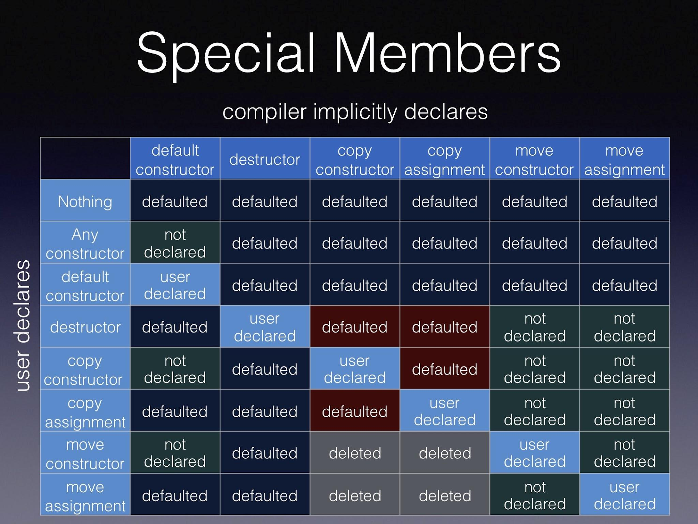
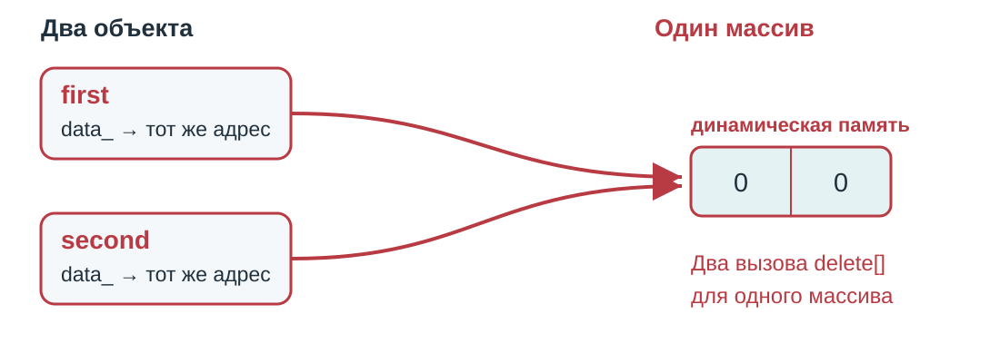
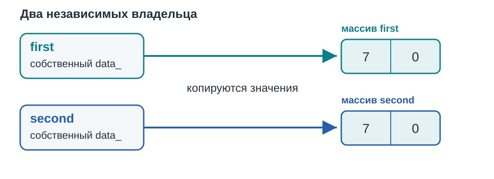

::: {.content-visible unless-format="revealjs"}

[Открыть слайды](../slides/lectures/08-oop-abstraction-encapsulation.html){.btn .btn-outline-primary target="_blank"}

:::

## План лекции

- Стек и дата: проблемы открытого состояния и инвариант
- ООП, класс, абстракция и инкапсуляция
- Конструкторы, методы, деструктор и присваивание
- `default`, `delete` и `explicit`
- Специальные функции, правила трёх, пяти и нуля

## Абстракция

**Абстракция** — придание объекту характеристик, которые чётко определяют его концептуальные границы, отличая от всех других объектов.

Основная идея — **отделить способ использования составных объектов данных от деталей их реализации** в виде более простых объектов.

Например, стек определяется операциями над вершиной и порядком LIFO.

## Задача: реализовать стек

Стек хранит элементы по правилу **LIFO**: последним добавили — первым извлекли.

| Операция | Что делает |
|---|---|
| `push(value)` | Добавляет элемент на вершину |
| `pop()` | Удаляет вершину непустого стека |
| `top()` | Возвращает вершину непустого стека |
| `empty()` | Проверяет, пуст ли стек |

## Stack. C

```{.cpp filename="plain-stack.cpp" code-line-numbers="4-7|9-12|14-17"}

```

## Stack. C

```{.cpp filename="stack-functions.cpp" code-line-numbers="20-24"}

```

[{.godbolt-link-image width="32"}][godbolt-08-stack-functions]{aria-label="Open in Compiler Explorer"}

## Stack. C

```{.cpp filename="stack-open.cpp" code-line-numbers="20-25|23|24"}

```

[{.godbolt-link-image width="32"}][godbolt-08-stack-open]{aria-label="Open in Compiler Explorer"}

## Инвариант

- Инвариант в объектно-ориентированном программировании — выражение, определяющее непротиворечивое внутреннее состояние объекта.

## Date. C

```{.cpp filename="plain-date.hpp" code-line-numbers="4-9"}

```

## Date. C

```{.cpp filename="create-date.cpp" code-line-numbers="6-9"}

```

## Date. C

```{.cpp filename="date-open.cpp" code-line-numbers="5|6-8"}

```

## Проблемы

  - Можем менять данные, которые не должны быть доступны.
  - Нарушение инварианта по отдельным данным
  - Нарушения инварианта в целом

## Класс

Класс - универсальный, комплексный тип данных, состоящий из тематически единого набора «полей» (переменных более элементарных типов) и «методов» (функций для работы с этими полями), то есть он является моделью информационной сущности с внутренним и внешним интерфейсами для оперирования своим содержимым (значениями полей).

Поля и методы класса:

- поля задают состояние объекта;
- методы определяют операции над этим состоянием;
- публичный интерфейс задаёт доступные клиенту операции.

Для стека поля хранят элементы и размер, а методы добавляют, удаляют и читают вершину.

## Инкапсуляция

**Инкапсуляция** — это фундаментальный принцип объектно-ориентированного программирования, заключающийся в объединении данных (состояния) и методов (поведения), которые с ними работают, в единую логическую единицу, (а также в скрытии внутренних деталей реализации от внешнего мира)

## Stack. C++

```{.cpp filename="stack.hpp" code-line-numbers="5-19|20-22|"}

```

## Клиент работает через публичный интерфейс

```{.cpp filename="stack-client.cpp"}

```

[{.godbolt-link-image width="32"}][godbolt-08-stack-client]{aria-label="Open in Compiler Explorer"}

## Детали реализации скрыты

```{.cpp filename="private-access-error.cpp"}

```

[{.godbolt-link-image width="32"}][godbolt-08-private-access-error]{aria-label="Open in Compiler Explorer"}

**Не компилируется:** `size_` — закрытое поле.

## Реализация скрыта и может быть различна

```{.cpp filename="stack-vector.hpp" code-line-numbers="7-9,20-21"}

```

## Один интерфейс — разные реализации

{width="1150" fig-alt="Клиент вызывает push, pop, top и empty. Внутри IntStack элементы могут храниться в массиве или std::vector."}

## Внутреняя реализация не влияет реализуемую асбтрацию

При замене массива на `std::vector` совпадения вывода одного примера недостаточно. Какие договорённости должны сохраниться?

::: {.fragment}

- `push(x)` добавляет `x` на вершину, если есть свободное место.
- `top()` читает вершину непустого стека, не меняя его.
- `pop()` удаляет только верхний элемент непустого стека.
- `empty()` сообщает, есть ли элементы; ёмкость остаётся равной 10.

:::

Представление изменилось, а смысл операций и их предусловия остались прежними.

## Модификаторы доступа

| Спецификатор | Кому доступен член класса |
|---|---|
| `public` | Внешнему коду, членам и друзьям класса |
| `private` | Членам и друзьям класса |
| `protected` | Также членам и друзьям производных классов, с ограничениями |


## Date. C++

```{.cpp filename="date.hpp" code-line-numbers="6-12|14-17"}

```

## Date. C++

```{.cpp filename="date-alternative.hpp" code-line-numbers="6-12|14-15"}

```

## Конструктор

Специальная функция-член, которая инициализирует объект и устанавливает его инвариант. Имя совпадает с именем класса.

  - default constructor
  - converting constructor
  - copy constructor
  - move constructorи


Поля инициализируются в порядке объявления в классе, до выполнения тела конструктора.

## Конструктор обеспечивает инвариант

```{.cpp filename="date-constructor.cpp" code-line-numbers="5-6|7-9"}

```

## Методы так же поддерживают инвариант

```{.cpp filename="date-set.cpp" code-line-numbers="6-8|9-12"}

```

`this` — указатель на текущий объект, `*this` — сам объект. Здесь `return *this` возвращает ссылку на него: тип результата метода — `Date&`.

## Инвариант

```{.cpp filename="date-use.cpp"}

```

## Почему не сеттер для каждого поля?

```{.cpp filename="date-setters.cpp" code-line-numbers="5-7,11-15|18-21"}

```

[{.godbolt-link-image width="32"}][godbolt-08-date-setters]{aria-label="Open in Compiler Explorer"}

::: {.fragment}
`2024-4-31` — поля закрыты, но смена месяца превратила 31 марта в несуществующее 31 апреля. Проверять нужно дату целиком.
:::

## set меняет всё или ничего

```{.cpp filename="date-transaction.cpp" code-line-numbers="6|7-11|12"}

```

[{.godbolt-link-image width="32"}][godbolt-08-date-transaction]{aria-label="Open in Compiler Explorer"}

::: {.fragment}
```text
invalid date
31.3
```

`set` сначала проверяет всю дату, затем меняет поля. При ошибке объект остаётся прежним. `catch` здесь перехватывает исключение.
:::

## Рациональное число

`Rational` представляет дробь с целым числителем и знаменателем.

Инвариант представления:

::: {.fragment}

- знаменатель положителен;
- дробь сокращена;
- ноль хранится как `0/1`.

:::

## Рациональное число: объявление конструкторов

```{.cpp filename="rational.hpp" code-line-numbers="5|6|7"}

```

## Конструктор рационального числа

```{.cpp filename="rational-constructor.cpp" code-line-numbers="4-6"}

```

## Рациональное число: конструктор копирования

```{.cpp filename="rational-copy-constructor.cpp"}

```

## Рациональное число: конструктор перемещения

```{.cpp filename="rational-move-constructor.cpp" code-line-numbers="4|5-6"}

```

## Копирование и перемещение рационального числа

```{.cpp filename="rational-constructors.cpp" code-line-numbers="6|7|8"}

```

## Методы

```{.cpp filename="rational-methods.cpp"}

```

## Константный метод

```{.cpp filename="const-method-error.cpp"}

```

[{.godbolt-link-image width="32"}][godbolt-08-const-method-error]{aria-label="Open in Compiler Explorer"}

**Не компилируется:** `numerator() const` пытается изменить поле `denominator_`.

## Деструктор

Специальная функция-член, которая выполняется при уничтожении объекта.

- Имя: `~ClassName()`.
- Нет параметров и возвращаемого типа.
- Освобождает ресурсы, которыми владеет объект.
- После тела деструктора поля уничтожаются в обратном порядке объявления.

## Деструктор освобождает память

```{.cpp filename="int-buffer.hpp" code-line-numbers="7|9-12"}

```

## Когда вызывается деструктор?

```{.cpp filename="buffer-lifetime.cpp" code-line-numbers="5-8|9"}

```

[{.godbolt-link-image width="32"}][godbolt-08-buffer-lifetime]{aria-label="Open in Compiler Explorer"}

## Копирование и присваивание

| Операция | Что происходит | Обычная сигнатура |
|---|---|---|
| `T second = first;` | Создаётся новый объект | `T(const T&)` |
| `second = first;` | Меняется существующий объект | `T& operator=(const T&)` |

Знак `=` в объявлении объекта обозначает инициализацию, а не вызов оператора присваивания.

Стандартная реализация копирует поля и базовые части. Для указателя копируется адрес, а не объект по этому адресу.

## Копирующий оператор присваивания

```{.cpp filename="rational-copy-assignment.cpp" code-line-numbers="3-6"}

```

## Передача по ссылке

:::: {.columns}
::: {.column width="48%"}
```{.cpp filename="print-rational.hpp"}

```

:::

::: {.column width="52%"}
```{.cpp filename="rational-use.cpp"}

```

:::

::::

## Нужен ли конструктор без аргументов?

| Тип | Вызов без аргументов | Состояние |
|---|---|---|
| `Rational` | Допустим: все параметры имеют значения по умолчанию | `0/1` |
| `Date` | Не допускается: нужны три аргумента | Дату выбирает клиент |

Если объявлен свой конструктор, конструктор без аргументов сам не добавляется.

Конструктор, у которого все параметры имеют значения по умолчанию, тоже называется **конструктором по умолчанию**. У нашего `Rational` он уже есть.

`= default` позволяет запросить стандартную реализацию специальной функции. Она должна подходить для инварианта класса.

## Неявный конструктор по умолчанию

```{.cpp filename="implicit-default.cpp"}

```

## Пользовательский конструктор и создание без аргументов

```{.cpp filename="missing-default-error.cpp"}

```

**Не компилируется:** пользовательский конструктор с параметрами подавляет неявное объявление конструктора по умолчанию.

## Порядок вызовов: определения классов

:::: {.columns}
::: {.column width="50%"}

```{.cpp filename="rational.hpp"}

```

:::
::: {.column width="50%"}

```{.cpp filename="geo-point.hpp"}

```

:::
::::

## Порядок вызовов: конструкторы и деструкторы

:::: {.columns}
::: {.column width="50%"}

```{.cpp filename="rational-constructors.cpp" code-line-numbers="6,10,14"}

```

:::
::: {.column width="50%"}

```{.cpp filename="geo-point-constructors.cpp" code-line-numbers="5,10,13"}

```

:::
::::

## Порядок вызовов: копирование и перемещение

:::: {.columns}
::: {.column width="50%"}

```{.cpp filename="rational-copy-move.cpp" code-line-numbers="8-9,14-15"}

```

:::
::: {.column width="50%"}

```{.cpp filename="geo-point-copy-move.cpp" code-line-numbers="7-8,13-14"}

```

:::
::::

## Порядок вызовов: присваивание

:::: {.columns}
::: {.column width="50%"}

```{.cpp filename="rational-assignment.cpp" code-line-numbers="6-7,13-14"}

```

:::
::: {.column width="50%"}

```{.cpp filename="geo-point-assignment.cpp" code-line-numbers="6-7,13-14"}

```

:::
::::

## Порядок конструирования объекта

:::: {.columns}
::: {.column width="43%"}

```{.cpp filename="construction-order.cpp" code-line-numbers="5-8"}

```

[{.godbolt-link-image width="32"}][godbolt-08-construction-order]{aria-label="Open in Compiler Explorer"}

:::
::: {.column width="57%"}

**Строка → вызов → объект**

::: {.fragment}
```text
 5  Rational default ctor    → first.latitude_
 5  Rational default ctor    → first.longitude_
 5  GeoPoint default ctor    → first
 6  Rational value ctor      → latitude
 7  Rational value ctor      → longitude
 8  Rational copy ctor       → second.latitude_
 8  Rational copy ctor       → second.longitude_
 8  GeoPoint value ctor      → second
```

::: {style="font-size: 0.75em;"}
Адреса опущены; имена объектов добавлены.
:::
:::

:::
::::

Сначала создаются поля, затем выполняется тело конструктора GeoPoint.

## Копирование и перемещение: порядок вызовов

:::: {.columns}
::: {.column width="43%"}

```{.cpp filename="construction-order.cpp" code-line-numbers="9-10"}

```

:::
::: {.column width="57%"}

**Строка → вызов → объект**

::: {.fragment}
```text
 9  Rational copy ctor       → third.latitude_
 9  Rational copy ctor       → third.longitude_
 9  GeoPoint copy ctor       → third
10  Rational move ctor       → fourth.latitude_
10  Rational move ctor       → fourth.longitude_
10  GeoPoint move ctor       → fourth
```

::: {style="font-size: 0.75em;"}
Адреса опущены; имена объектов добавлены.
:::
:::

:::
::::

Конструктор GeoPoint копирует или перемещает поля до выполнения своего тела.

## Присваивание: порядок вызовов

:::: {.columns}
::: {.column width="43%"}

```{.cpp filename="construction-order.cpp" code-line-numbers="11-12"}

```

:::
::: {.column width="57%"}

**Строка → вызов → объект**

::: {.fragment}
```text
11  GeoPoint copy assignment → first
11  Rational copy assignment → first.latitude_
11  Rational copy assignment → first.longitude_
12  GeoPoint move assignment → third
12  Rational move assignment → third.latitude_
12  Rational move assignment → third.longitude_
```

::: {style="font-size: 0.75em;"}
Адреса опущены; имена объектов добавлены.
:::
:::

:::
::::

Оператор присваивания GeoPoint вызывает операторы присваивания полей. Новые объекты не создаются.

## Уничтожение: порядок вызовов

:::: {.columns}
::: {.column width="43%"}

```{.cpp filename="construction-order.cpp" code-line-numbers="13"}

```

:::
::: {.column width="57%"}

**Строка → вызов → объект**

::: {.fragment}
```text
13  GeoPoint dtor            → fourth
13  Rational dtor            → fourth.longitude_
13  Rational dtor            → fourth.latitude_
13  GeoPoint dtor            → third
13  Rational dtor            → third.longitude_
13  Rational dtor            → third.latitude_
13  GeoPoint dtor            → second
13  Rational dtor            → second.longitude_
13  Rational dtor            → second.latitude_
13  Rational dtor            → longitude
13  Rational dtor            → latitude
13  GeoPoint dtor            → first
13  Rational dtor            → first.longitude_
13  Rational dtor            → first.latitude_
```

::: {style="font-size: 0.75em;"}
Адреса опущены; имена объектов добавлены.
:::
:::

:::
::::

Сначала выполняется тело деструктора GeoPoint, затем уничтожаются поля в обратном порядке объявления.

## = default

```{.cpp filename="defaulted-constructor.cpp" code-line-numbers="4"}

```

## = delete: запрет копирования {#copy-details}

```{.cpp filename="default-delete-error.cpp"}

```

**Не компилируется:** вызван удалённый конструктор копирования.

## NonCopyable

```{.cpp filename="non-copyable.cpp"}

```

## Неявное преобразование типов

```{.cpp filename="implicit-conversion.cpp"}

```

[{.godbolt-link-image width="32"}][godbolt-08-implicit-conversion]{aria-label="Open in Compiler Explorer"}

## explicit: создание должно быть явным

```{.cpp filename="rational.hpp" code-line-numbers="6"}

```

## Какие строки теперь нужно исправить?

```{.cpp filename="explicit-conversion-error.cpp"}

```

[{.godbolt-link-image width="32"}][godbolt-08-explicit-conversion-error]{aria-label="Open in Compiler Explorer"}

**Не компилируется:** `Rational number = 1` и `print_rational(2)` требуют неявного преобразования через `explicit`-конструктор.

## Явное создание объекта

```{.cpp filename="explicit-conversion.cpp"}

```

[{.godbolt-link-image width="32"}][godbolt-08-explicit-conversion]{aria-label="Open in Compiler Explorer"}

## Таблица специальных функций

{height="540" style="max-height: none; margin: 0;" fig-alt="Исходная таблица Howard Hinnant: правила неявного объявления специальных функций C++."}

::: {style="font-size: 0.7em;"}
В каждой строке явно объявлена только указанная функция. `= default` и `= delete` тоже считаются пользовательскими объявлениями.

© [Howard Hinnant](https://howardhinnant.github.io/classdecl.html), «Special Members». [Правила копирования](https://eel.is/c++draft/class.copy.ctor) и [присваивания](https://eel.is/c++draft/class.copy.assign).
:::

## Правило трёх (Rule of three) {#правило-трёх}

Если класс сам управляет ресурсом и ему нужна особая реализация одной из этих операций, обычно нужно согласовать все три:

- деструктор;
- конструктор копирования;
- копирующий оператор присваивания.

Можно реализовать независимое копирование ресурса или явно запретить копирование через `= delete`.

Это правило проектирования, а не автоматическое требование компилятора.

## Правило пяти (Rule of five) {#правило-пяти}

При ручном управлении ресурсом согласуем пять специальных функций:

- деструктор;
- конструктор копирования;
- копирующее присваивание;
- конструктор перемещения;
- перемещающее присваивание.

Каждую операцию можно реализовать, оставить стандартной или запретить. Правила трёх и пяти — рекомендации по проектированию, а не требования компилятора.


## ShallowArray

```{.cpp filename="shallow-array.hpp"}

```

## ShallowArray

```{.cpp filename="shallow-copy.cpp"}

```

{height=300 fig-alt="Два объекта хранят один адрес массива и оба считают себя владельцами."}

**Не запускайте:** два объекта освобождают один массив — неопределённое поведение.

## ShallowArray

```{.cpp filename="shallow-assignment.cpp"}

```

## Как должна вести себя независимая копия?

{height=280 fig-alt="Объекты first и second владеют разными массивами с одинаковыми исходными значениями."}

Копирующий конструктор создаёт отдельный массив с такими же значениями. Изменения одной копии не затрагивают другую, каждый деструктор освобождает свой массив.

При присваивании нужно также заменить прежний ресурс получателя.

## IntArray

```{.cpp filename="int-array.hpp" code-line-numbers="6-9|14-16"}

```

## IntArray

:::: {.columns}
::: {.column width="50%"}
```{.cpp filename="int-array-lifetime.cpp"}

```

:::

::: {.column width="50%"}
```{.cpp filename="int-array-access.cpp"}

```

:::

::::

## IntArray. CopyConstructor

```{.cpp filename="int-array-copy.cpp"}

```

## IntArray. operator=

```{.cpp filename="int-array-copy-assignment.cpp" code-line-numbers="4-6|7-10|11-14"}

```

## IntArray

```{.cpp filename="int-array-use.cpp"}

```

## Правило нуля (Rule of zero) {#правило-нуля}

Поручаем владение ресурсами готовым типам — например, `std::vector`.

Если стандартные операции полей сохраняют инвариант класса, собственные деструктор, копирование и перемещение не нужны.

## Правило нуля (Rule of zero): поручаем ресурс полю {#правило-нуля-поручаем-ресурс-полю}

```{.cpp filename="array-value.hpp"}

```

## Копии на основе vector независимы

```{.cpp filename="rule-zero.cpp"}

```

[{.godbolt-link-image width="32"}][godbolt-08-rule-zero]{aria-label="Open in Compiler Explorer"}

## new и delete вызывают специальные функции

:::: {.columns}
::: {.column width="50%"}

```{.cpp filename="trace.hpp" code-line-numbers="6-11"}

```

:::
::: {.column width="50%"}

```{.cpp filename="new-delete.cpp"}

```

[{.godbolt-link-image width="32"}][godbolt-08-new-delete]{aria-label="Open in Compiler Explorer"}

::: {.fragment}
```text
+ object
- object
```
:::

:::
::::

`new` и `delete` вызывают конструктор и деструктор. `std::malloc` и `std::free` только выделяют и освобождают память.

## class и struct

Оба могут иметь поля, методы, конструкторы, деструктор и модификаторы доступа.

| Доступ по умолчанию | `class` | `struct` |
|---|---|---|
| К членам | `private` | `public` |
| При наследовании | `private` | `public` |

**Семантика использования различается:**

- `struct` — простой набор данных, к полям которого обычно обращаются напрямую.
- `class` — объект с инвариантом, который поддерживают его методы.

Это соглашение о проектировании: язык позволяет использовать оба ключевых слова в обеих ролях.


[godbolt-08-stack-functions]: <https://godbolt.org/#g:!((g:!((h:codeEditor,i:(j:1,lang:c%2B%2B,options:(compileOnChange:'0'),source:'%23include+%3Ccassert%3E%0A%23include+%3Ccstddef%3E%0A%23include+%3Ciostream%3E%0A%0Astruct+Stack+%7B%0A++++int+data%5B10%5D%7B%7D%3B%0A++++std::size_t+size+%3D+0%3B%0A%7D%3B%0A%0Avoid+push(Stack%26+stack,+int+value)+%7B%0A++++assert(stack.size+%3C+10)%3B%0A++++stack.data%5Bstack.size%2B%2B%5D+%3D+value%3B%0A%7D%0A%0Aint+top(const+Stack%26+stack)+%7B%0A++++assert(stack.size+%3E+0)%3B%0A++++return+stack.data%5Bstack.size+-+1%5D%3B%0A%7D%0A%0Aint+main()+%7B%0A++++Stack+stack%3B%0A++++push(stack,+42)%3B%0A++++std::cout+%3C%3C+top(stack)+%3C%3C+!'%5Cn!'%3B%0A%7D%0A'),l:'5'),(h:executor,i:(compilationPanelShown:'0',compiler:clang2310,compilerOutShown:'0',lang:c%2B%2B,libs:!(),options:'-std%3Dc%2B%2B20+-O0+-Wall+-Wextra+-pedantic',source:1,tree:0),l:'5')),l:'2')),version:4>
<!-- godbolt source="../examples/08-oop-abstraction-encapsulation/stack-functions.cpp" compiler="clang2310" options="-std=c++20 -O0 -Wall -Wextra -pedantic" -->

[godbolt-08-stack-client]: <https://godbolt.org/#g:!((g:!((h:codeEditor,i:(j:1,lang:c%2B%2B,options:(compileOnChange:'0'),source:'%23include+%3Ccassert%3E%0A%23include+%3Ccstddef%3E%0A%0Aclass+IntStack+%7B%0Apublic:%0A++++void+push(int+value)+%7B%0A++++++++assert(size_+%3C+10)%3B%0A++++++++data_%5Bsize_%2B%2B%5D+%3D+value%3B%0A++++%7D%0A++++void+pop()+%7B%0A++++++++assert(!!empty())%3B%0A++++++++--size_%3B%0A++++%7D%0A++++int+top()+const+%7B%0A++++++++assert(!!empty())%3B%0A++++++++return+data_%5Bsize_+-+1%5D%3B%0A++++%7D%0A++++bool+empty()+const+%7B+return+size_+%3D%3D+0%3B+%7D%0Aprivate:%0A++++int+data_%5B10%5D%7B%7D%3B%0A++++std::size_t+size_+%3D+0%3B%0A%7D%3B%0A%23include+%3Ciostream%3E%0A%0Aint+main()+%7B%0A++++IntStack+stack%3B%0A++++stack.push(10)%3B%0A++++stack.push(20)%3B%0A++++std::cout+%3C%3C+stack.top()+%3C%3C+!'%5Cn!'%3B%0A++++stack.pop()%3B%0A++++std::cout+%3C%3C+stack.top()+%3C%3C+!'%5Cn!'%3B%0A%7D%0A'),l:'5'),(h:executor,i:(compilationPanelShown:'0',compiler:clang2310,compilerOutShown:'0',lang:c%2B%2B,libs:!(),options:'-std%3Dc%2B%2B20+-O0+-Wall+-Wextra+-pedantic',source:1,tree:0),l:'5')),l:'2')),version:4>
<!-- godbolt source="../examples/08-oop-abstraction-encapsulation/stack-client.cpp" compiler="clang2310" options="-std=c++20 -O0 -Wall -Wextra -pedantic" -->

[godbolt-08-private-access-error]: <https://godbolt.org/#g:!((g:!((h:codeEditor,i:(j:1,lang:c%2B%2B,options:(compileOnChange:'0'),source:'%23include+%3Ccassert%3E%0A%23include+%3Ccstddef%3E%0A%0Aclass+IntStack+%7B%0Apublic:%0A++++void+push(int+value)+%7B%0A++++++++assert(size_+%3C+10)%3B%0A++++++++data_%5Bsize_%2B%2B%5D+%3D+value%3B%0A++++%7D%0A++++void+pop()+%7B%0A++++++++assert(!!empty())%3B%0A++++++++--size_%3B%0A++++%7D%0A++++int+top()+const+%7B%0A++++++++assert(!!empty())%3B%0A++++++++return+data_%5Bsize_+-+1%5D%3B%0A++++%7D%0A++++bool+empty()+const+%7B+return+size_+%3D%3D+0%3B+%7D%0Aprivate:%0A++++int+data_%5B10%5D%7B%7D%3B%0A++++std::size_t+size_+%3D+0%3B%0A%7D%3B%0A%0Aint+main()+%7B%0A++++IntStack+stack%3B%0A++++stack.size_+%3D+100500%3B%0A%7D%0A'),l:'5'),(h:compiler,i:(compiler:clang2310,filters:(binary:'1',binaryObject:'1',execute:'1'),j:1,lang:c%2B%2B,libs:!(),options:'-std%3Dc%2B%2B20+-O0+-Wall+-Wextra+-pedantic',source:1,tree:0),l:'5')),l:'2')),version:4>
<!-- godbolt source="../examples/08-oop-abstraction-encapsulation/private-access-error.cpp" compiler="clang2310" options="-std=c++20 -O0 -Wall -Wextra -pedantic" mode="compiler" -->

[godbolt-08-implicit-conversion]: <https://godbolt.org/#g:!((g:!((h:codeEditor,i:(j:1,lang:c%2B%2B,options:(compileOnChange:'0'),source:'%23include+%3Climits%3E%0A%23include+%3Cnumeric%3E%0A%23include+%3Cstdexcept%3E%0Astatic_assert(std::numeric_limits%3Cint%3E::digits+%3C+std::numeric_limits%3Clong+long%3E::digits)%3B%0A%0Ainline+void+normalize_rational(int%26+numerator,+int%26+denominator)+%7B%0A++++if+(denominator+%3D%3D+0)+%7B%0A++++++++throw+std::invalid_argument(%22denominator+must+be+nonzero%22)%3B%0A++++%7D%0A++++long+long+n+%3D+numerator,+d+%3D+denominator%3B%0A++++const+auto+divisor+%3D+std::gcd(n,+d)%3B%0A++++n+/%3D+divisor%3B%0A++++d+/%3D+divisor%3B%0A++++if+(d+%3C+0)+%7B%0A++++++++n+%3D+-n%3B%0A++++++++d+%3D+-d%3B%0A++++%7D%0A++++if+(n+%3C+std::numeric_limits%3Cint%3E::min()+%7C%7C+n+%3E+std::numeric_limits%3Cint%3E::max()%0A++++++++%7C%7C+d+%3E+std::numeric_limits%3Cint%3E::max())+%7B%0A++++++++throw+std::overflow_error(%22normalized+rational+does+not+fit+in+int%22)%3B%0A++++%7D%0A++++numerator+%3D+static_cast%3Cint%3E(n)%3B%0A++++denominator+%3D+static_cast%3Cint%3E(d)%3B%0A%7D%0A%0Aclass+Rational+%7B%0Apublic:%0A++++Rational(int+numerator+%3D+0,+int+denominator+%3D+1)%0A++++++++:+numerator_(numerator),+denominator_(denominator)+%7B%0A++++++++normalize_rational(numerator_,+denominator_)%3B%0A++++%7D%0A%0A++++int+numerator()+const+%7B+return+numerator_%3B+%7D%0A++++int+denominator()+const+%7B+return+denominator_%3B+%7D%0A%0Aprivate:%0A++++int+numerator_%3B%0A++++int+denominator_%3B%0A%7D%3B%0A%23include+%3Ciostream%3E%0A%0Avoid+print_rational(const+Rational%26+number)+%7B%0A++++std::cout+%3C%3C+number.numerator()+%3C%3C+!'/!'+%3C%3C+number.denominator()+%3C%3C+!'%5Cn!'%3B%0A%7D%0A%0Aint+main()+%7B%0A++++Rational+number+%3D+1%3B%0A++++print_rational(number)%3B%0A++++print_rational(2)%3B%0A%7D%0A'),l:'5'),(h:executor,i:(compilationPanelShown:'0',compiler:clang2310,compilerOutShown:'0',lang:c%2B%2B,libs:!(),options:'-std%3Dc%2B%2B20+-O0+-Wall+-Wextra+-pedantic',source:1,tree:0),l:'5')),l:'2')),version:4>
<!-- godbolt source="../examples/08-oop-abstraction-encapsulation/implicit-conversion.cpp" compiler="clang2310" options="-std=c++20 -O0 -Wall -Wextra -pedantic" -->

[godbolt-08-explicit-conversion-error]: <https://godbolt.org/#g:!((g:!((h:codeEditor,i:(j:1,lang:c%2B%2B,options:(compileOnChange:'0'),source:'%23include+%3Climits%3E%0A%23include+%3Cnumeric%3E%0A%23include+%3Cstdexcept%3E%0Astatic_assert(std::numeric_limits%3Cint%3E::digits+%3C+std::numeric_limits%3Clong+long%3E::digits)%3B%0A%0Ainline+void+normalize_rational(int%26+numerator,+int%26+denominator)+%7B%0A++++if+(denominator+%3D%3D+0)+%7B%0A++++++++throw+std::invalid_argument(%22denominator+must+be+nonzero%22)%3B%0A++++%7D%0A++++long+long+n+%3D+numerator,+d+%3D+denominator%3B%0A++++const+auto+divisor+%3D+std::gcd(n,+d)%3B%0A++++n+/%3D+divisor%3B%0A++++d+/%3D+divisor%3B%0A++++if+(d+%3C+0)+%7B%0A++++++++n+%3D+-n%3B%0A++++++++d+%3D+-d%3B%0A++++%7D%0A++++if+(n+%3C+std::numeric_limits%3Cint%3E::min()+%7C%7C+n+%3E+std::numeric_limits%3Cint%3E::max()%0A++++++++%7C%7C+d+%3E+std::numeric_limits%3Cint%3E::max())+%7B%0A++++++++throw+std::overflow_error(%22normalized+rational+does+not+fit+in+int%22)%3B%0A++++%7D%0A++++numerator+%3D+static_cast%3Cint%3E(n)%3B%0A++++denominator+%3D+static_cast%3Cint%3E(d)%3B%0A%7D%0A%0Aclass+Rational+%7B%0Apublic:%0A++++explicit+Rational(int+numerator+%3D+0,+int+denominator+%3D+1)%0A++++++++:+numerator_(numerator),+denominator_(denominator)+%7B%0A++++++++normalize_rational(numerator_,+denominator_)%3B%0A++++%7D%0A%0A++++int+numerator()+const+%7B+return+numerator_%3B+%7D%0A++++int+denominator()+const+%7B+return+denominator_%3B+%7D%0A%0Aprivate:%0A++++int+numerator_%3B%0A++++int+denominator_%3B%0A%7D%3B%0A%23include+%3Ciostream%3E%0A%0Ainline+void+print_rational(const+Rational%26+number)+%7B%0A++++std::cout+%3C%3C+number.numerator()+%3C%3C+!'/!'+%3C%3C+number.denominator()+%3C%3C+!'%5Cn!'%3B%0A%7D%0A%0Aint+main()+%7B%0A++++Rational+number+%3D+1%3B%0A++++print_rational(number)%3B%0A++++print_rational(2)%3B%0A%7D%0A'),l:'5'),(h:compiler,i:(compiler:clang2310,filters:(binary:'1',binaryObject:'1',execute:'1'),j:1,lang:c%2B%2B,libs:!(),options:'-std%3Dc%2B%2B20+-O0+-Wall+-Wextra+-pedantic',source:1,tree:0),l:'5')),l:'2')),version:4>
<!-- godbolt source="../examples/08-oop-abstraction-encapsulation/explicit-conversion-error.cpp" compiler="clang2310" options="-std=c++20 -O0 -Wall -Wextra -pedantic" mode="compiler" -->

[godbolt-08-explicit-conversion]: <https://godbolt.org/#g:!((g:!((h:codeEditor,i:(j:1,lang:c%2B%2B,options:(compileOnChange:'0'),source:'%23include+%3Climits%3E%0A%23include+%3Cnumeric%3E%0A%23include+%3Cstdexcept%3E%0Astatic_assert(std::numeric_limits%3Cint%3E::digits+%3C+std::numeric_limits%3Clong+long%3E::digits)%3B%0A%0Ainline+void+normalize_rational(int%26+numerator,+int%26+denominator)+%7B%0A++++if+(denominator+%3D%3D+0)+%7B%0A++++++++throw+std::invalid_argument(%22denominator+must+be+nonzero%22)%3B%0A++++%7D%0A++++long+long+n+%3D+numerator,+d+%3D+denominator%3B%0A++++const+auto+divisor+%3D+std::gcd(n,+d)%3B%0A++++n+/%3D+divisor%3B%0A++++d+/%3D+divisor%3B%0A++++if+(d+%3C+0)+%7B%0A++++++++n+%3D+-n%3B%0A++++++++d+%3D+-d%3B%0A++++%7D%0A++++if+(n+%3C+std::numeric_limits%3Cint%3E::min()+%7C%7C+n+%3E+std::numeric_limits%3Cint%3E::max()%0A++++++++%7C%7C+d+%3E+std::numeric_limits%3Cint%3E::max())+%7B%0A++++++++throw+std::overflow_error(%22normalized+rational+does+not+fit+in+int%22)%3B%0A++++%7D%0A++++numerator+%3D+static_cast%3Cint%3E(n)%3B%0A++++denominator+%3D+static_cast%3Cint%3E(d)%3B%0A%7D%0A%0Aclass+Rational+%7B%0Apublic:%0A++++explicit+Rational(int+numerator+%3D+0,+int+denominator+%3D+1)%0A++++++++:+numerator_(numerator),+denominator_(denominator)+%7B%0A++++++++normalize_rational(numerator_,+denominator_)%3B%0A++++%7D%0A%0A++++int+numerator()+const+%7B+return+numerator_%3B+%7D%0A++++int+denominator()+const+%7B+return+denominator_%3B+%7D%0A%0Aprivate:%0A++++int+numerator_%3B%0A++++int+denominator_%3B%0A%7D%3B%0A%23include+%3Ciostream%3E%0A%0Ainline+void+print_rational(const+Rational%26+number)+%7B%0A++++std::cout+%3C%3C+number.numerator()+%3C%3C+!'/!'+%3C%3C+number.denominator()+%3C%3C+!'%5Cn!'%3B%0A%7D%0A%0Aint+main()+%7B%0A++++Rational+number%7B1%7D%3B%0A++++print_rational(number)%3B%0A++++print_rational(Rational%7B2%7D)%3B%0A%7D%0A'),l:'5'),(h:executor,i:(compilationPanelShown:'0',compiler:clang2310,compilerOutShown:'0',lang:c%2B%2B,libs:!(),options:'-std%3Dc%2B%2B20+-O0+-Wall+-Wextra+-pedantic',source:1,tree:0),l:'5')),l:'2')),version:4>
<!-- godbolt source="../examples/08-oop-abstraction-encapsulation/explicit-conversion.cpp" compiler="clang2310" options="-std=c++20 -O0 -Wall -Wextra -pedantic" -->

[godbolt-08-const-method-error]: <https://godbolt.org/#g:!((g:!((h:codeEditor,i:(j:1,lang:c%2B%2B,options:(compileOnChange:'0'),source:'class+Rational+%7B%0Apublic:%0A++++int+numerator()+const+%7B%0A++++++++denominator_+%3D+1%3B%0A++++++++return+numerator_%3B%0A++++%7D%0A%0Aprivate:%0A++++int+numerator_+%3D+1%3B%0A++++int+denominator_+%3D+2%3B%0A%7D%3B%0A%0Aint+main()+%7B%0A++++const+Rational+number%3B%0A++++return+number.numerator()%3B%0A%7D%0A'),l:'5'),(h:compiler,i:(compiler:clang2310,filters:(binary:'1',binaryObject:'1',execute:'1'),j:1,lang:c%2B%2B,libs:!(),options:'-std%3Dc%2B%2B20+-O0+-Wall+-Wextra+-pedantic',source:1,tree:0),l:'5')),l:'2')),version:4>
<!-- godbolt source="../examples/08-oop-abstraction-encapsulation/const-method-error.cpp" compiler="clang2310" options="-std=c++20 -O0 -Wall -Wextra -pedantic" mode="compiler" -->

[godbolt-08-construction-order]: <https://godbolt.org/#g:!((g:!((h:codeEditor,i:(j:1,lang:c%2B%2B,options:(compileOnChange:'0'),source:'%0Aclass+Rational+%7B%0Apublic:%0A++++Rational()%3B%0A++++Rational(int+numerator,+int+denominator+%3D+1)%3B%0A++++Rational(const+Rational%26+other)%3B%0A++++Rational(Rational%26%26+other)+noexcept%3B%0A++++~Rational()%3B%0A++++Rational%26+operator%3D(const+Rational%26+other)%3B%0A++++Rational%26+operator%3D(Rational%26%26+other)+noexcept%3B%0A++++int+numerator()+const+%7B+return+numerator_%3B+%7D%0A++++int+denominator()+const+%7B+return+denominator_%3B+%7D%0A%0Aprivate:%0A++++int+numerator_%3B%0A++++int+denominator_%3B%0A%7D%3B%0A%0Aclass+GeoPoint+%7B%0Apublic:%0A++++GeoPoint()%3B%0A++++GeoPoint(const+Rational%26+lat,+const+Rational%26+lon)%3B%0A++++GeoPoint(const+GeoPoint%26+other)%3B%0A++++GeoPoint(GeoPoint%26%26+other)+noexcept%3B%0A++++~GeoPoint()%3B%0A++++GeoPoint%26+operator%3D(const+GeoPoint%26+other)%3B%0A++++GeoPoint%26+operator%3D(GeoPoint%26%26+other)+noexcept%3B%0A++++const+Rational%26+latitude()+const+%7B+return+latitude_%3B+%7D%0A++++const+Rational%26+longitude()+const+%7B+return+longitude_%3B+%7D%0A%0Aprivate:%0A++++Rational+latitude_%3B%0A++++Rational+longitude_%3B%0A%7D%3B%0A%23include+%3Cutility%3E%0A%0Aint+main()+%7B%0A++++GeoPoint+first%3B%0A++++const+Rational+latitude%7B1,+2%7D%3B%0A++++const+Rational+longitude%7B3,+4%7D%3B%0A++++GeoPoint+second%7Blatitude,+longitude%7D%3B%0A++++GeoPoint+third%7Bsecond%7D%3B%0A++++GeoPoint+fourth%7Bstd::move(second)%7D%3B%0A++++first+%3D+third%3B%0A++++third+%3D+std::move(fourth)%3B%0A%7D%0A%0A%0A%23include+%3Climits%3E%0A%23include+%3Cnumeric%3E%0A%23include+%3Cstdexcept%3E%0Astatic_assert(std::numeric_limits%3Cint%3E::digits+%3C+std::numeric_limits%3Clong+long%3E::digits)%3B%0A%0Ainline+void+normalize_rational(int%26+numerator,+int%26+denominator)+%7B%0A++++if+(denominator+%3D%3D+0)+%7B%0A++++++++throw+std::invalid_argument(%22denominator+must+be+nonzero%22)%3B%0A++++%7D%0A++++long+long+n+%3D+numerator,+d+%3D+denominator%3B%0A++++const+auto+divisor+%3D+std::gcd(n,+d)%3B%0A++++n+/%3D+divisor%3B%0A++++d+/%3D+divisor%3B%0A++++if+(d+%3C+0)+%7B%0A++++++++n+%3D+-n%3B%0A++++++++d+%3D+-d%3B%0A++++%7D%0A++++if+(n+%3C+std::numeric_limits%3Cint%3E::min()+%7C%7C+n+%3E+std::numeric_limits%3Cint%3E::max()%0A++++++++%7C%7C+d+%3E+std::numeric_limits%3Cint%3E::max())+%7B%0A++++++++throw+std::overflow_error(%22normalized+rational+does+not+fit+in+int%22)%3B%0A++++%7D%0A++++numerator+%3D+static_cast%3Cint%3E(n)%3B%0A++++denominator+%3D+static_cast%3Cint%3E(d)%3B%0A%7D%0A%23include+%3Ciostream%3E%0A%0ARational::Rational()+:+numerator_(0),+denominator_(1)+%7B%0A++++std::cout+%3C%3C+%22Rational+default+ctor:+%22+%3C%3C+this+%3C%3C+!'%5Cn!'%3B%0A%7D%0ARational::Rational(int+numerator,+int+denominator)%0A++++:+numerator_(numerator),+denominator_(denominator)+%7B%0A++++std::cout+%3C%3C+%22Rational+value+ctor:+%22+%3C%3C+this+%3C%3C+!'%5Cn!'%3B%0A++++normalize_rational(numerator_,+denominator_)%3B%0A%7D%0ARational::~Rational()+%7B%0A++++std::cout+%3C%3C+%22Rational+dtor:+%22+%3C%3C+this+%3C%3C+!'%5Cn!'%3B%0A%7D%0A%0A%0A%23include+%3Ciostream%3E%0A%23include+%3Cutility%3E%0A%0ARational::Rational(const+Rational%26+other)%0A++++:+numerator_(other.numerator_),%0A++++++denominator_(other.denominator_)+%7B%0A++++std::cout+%3C%3C+%22Rational+copy+ctor:+%22+%3C%3C+this%0A++++++++++++++%3C%3C+%22+%3C-+%22+%3C%3C+%26other+%3C%3C+!'%5Cn!'%3B%0A%7D%0ARational::Rational(Rational%26%26+other)+noexcept%0A++++:+numerator_(std::exchange(other.numerator_,+0)),%0A++++++denominator_(std::exchange(other.denominator_,+1))+%7B%0A++++std::cout+%3C%3C+%22Rational+move+ctor:+%22+%3C%3C+this%0A++++++++++++++%3C%3C+%22+%3C-+%22+%3C%3C+%26other+%3C%3C+!'%5Cn!'%3B%0A%7D%0A%0A%0A%23include+%3Ciostream%3E%0A%23include+%3Cutility%3E%0A%0ARational%26+Rational::operator%3D(const+Rational%26+other)+%7B%0A++++std::cout+%3C%3C+%22Rational+copy+assignment:+%22+%3C%3C+this%0A++++++++++++++%3C%3C+%22+%3C-+%22+%3C%3C+%26other+%3C%3C+!'%5Cn!'%3B%0A++++numerator_+%3D+other.numerator_%3B%0A++++denominator_+%3D+other.denominator_%3B%0A++++return+*this%3B%0A%7D%0ARational%26+Rational::operator%3D(Rational%26%26+other)+noexcept+%7B%0A++++std::cout+%3C%3C+%22Rational+move+assignment:+%22+%3C%3C+this%0A++++++++++++++%3C%3C+%22+%3C-+%22+%3C%3C+%26other+%3C%3C+!'%5Cn!'%3B%0A++++if+(this+!!%3D+%26other)+%7B%0A++++++++numerator_+%3D+std::exchange(other.numerator_,+0)%3B%0A++++++++denominator_+%3D+std::exchange(other.denominator_,+1)%3B%0A++++%7D%0A++++return+*this%3B%0A%7D%0A%0A%0A%23include+%3Ciostream%3E%0A%0AGeoPoint::GeoPoint()+%7B%0A++++std::cout+%3C%3C+%22GeoPoint+default+ctor:+%22+%3C%3C+this+%3C%3C+!'%5Cn!'%3B%0A%7D%0AGeoPoint::GeoPoint(const+Rational%26+lat,%0A+++++++++++++++++++++++++const+Rational%26+lon)%0A++++:+latitude_(lat),+longitude_(lon)+%7B%0A++++std::cout+%3C%3C+%22GeoPoint+value+ctor:+%22+%3C%3C+this+%3C%3C+!'%5Cn!'%3B%0A%7D%0AGeoPoint::~GeoPoint()+%7B%0A++++std::cout+%3C%3C+%22GeoPoint+dtor:+%22+%3C%3C+this+%3C%3C+!'%5Cn!'%3B%0A%7D%0A%0A%0A%23include+%3Ciostream%3E%0A%23include+%3Cutility%3E%0A%0AGeoPoint::GeoPoint(const+GeoPoint%26+other)%0A++++:+latitude_(other.latitude_),+longitude_(other.longitude_)+%7B%0A++++std::cout+%3C%3C+%22GeoPoint+copy+ctor:+%22+%3C%3C+this%0A++++++++++++++%3C%3C+%22+%3C-+%22+%3C%3C+%26other+%3C%3C+!'%5Cn!'%3B%0A%7D%0AGeoPoint::GeoPoint(GeoPoint%26%26+other)+noexcept%0A++++:+latitude_(std::move(other.latitude_)),%0A++++++longitude_(std::move(other.longitude_))+%7B%0A++++std::cout+%3C%3C+%22GeoPoint+move+ctor:+%22+%3C%3C+this%0A++++++++++++++%3C%3C+%22+%3C-+%22+%3C%3C+%26other+%3C%3C+!'%5Cn!'%3B%0A%7D%0A%0A%0A%23include+%3Ciostream%3E%0A%23include+%3Cutility%3E%0A%0AGeoPoint%26+GeoPoint::operator%3D(const+GeoPoint%26+other)+%7B%0A++++std::cout+%3C%3C+%22GeoPoint+copy+assignment:+%22+%3C%3C+this%0A++++++++++++++%3C%3C+%22+%3C-+%22+%3C%3C+%26other+%3C%3C+!'%5Cn!'%3B%0A++++latitude_+%3D+other.latitude_%3B%0A++++longitude_+%3D+other.longitude_%3B%0A++++return+*this%3B%0A%7D%0AGeoPoint%26+GeoPoint::operator%3D(GeoPoint%26%26+other)+noexcept+%7B%0A++++std::cout+%3C%3C+%22GeoPoint+move+assignment:+%22+%3C%3C+this%0A++++++++++++++%3C%3C+%22+%3C-+%22+%3C%3C+%26other+%3C%3C+!'%5Cn!'%3B%0A++++latitude_+%3D+std::move(other.latitude_)%3B%0A++++longitude_+%3D+std::move(other.longitude_)%3B%0A++++return+*this%3B%0A%7D%0A'),l:'5'),(h:executor,i:(compilationPanelShown:'0',compiler:clang2310,compilerOutShown:'0',lang:c%2B%2B,libs:!(),options:'-std%3Dc%2B%2B20+-O0+-Wall+-Wextra+-pedantic',source:1,tree:0),l:'5')),l:'2')),version:4>
<!-- godbolt source="../examples/08-oop-abstraction-encapsulation/construction-order.cpp" compiler="clang2310" options="-std=c++20 -O0 -Wall -Wextra -pedantic" extra-sources="../examples/08-oop-abstraction-encapsulation/lifetime/rational-constructors.cpp ../examples/08-oop-abstraction-encapsulation/lifetime/rational-copy-move.cpp ../examples/08-oop-abstraction-encapsulation/lifetime/rational-assignment.cpp ../examples/08-oop-abstraction-encapsulation/lifetime/geo-point-constructors.cpp ../examples/08-oop-abstraction-encapsulation/lifetime/geo-point-copy-move.cpp ../examples/08-oop-abstraction-encapsulation/lifetime/geo-point-assignment.cpp" -->

[godbolt-08-rule-zero]: <https://godbolt.org/#g:!((g:!((h:codeEditor,i:(j:1,lang:c%2B%2B,options:(compileOnChange:'0'),source:'%23include+%3Ccassert%3E%0A%23include+%3Ccstddef%3E%0A%23include+%3Cvector%3E%0A%0Aclass+IntArray+%7B%0Apublic:%0A++++explicit+IntArray(std::size_t+size)+:+data_(size)+%7B%0A++++%7D%0A++++std::size_t+size()+const+%7B+return+data_.size()%3B+%7D%0A++++int%26+at(std::size_t+index)+%7B%0A++++++++assert(index+%3C+size())%3B%0A++++++++return+data_%5Bindex%5D%3B%0A++++%7D%0A%0Aprivate:%0A++++std::vector%3Cint%3E+data_%3B%0A%7D%3B%0A%23include+%3Ciostream%3E%0A%0Aint+main()+%7B%0A++++IntArray+first(2)%3B%0A++++first.at(0)+%3D+7%3B%0A++++IntArray+second+%3D+first%3B%0A++++second.at(0)+%3D+9%3B%0A++++std::cout+%3C%3C+first.at(0)+%3C%3C+!'+!'+%3C%3C+second.at(0)+%3C%3C+!'%5Cn!'%3B%0A%7D%0A'),l:'5'),(h:executor,i:(compilationPanelShown:'0',compiler:clang2310,compilerOutShown:'0',lang:c%2B%2B,libs:!(),options:'-std%3Dc%2B%2B20+-O0+-Wall+-Wextra+-pedantic',source:1,tree:0),l:'5')),l:'2')),version:4>
<!-- godbolt source="../examples/08-oop-abstraction-encapsulation/rule-zero.cpp" compiler="clang2310" options="-std=c++20 -O0 -Wall -Wextra -pedantic" -->

[godbolt-08-date-setters]: <https://godbolt.org/#g:!((g:!((h:codeEditor,i:(j:1,lang:c%2B%2B,options:(compileOnChange:'0'),source:'%23include+%3Ciostream%3E%0A%0Aclass+Date+%7B%0Apublic:%0A++++void+set_year(int+year)+%7B+year_+%3D+year%3B+%7D%0A++++void+set_month(unsigned+month)+%7B+month_+%3D+month%3B+%7D%0A++++void+set_day(unsigned+day)+%7B+day_+%3D+day%3B+%7D%0A++++int+year()+const+%7B+return+year_%3B+%7D%0A++++unsigned+month()+const+%7B+return+month_%3B+%7D%0A++++unsigned+day()+const+%7B+return+day_%3B+%7D%0Aprivate:%0A++++int+year_+%3D+2024%3B%0A++++unsigned+month_+%3D+3%3B%0A++++unsigned+day_+%3D+31%3B%0A%7D%3B%0A%0Aint+main()+%7B%0A++++Date+date%3B%0A++++date.set_month(4)%3B%0A++++std::cout+%3C%3C+date.year()+%3C%3C+!'-!'+%3C%3C+date.month()+%3C%3C+!'-!'+%3C%3C+date.day()+%3C%3C+!'%5Cn!'%3B%0A%7D%0A'),l:'5'),(h:executor,i:(compilationPanelShown:'0',compiler:clang2310,compilerOutShown:'0',lang:c%2B%2B,libs:!(),options:'-std%3Dc%2B%2B20+-O0+-Wall+-Wextra+-pedantic',source:1,tree:0),l:'5')),l:'2')),version:4>
<!-- godbolt source="../examples/08-oop-abstraction-encapsulation/date-setters.cpp" compiler="clang2310" options="-std=c++20 -O0 -Wall -Wextra -pedantic" -->

[godbolt-08-date-transaction]: <https://godbolt.org/#g:!((g:!((h:codeEditor,i:(j:1,lang:c%2B%2B,options:(compileOnChange:'0'),source:'%23include+%3Ccstdint%3E%0A%0Aclass+Date+%7B%0Apublic:%0A++++Date(int+year,+unsigned+month,+unsigned+day)%3B%0A++++Date%26+set(int+year,+unsigned+month,+unsigned+day)%3B%0A%0A++++int+year()+const%3B%0A++++unsigned+month()+const%3B%0A++++unsigned+day()+const%3B%0A++++std::int64_t+timestamp()+const%3B%0A%0Aprivate:%0A++++int+year_%3B%0A++++unsigned+month_%3B%0A++++unsigned+day_%3B%0A%7D%3B%0A%23include+%3Ciostream%3E%0A%23include+%3Cstdexcept%3E%0A%0Aint+main()+%7B%0A++++Date+date%7B2024,+3,+31%7D%3B%0A++++try+%7B%0A++++++++date.set(2024,+4,+31)%3B%0A++++%7D+catch+(const+std::invalid_argument%26)+%7B%0A++++++++std::cout+%3C%3C+%22invalid+date%5Cn%22%3B%0A++++%7D%0A++++std::cout+%3C%3C+date.day()+%3C%3C+!'.!'+%3C%3C+date.month()+%3C%3C+!'%5Cn!'%3B%0A%7D%0A%0A%0A%0Ainline+bool+valid_date(int+year,+unsigned+month,+unsigned+day)+%7B%0A++++if+(year+%3C+1+%7C%7C+year+%3E+9999+%7C%7C+month+%3C+1+%7C%7C+month+%3E+12+%7C%7C+day+%3C+1)+%7B%0A++++++++return+false%3B%0A++++%7D%0A++++const+unsigned+days%5B%5D+%3D+%7B31,+28,+31,+30,+31,+30,+31,+31,+30,+31,+30,+31%7D%3B%0A++++unsigned+limit+%3D+days%5Bmonth+-+1%5D%3B%0A++++const+bool+leap+%3D+year+%25+4+%3D%3D+0+%26%26+(year+%25+100+!!%3D+0+%7C%7C+year+%25+400+%3D%3D+0)%3B%0A++++if+(month+%3D%3D+2+%26%26+leap)+%7B%0A++++++++%2B%2Blimit%3B%0A++++%7D%0A++++return+day+%3C%3D+limit%3B%0A%7D%0A%23include+%3Cstdexcept%3E%0A%0ADate::Date(int+year,+unsigned+month,+unsigned+day)%0A++++:+year_(year),+month_(month),+day_(day)+%7B%0A++++if+(!!valid_date(year_,+month_,+day_))+%7B%0A++++++++throw+std::invalid_argument(%22invalid+date%22)%3B%0A++++%7D%0A%7D%0A%0A%0A%0A%23include+%3Cstdexcept%3E%0A%0ADate%26+Date::set(int+year,+unsigned+month,+unsigned+day)+%7B%0A++++if+(!!valid_date(year,+month,+day))+%7B%0A++++++++throw+std::invalid_argument(%22invalid+date%22)%3B%0A++++%7D%0A++++year_+%3D+year%3B%0A++++month_+%3D+month%3B%0A++++day_+%3D+day%3B%0A++++return+*this%3B%0A%7D%0A%0A%0A%23include+%3Ccstdint%3E%0A%0Astruct+CalendarDate+%7B%0A++++int+year%3B%0A++++unsigned+month%3B%0A++++unsigned+day%3B%0A%7D%3B%0A%0Astd::int64_t+to_timestamp(int+year,+unsigned+month,+unsigned+day)%3B%0ACalendarDate+from_timestamp(std::int64_t+timestamp)%3B%0A%0Aint+Date::year()+const+%7B%0A++++return+year_%3B%0A%7D%0A%0Aunsigned+Date::month()+const+%7B%0A++++return+month_%3B%0A%7D%0A%0Aunsigned+Date::day()+const+%7B%0A++++return+day_%3B%0A%7D%0A%0Astd::int64_t+Date::timestamp()+const+%7B%0A++++return+to_timestamp(year_,+month_,+day_)%3B%0A%7D%0A%0A%0A%0A%23include+%3Cchrono%3E%0A%23include+%3Cstdexcept%3E%0A%0Astd::int64_t+to_timestamp(int+year,+unsigned+month,+unsigned+day)+%7B%0A++++if+(!!valid_date(year,+month,+day))+%7B%0A++++++++throw+std::invalid_argument(%22invalid+date%22)%3B%0A++++%7D%0A++++const+auto+date+%3D+std::chrono::year%7Byear%7D+/+month+/+day%3B%0A++++const+auto+days+%3D+std::chrono::sys_days%7Bdate%7D.time_since_epoch()%3B%0A++++return+std::chrono::duration_cast%3Cstd::chrono::seconds%3E(days).count()%3B%0A%7D%0A'),l:'5'),(h:executor,i:(compilationPanelShown:'0',compiler:clang2310,compilerOutShown:'0',lang:c%2B%2B,libs:!(),options:'-std%3Dc%2B%2B20+-O0+-Wall+-Wextra+-pedantic',source:1,tree:0),l:'5')),l:'2')),version:4>
<!-- godbolt source="../examples/08-oop-abstraction-encapsulation/date-transaction.cpp" compiler="clang2310" options="-std=c++20 -O0 -Wall -Wextra -pedantic" extra-sources="../examples/08-oop-abstraction-encapsulation/date-constructor.cpp ../examples/08-oop-abstraction-encapsulation/date-set.cpp ../examples/08-oop-abstraction-encapsulation/date-access.cpp ../examples/08-oop-abstraction-encapsulation/date-to-timestamp.cpp" -->

[godbolt-08-new-delete]: <https://godbolt.org/#g:!((g:!((h:codeEditor,i:(j:1,lang:c%2B%2B,options:(compileOnChange:'0'),source:'%23include+%3Ciostream%3E%0A%0Aclass+Trace+%7B%0Apublic:%0A++++explicit+Trace(const+char*+name)+:+name_(name)+%7B%0A++++++++std::cout+%3C%3C+%22%2B+%22+%3C%3C+name_+%3C%3C+!'%5Cn!'%3B%0A++++%7D%0A++++~Trace()+%7B%0A++++++++std::cout+%3C%3C+%22-+%22+%3C%3C+name_+%3C%3C+!'%5Cn!'%3B%0A++++%7D%0A%0Aprivate:%0A++++const+char*+name_%3B%0A%7D%3B%0A%23include+%3Ccstdlib%3E%0A%0Aint+main()+%7B%0A++++Trace*+object+%3D+new+Trace%7B%22object%22%7D%3B%0A++++delete+object%3B%0A%0A++++void*+memory+%3D+std::malloc(sizeof(Trace))%3B%0A++++std::free(memory)%3B%0A%7D%0A'),l:'5'),(h:executor,i:(compilationPanelShown:'0',compiler:clang2310,compilerOutShown:'0',lang:c%2B%2B,libs:!(),options:'-std%3Dc%2B%2B20+-O0+-Wall+-Wextra+-pedantic',source:1,tree:0),l:'5')),l:'2')),version:4>
<!-- godbolt source="../examples/08-oop-abstraction-encapsulation/new-delete.cpp" compiler="clang2310" options="-std=c++20 -O0 -Wall -Wextra -pedantic" -->

[godbolt-08-stack-open]: <https://godbolt.org/#g:!((g:!((h:codeEditor,i:(j:1,lang:c%2B%2B,options:(compileOnChange:'0'),source:'%23include+%3Ccassert%3E%0A%23include+%3Ccstddef%3E%0A%23include+%3Ciostream%3E%0A%0Astruct+Stack+%7B%0A++++int+data%5B10%5D%7B%7D%3B%0A++++std::size_t+size+%3D+0%3B%0A%7D%3B%0A%0Avoid+push(Stack%26+stack,+int+value)+%7B%0A++++assert(stack.size+%3C+10)%3B%0A++++stack.data%5Bstack.size%2B%2B%5D+%3D+value%3B%0A%7D%0A%0Aint+top(const+Stack%26+stack)+%7B%0A++++assert(stack.size+%3E+0)%3B%0A++++return+stack.data%5Bstack.size+-+1%5D%3B%0A%7D%0A%0Aint+main()+%7B%0A++++Stack+stack%3B%0A++++push(stack,+42)%3B%0A++++stack.size+%3D+100500%3B%0A++++std::cout+%3C%3C+stack.size+%3C%3C+!'%5Cn!'%3B%0A%7D%0A'),l:'5'),(h:executor,i:(compilationPanelShown:'0',compiler:clang2310,compilerOutShown:'0',lang:c%2B%2B,libs:!(),options:'-std%3Dc%2B%2B20+-O0+-Wall+-Wextra+-pedantic',source:1,tree:0),l:'5')),l:'2')),version:4>
<!-- godbolt source="../examples/08-oop-abstraction-encapsulation/stack-open.cpp" compiler="clang2310" options="-std=c++20 -O0 -Wall -Wextra -pedantic" -->

[godbolt-08-buffer-lifetime]: <https://godbolt.org/#g:!((g:!((h:codeEditor,i:(j:1,lang:c%2B%2B,options:(compileOnChange:'0'),source:'%23include+%3Ccstddef%3E%0A%23include+%3Ciostream%3E%0A%0Aclass+IntBuffer+%7B%0Apublic:%0A++++explicit+IntBuffer(std::size_t+size)%0A++++++++:+data_(new+int%5Bsize%5D%7B%7D)%0A++++%7B%7D%0A%0A++++~IntBuffer()+%7B%0A++++++++delete%5B%5D+data_%3B%0A++++++++std::cout+%3C%3C+%22~IntBuffer%5Cn%22%3B%0A++++%7D%0A++++IntBuffer(const+IntBuffer%26)+%3D+delete%3B%0A++++IntBuffer%26+operator%3D(const+IntBuffer%26)+%3D+delete%3B%0A%0Aprivate:%0A++++int*+data_%3B%0A%7D%3B%0A%23include+%3Ciostream%3E%0A%0Aint+main()+%7B%0A++++%7B%0A++++++++IntBuffer+buffer%7B10%7D%3B%0A++++++++std::cout+%3C%3C+%22inside+block%5Cn%22%3B%0A++++%7D%0A++++std::cout+%3C%3C+%22after+block%5Cn%22%3B%0A%7D%0A'),l:'5'),(h:executor,i:(compilationPanelShown:'0',compiler:clang2310,compilerOutShown:'0',lang:c%2B%2B,libs:!(),options:'-std%3Dc%2B%2B20+-O0+-Wall+-Wextra+-pedantic',source:1,tree:0),l:'5')),l:'2')),version:4>
<!-- godbolt source="../examples/08-oop-abstraction-encapsulation/buffer-lifetime.cpp" compiler="clang2310" options="-std=c++20 -O0 -Wall -Wextra -pedantic" -->
